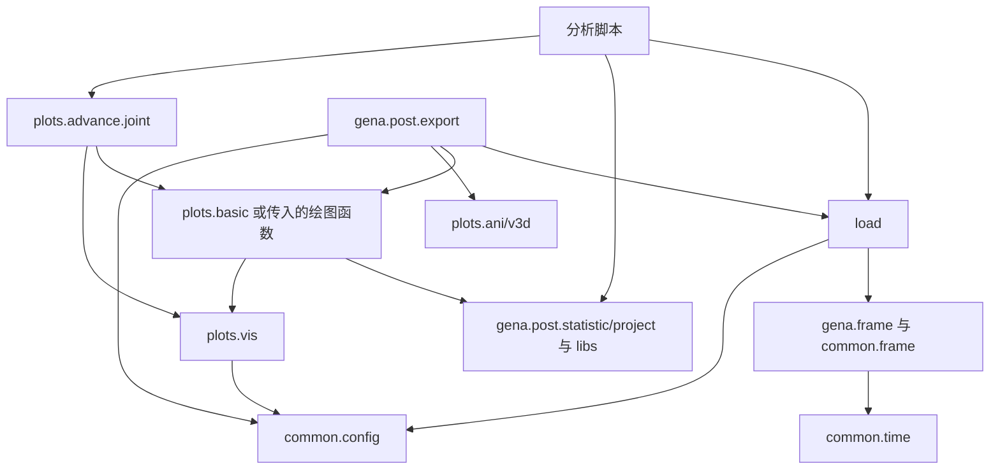

# GENA-CODE-Dev 架构设计

编写日期：2026-09-16；源码核查与第 11 节整理日期：2026-09-17。本文描述本次修改后的工作目录；逐项核查依据、修改范围、测试结果与剩余问题见 [独立修改报告](docs/design_review_20260917.md)。第 11 节原文实际列出 10 项问题。

## 1. 项目定位与设计目标

本程序库以鹊桥二号 GENA ENA 数据处理为核心，结合 THEMIS、MMS、OMNI 和地磁指数开展联合分析。GENA 保留遥测解码、仪器校准、事件过滤与科学产品计算；外部观测经过格式适配后参加科学计算与联合绘图。

1. 按主要职责组织：数据读取放在 `load/`，科学绘图放在 `plots/`，跨任务科学计算放在 `libs/`。
2. GENA 仪器类型、参数、事件判据与专用处理保留在 `gena/`，便于引用溯源。
3. 外部时序表共享数据格式，GENA 事件表继承共享表类型。
4. 通过已加载数据和明确参数组合模块，联合绘图采用 `Panel`。
5. 本次迁移同步更新调用入口，不保留旧模块路径的兼容壳。

## 2. 项目文件组织形式

项目采用“根目录按主要职责组织，GENA 保留专用领域包”的方式。同一科学流程不必被拆成大量微小模块；已有功能只在职责明确、确有复用的边界迁移。

| 模块 | 组织依据 | 主要责任 |
| --- | --- | --- |
| `load/` | 数据获取与格式适配 | 文件定位、必要下载、本地读取、变量提取 |
| `gena/` | GENA 仪器与事件处理 | 类型、标定、过滤、遥测转换、事件统计与投影 |
| `libs/` | 科学问题与物理模型 | 区域判据、等离子体公式、通量模型、能谱归一化与星历服务 |
| `plots/` | 展示与联合编排 | 基础绘图、产品图、联合图、动画和三维场景 |
| `common/` | 共享基础设施 | 路径、时间、数据类型、坐标和常数 |
| 分析脚本 | 具体研究问题 | 日期、事件选择、论文图件与研究假设 |

`plots.basic` 按数据源保留默认变量和画法；共享轴、colorbar 和文件保存复用 `plots.vis`，通用时间序列画线复用 `plots.basic.tplot`，无需再次按 1D/2D/3D 建立多套底层实现。

## 3. 当前目录与功能

下面列出本次涉及的现行模块，并非完整文件清单。

```text
GENA-CODE-Dev/
├── design.md
├── load/
│   ├── gena.py             # Parquet 加载与产品类型构造
│   ├── themis.py
│   ├── mms.py
│   ├── omni.py
│   └── indices.py
├── gena/
│   ├── frame.py            # ParticleDataFrame、ParameterDataFrame
│   ├── constants.py
│   ├── filter.py           # 掩码规则、诊断与质量分类
│   ├── utils.py            # 领域几何、速度与现有轨道图
│   ├── raw/               # 遥测解码、级别转换及写入
│   ├── post/              # statistic、project、export
│   └── deprecated/        # 历史实现
├── libs/
│   ├── regions.py
│   ├── plasma.py
│   ├── ephemeris.py
│   ├── environment.py
│   ├── space.py
│   ├── flux.py
│   └── spectrum.py         # 复用存档中的能谱归一化实现
├── plots/
│   ├── vis.py              # axes、colorbar、刻度、savefig
│   ├── config.py           # 现有样式模块，仍有外部 myplot 依赖
│   ├── basic/              # timeseries（tplot）、gena、themis、mms、omni
│   └── advance/
│       ├── __init__.py     # Panel、overview、env、plot_region_code
│       ├── joint.py
│       ├── ani.py
│       └── v3d.py
├── common/
│   ├── config.py
│   ├── frame.py            # DataFrame 类型、表操作、同步与变量读取
│   ├── utils.py            # 时间归一化、时间分段、插值及通用工具
│   ├── coord.py
│   └── constants.py
├── tests/
├── docs/
└── deprecated/
```

### 3.1 数据加载

| 入口 | 主要数据 | 网络行为 |
| --- | --- | --- |
| `load.load_gena` | GENA Parquet | 读取本地产品 |
| `load.load_spedas("themis", ...)` | ESA、FGM、MOM、EFI、SST、ESD | 默认 `download=False` |
| `load.load_spedas("mms", ...)` | FPI、HPCA | 默认 `download="local_first"` |
| `load.load_spedas("omni", ...)` | OMNI HRO | 默认 `download=True`，支持本地模式 |
| `load.load_indices` | Kyoto AE/Dst/SYM/ASY，GFZ Kp/ap/Ap/SN/F10.7 | 统一 `download=False` 离线、`local_first` 缓存优先、`refresh` 刷新策略；API 读取与解析，loader 组装与合并 |

GENA 加载器按产品返回不同类型：PDF 工参返回 `gena.frame.ParameterDataFrame`，粒子产品返回 `gena.frame.ParticleDataFrame`。外部加载器默认返回 `common.frame.TimeSeriesDataFrame`，显式 `return_type="dict"` 则返回逐变量字典。它是有效的数据格式选项，不是旧模块路径兼容层。

加载器保留各数据源的 probe、level、变量选择与产品时间适配含义，不承担研究事件选择或绘图布局。

### 3.2 GENA 专用处理

`gena.raw` 负责遥测解析、Raw/L0/L1/L2 转换及写入；`gena.constants` 负责仪器几何与效率；`gena.filter` 生成布尔掩码；`gena.post.statistic` 负责计数、通量及派生统计；`gena.post.project` 负责射线与投影。

`gena.frame` 保存两个 GENA 数据表类型。`ParticleDataFrame` 只保留离散事件的行操作和粒子统计方法，逐事件位置姿态保持普通列；`ParameterDataFrame` 表示 PDF 工参，内部清理有效位置和姿态样本，并通过 `pos_at()`、`rot_at()` 按请求时刻插值。`load.load_gena` 只负责读取 Parquet、整理时间列并选择产品类型。

`gena.post.export` 是有 I/O 的报告编排层，可以组织加载、科学计算、绘图与输出。动画和三维实现位于 `plots.ani` 与 `plots.v3d`。

### 3.3 科学计算与服务

`libs.regions` 根据观测量判定区域或流结构；`libs.plasma` 提供等离子体公式；`libs.space` 提供空间环境模型；`libs.flux` 包含 Maxwellian/Kappa 通量与现有拟合。`libs.spectrum` 提供 GENA 与 THEMIS 共用的相对能谱归一化。

`libs.ephemeris` 涉及星历文件及显式轨道更新；`load.load_sw` 组合 OMNI 和指数并在失败时回退默认值。这是加载后的组合服务，不能直接当作 OMNI 加载器的重复实现。

当前目录没有 `libs.energy_transport`、`libs.bbf_ena`、`libs.ena_response`、`libs.distribution` 或 `gena.post.ena_drift`。部分文件保存在 `undefined.zip`，历史测试和说明仍有引用；不能把它们列为当前可调用模块。

### 3.4 科学绘图

`plots.vis` 提供画布、坐标轴、装饰和保存工具；`plots.basic.tplot` 提供通用时间序列绘图，`plots.basic` 中的卫星模块提供产品图；`plots.advance.joint` 通过 `Panel`、`overview`、`env` 和 `plot_region_code` 组合已经加载的数据。这些联合入口仍可以从 `plots` 或 `plots.advance` 导入。

`overview` 共享 UTC 时间轴，保留各产品原生采样，`trange` 只限制显示范围。能量直方图与 FOV 空间图不能直接当作时间横轴 panel。自定义函数必须复用传入的 `ax`。

### 3.5 共享基础设施

`common.frame` 定义共享 DataFrame 类型、表操作、同步和变量读取；产品字典适配位于 `load`。`common.time` 定义时间输入与转换，`common.frame` 负责 pandas datetime 的连续区间分段，`common.interp` 提供插值工具。`common.config` 管理输入目录和运行时结果目录；`common.coord` 管理坐标变换。

表的 `tplot()` 是保留的便利方法，只在调用时导入 `plots.basic.tplot`；因此不能声称 common 在所有调用路径上完全不依赖 plots。普通表构造不导入绘图库。

## 4. 数据规范

### 4.1 基础结构

| 内容 | 约定 |
| --- | --- |
| 共享类型 | `common.frame.TimeSeriesDataFrame` |
| GENA PDF 工参类型 | `gena.frame.ParameterDataFrame` |
| GENA 粒子类型 | `gena.frame.ParticleDataFrame` |
| `Datetime` | 无时区 pandas `datetime64[ns]`，数值含义为 UTC |
| `Timestamp` | Unix 秒 |
| 标量 | 独立数值列 |
| 三分量矢量 | `<name>_x/y/z` |
| 能谱与分布 | 行内数组，轴信息放在伴随列和元数据中 |
| 来源与变量布局 | `DataFrame.attrs` |

GENA 一行可以是粒子事件或工程采样；其他数据源一行对应变量采样时刻。共享表操作不代表粒子事件可按连续场量插值。

`load` 中的产品适配器先按原生时间并集建表，生成普通列字典后构造实例。`TimeSeriesDataFrame.__init__` 只检查必需的 `Datetime` 列并调用 `common.time.Time(...).datetime`，不识别 CDF、Parquet 或后端专用字段，也不从其他列推断时间；THEMIS 常规 ESA 的 DataFrame 输出进一步以 reduced-ion `peir` 时间为参考同步 ESA 变量。跨任务统一网格由调用者显式决定。

统一的 `load/load.py` 按 parser、assembler 和 loader 三层组织。THEMIS/MMS 的字段布局由对应 loader 明确声明，`parse_spedas()` 将已解码后端变量转换成明确变量说明；OMNI HRO 按 `Epoch` 与标量字段解析，indices 按各自来源解析，GENA 按 Parquet 列解析。三列数组不会自动识别为空间向量，`v` 不会自动命名为能量。`assemble()` 只负责按明确说明拼列、外连接和生成统一时间列。旧式字典输出直接合并原始变量，绘图通过 `common.frame.read_variable` 读取单个变量。

### 4.2 时间与筛选

`select`、`select_by`、`between`、`split`、`sync` 保留具体子类和元数据。`concat` 提供共享拼接。`sync` 对浮点标量默认线性插值，对整数、布尔、质量标记及数组使用近邻，默认自动缺口限制避免跨长时间中断插值。

`common.time.Time` 统一标量和一维时间输入，内部保存 pandas `Timestamp` 或 `DatetimeIndex`，输出无时区 UTC 纳秒时间。裸数字只表示 Unix 秒；毫秒、JD、MJD 等显式指定 `format`，不按数值大小猜测。普通时间处理走 pandas，科学格式和时间尺度转换按需使用 Astropy。DataFrame 使用 `.datetime`，数字和 SpacePy 时间分别使用 `to_timestamp()`、`to_tick()`；旧独立转换函数已删除。范围入口直接用 `Time(trange).datetime` 并检查两个端点，每日展开由调用方使用 `pd.date_range`；连续区间分段位于 `common.frame.split_time_intervals`，直接处理 pandas datetime，不经过 `Time`。详见 [时间 API](docs/time.md)。

GENA 过滤统一遵循“函数返回掩码，表负责选行”：

```python
from gena import filter as gf

mask = gf.energy_eff(l2, Emin=4, Emax=100)
rule = gf.energy_eff(Emin=4, Emax=100) & gf.onboard_eff()
selected = l2.select(rule)
```

`FilterNode` 只负责延迟调用和 `& | ~` 组合。`SelectorNode` 及重复的 `gena.filter.select` 已移除。通道判据、阈值和探头标定保持原实现。

### 4.3 科学量与姿态

调用前核对单位、坐标、能量范围、探针和级别。典型就位观测使用密度 cm⁻³、温度 eV、磁场 nT、位置 R_E；GENA 能量统计使用 keV。GENA 事件权重以行位置对齐的外部数组传入，默认单位几何因子不代表绝对标定通量。

粒子产品中的位置与姿态是捕获事件时记录的离散列，投影函数直接读取，不提供 `pos()`、`rot()` 或插值方法。PDF 工参由 `ParameterDataFrame.pos_at(times)` 与 `rot_at(times)` 在已有覆盖范围内插值。

## 5. 依赖关系与数据流

箭头表示主要调用关系，不能当作所有导入边的严格无环证明。



一次分析的调用顺序是：配置目录 → 加载产品 → 检查单位和坐标 → 生成掩码并选行 → 按需同步 → 计算科学量 → 组合产品图 → 保存结果。各步均可单独使用。

加载器不决定科学筛选策略；计算优先接收内存数据；普通 panel 不下载数据。`report`、三维场景构造、环境和星历服务允许组织 I/O，但必须通过参数和文档明确。

## 6. 跨任务区域判定：已有列映射与适用边界

Liuzzo、Kiehas、Runov 的实现位于 `libs.regions`，默认识别 THEMIS 列名，并已接受 `columns` 映射。MMS 可显式传入密度、标量温度、磁场等实际列；这部分不能再统一标为“待实现”。

Runov 仍需要额外高能粒子矩，不能将 FPI 数据重复传入代替 ESA/SST 的物理组合。Grigorenko reduced-ESA 检查是 THEMIS 专用分支。`plot_region_code` 只适用于含区域代码的输出，Kiehas/Runov 布尔结果不自动成为完整区域分类。详见 [区域说明](docs/regions.md)。

## 7. 配置、I/O 与输出边界

`resolve_paths()` 只解析；`configure()` 显式校验/建目录，并保存调用者指定的运行时目录；`get_configured_paths()` 根据当前解析结果缓存校验，环境或运行时目录变化会生成新的缓存项。`resolve_output_path()` 只解析结果路径，不校验输入数据盘。

```python
from common.config import configure
from load import load_gena
from plots import savefig
from plots.basic import gena as plot_gena

configure(file_base="/data/ENA", output_dir="/data/results/run_20260917")
l2 = load_gena(trange=["2026-04-07", "2026-04-08"], product="l2_a")
figure, axis = plot_gena.energy(l2)
savefig(figure, "figures/energy.png")
```

路径优先级为：函数显式参数 → 运行时配置 → 环境变量 → 默认值。`GENA_OUTPUT_DIR` 可设置独立结果目录；未设置时仍使用数据根目录下的 `GENA_RES`。相对输出路径放在结果根目录下，绝对路径为显式覆盖。报告默认放在 `<结果根>/reports/`，三维批量输出默认放在 `<结果根>/YYYYMMDD/3d.html`。

只绘制内存数据时可用 `configure(output_dir=..., mkdir=False, validate=False)`，实际保存时创建父目录。原始遥测转换和数据下载仍按其输入数据目录或显式输出参数工作。直接调用 Matplotlib、pandas 或 Plotly 的原生写入方法不会被项目配置自动拦截。

## 8. 当前保留的例外

| 现状 | 处理边界 |
| --- | --- |
| `gena.utils` 同时含计算与轨道图 | 保留算法和接口；未来根据实际复用再拆分 |
| `plots.basic.themis` 含统计便利计算 | 共用能谱归一化已复用 `libs.spectrum`，其他实现保留 |
| 绘图导入时设置部分 `rcParams` | 仍存在；此次未扩大到全项目样式改造 |
| `plots.config` 依赖 `myplot` | 当前环境可导入，但该外部依赖未列入项目安装依赖，迁移到新环境时需要处理 |
| 表的 `tplot()` 延迟调用 plots | 明确保留的便利方法 |
| `libs.flux.integral_ena_counts` 原为空函数草稿 | 现在显式抛出 `NotImplementedError`，现有估算请调用 `qk_estimate_ena_counts` 并提供物理参数 |
| 历史测试引用缺失模型和分析脚本 | 未恢复被移走的研究功能；详见本次报告中的实际测试结果 |

## 9. 扩展与验证原则

新增数据源先建立 `load/<source>.py`，复用共享表适配器；有产品图需求时再建立 `plots/basic/<source>.py`。GENA 仪器专用算法留在 GENA，跨任务科学量放在 libs。新增联合图优先组合现有 `Panel`。

验证覆盖数据格式、时间缺口、列映射、原算法行为、输出类型和实际文件路径。小型内存表、临时 Parquet 和模拟下载边界可验证软件行为，不能替代真实遥测、标定和跨仪器科学适用性验证。不能引用历史测试次数作为本次结果。

## 10. 参考文档

- [common 基础模块手册](common/README.md)：全部基础模块的设计、数据格式、接口、调用关系和可执行测试示例。

- [修改报告](docs/design_review_20260917.md)：本次逐项判断、修改清单、测试命令及剩余问题。
- [中文 README](readme.zh.md) / [英文 README](readme.md)：现行导入和使用入口。
- [绘图说明](docs/plots.md)：产品图、联合图、迁移和结果目录。
- [区域说明](docs/regions.md)：输入列映射和仪器适用范围。
- [THEMIS ESD](docs/themis_esd_loader.md)：多维数组及轴信息。
- [L1 角分布研究记录](docs/themis_thb_l1_3d_angular_distribution_20251204.md)：具体事件背景。
- [历史 observation review 迁移记录](docs/gena_observation_review_migration.md)：历史过程与当时验证结果，不代替本次验收。
- [GENA 后处理说明](gena/post/readme.md) / [raw 文档](gena/raw/doc/)：科学语义和历史背景，部分历史模块当前不在工作目录。

## 11. 原有问题与本次处理状态

| 原序号 | 原问题 | 本次状态 |
| --- | --- | --- |
| 1 | GENA 加载入口尚未进入 load | 已集中到 `load/load.py` 的 `load_gena()`，类型位于 `gena/frame.py` |
| 2 | filter 抽象较多、规则不统一 | 保留掩码组合，删除重复选行层，统一用表的 `select()` |
| 3 | config 职责与实现复杂度不清 | 简化实现和注释，保留解析/校验边界，修复运行时配置与缓存 |
| 4 | 共享表类型与操作需要统一管理 | 合并到 `common/frame.py`，同步所有现行引用 |
| 5 | timeseries 与 utils 时间功能重叠 | 独立时间函数集中到 utils，类型与表适配放在 type |
| 6 | common.vis 应属于 plots | 整体迁入 `plots/vis.py`，不保留旧路径转接 |
| 7 | ani/v3d 移动后依赖断裂 | 导入指向现有文件，并补齐 advance 包入口；验证报告与三维输出 |
| 8 | flux 空函数导致语法错误 | 修复模块导入，草稿明确报错，现有模型实际测试；旧缺失 API 另行记录 |
| 9 | 文档沿用旧加载/绘图路径 | 更新现行示例，历史记录明确标注 |
| 10 | 输出目录缺乏运行时统一设置 | `configure(output_dir=...)` 与 `resolve_output_path()` 覆盖项目图件、CSV、Excel、动画与三维批量输出 |

上述“已处理”仅表示相应架构问题已处理，不表示全部历史功能和测试均已恢复。

# design 文档核查与项目修改报告

日期：2026-09-17。核查对象：本地工作目录 `/Users/shawn/syncthing/GENA-CODE-Dev` 中的 `design.md` 和实际源码。第 11 节是章节编号，其中实际列出 10 项问题。本报告逐项记录核查结果、实施内容、验证和剩余限制。

## 1. 修改结果

已完成加载入口、类型定义、时间工具、基础绘图和高级绘图入口的整理，统一项目输出路径配置，修复报告的缺失导入与 `libs.flux` 的语法错误，并同步修订 design、README、相关说明和 GENA 技能的架构指引。修改以移动现有实现和调整调用为主。

本次主要回归集合为 **153 项通过**。另外检查 `tests/test_flux.py` 时，现有模型的 7 项测试通过，4 项测试因源码中已经缺失的旧 API 失败。全量测试收集仍有 11 个错误，原因是已经缺失的研究脚本或模型模块，详见第 6 节。因此，本报告不宣称整个历史测试集已通过。

## 2. design 是否符合实际

原文关于混合分层、GENA 专用处理、默认表格式、THEMIS ESA 产品时间适配、区域判据列映射、报告具有 I/O 等描述基本符合源码。主要问题在于现状、拟议结构与历史功能混在一起。

| 原文位置或说法 | 修改前源码证据 | 核查判断及修正 |
| --- | --- | --- |
| 第 3 节把 GENA load 留在 gena，第 8 节拟议迁移 | `gena/load.py` 同时包含类、读取和姿态辅助函数 | 事实正确；本次落实拆分并更新现状 |
| `common` 中既有表类型又有基础绘图 | `common/timeseries.py` 与 `common/vis.py` 存在 | 事实正确；类型和绘图分别迁入新归属 |
| 第 6 节标题写“待实现功能” | `libs.regions` 已提供 `columns` 映射；现有跨列名测试可运行 | 标题不准确；改成“已有能力及适用边界” |
| ani/v3d “缺失” | 文件实际在 `plots/advance/ani.py` 和 `v3d.py`，export 仍从 gena 导入 | 缺的是正确引用；没有重新编写或恢复一套动画实现 |
| `plots.advance` 提供 Panel 等入口 | 实现已在 `joint.py`，但 advance 目录没有 `__init__.py` 导出入口 | 原说明遗漏迁移后的入口断裂；本次补齐 |
| `libs.flux` 第 679 行后为空函数体 | `integral_ena_counts(...)` 后直接开始顶层 `__all__` | 属实，阻止整个模块导入 |
| libs 中的能量输运、BBF 正演和响应推断 | 当前 `.py` 文件不在 libs，部分文件在 `undefined.zip` | 不能列成现有 API；已明确历史/存档状态 |
| `load_sw` 与 OMNI load 重复 | `load_sw()` 组合 OMNI、Dst，插值并提供失败回退 | 职责不同，保留该组合服务 |
| 本表 `pos()/rot()` 也进行清理和插值 | 源码确实调用位置插值和 SLERP | 原 design 此处正确，保留；修正技能参考中“本表旋转不插值”的旧说法 |
| common 完全不依赖绘图层 | 共享表 `tplot()` 方法在调用时导入绘图 | 应说明这一便利方法的延迟依赖；不能声称严格无反向调用 |
| 配置只是在拼路径 | 实际还涉及环境变量、校验、建目录与缓存 | 这些边界有必要；简化实现，保留职责分离 |

额外发现：`common.spectrum` 已缺失，但 GENA 统计和 THEMIS 能谱仍导入它，导致报告与产品绘图无法导入。项目现有 `undefined.zip` 包含原始 `spectrum.py`，本次将它复用到 `libs/spectrum.py`。归一化和误差传播算法沿用存档，只将 NumPy 2 的异常入口改为 `np.exceptions.AxisError`。

## 3. 第 11 节逐项修改

### 3.1 问题 1：GENA 加载入口统一

2026-10-15 更新：所有 parser、`assemble()` 和具名任务加载器集中在 `load/load.py`，GENA 入口为 `load_gena()`。GENA 的表类型和位置姿态方法位于 `gena.frame`。

依赖顺序为 `load → gena.frame → common.frame`。类型定义不反向导入加载器；`gena.post.project` 直接引用实际归属模块中的类型和处理函数。

加载器的文件发现、时间裁剪、排序、事件去重、Parquet 列投影、损坏文件恢复和姿态插值算法均保留。已同步现行代码、测试和使用示例。旧 `gena/load.py` 被移除，没有增加转接文件。

### 3.2 问题 2：过滤接口统一且简洁

保留已广泛使用的 `FilterNode`，只承担延迟掩码计算和 `&`、`|`、`~` 组合。移除没有现行调用方的 `SelectorNode` 和 `gena.filter.select()`，选行统一复用共享表的 `select()`，因此子类和 `attrs` 也由同一实现维护。

`filter_rule()` 改为简短的两种调用分派，增加 `functools.wraps`，保留函数名称、说明和可检查签名；同时支持 `energy_eff(df=frame, ...)` 的关键字形式。删除文件末尾注释字符串中的重复过滤实现。文件由 549 行减少到 474 行。

```python
from gena import filter as gf

# 直接获得掩码。
mask = gf.energy_eff(l2, Emin=4, Emax=100)

# 组合条件，选行复用数据表方法。
rule = gf.energy_eff(Emin=4, Emax=100) & gf.onboard_eff()
selected = l2.select(rule)
```

通道长度、起止关系、求和/差分、TOF、空间与能量阈值、golden/soft 规则及 A/B 标定参数均保留。没有引入新的过滤框架。

### 3.3 问题 3：配置为何需要这些层，以及如何简化

`common/config.py` 从 160 行整理为 80 行。保留三个已有职责：`resolve_paths()` 只解析；`configure()` 显式校验和建目录；`get_configured_paths()` 供加载器复用已校验结果。新增的 `resolve_output_path()` 只负责解析结果路径。

原 `configure(file_base=...)` 只返回字典，后续无参数加载并不会自动使用这次传入的目录；旧缓存键也不包含实际环境变量解析结果。这会让“运行开始配置一次”的预期落空。现在显式配置会保存到当前进程，缓存按实际解析后的路径和校验选项建立，环境变化不会继续命中旧目录。返回缓存的字典副本，防止调用者误改缓存内容。

导入 config 不读取文件、不建目录。单纯保存已加载的数据不必验证数据盘。环境变量原有的 `GENA_RAW`、`GENA_PQT`、`SPEDAS`、`GENA_RES` 仍作为数据根下的子路径使用。

### 3.4 问题 4：类型单独管理

共享类型及配套表操作、同步和变量读取实现统一放在 `common/frame.py`，GENA 专用类型放在 `gena/type.py`。没有把 GENA 仪器姿态处理放进 common，也没有为了拆文件新增基类或多层代理。

2026-10-15 更新：产品和存储格式转换统一位于 `load/load.py`。`parse_spedas()` 和来源 parser 生成明确变量说明，`assemble()` 拼成时间序列表，具名 `load_*` 函数组织完整加载过程。`common.frame` 保存表类型、实例操作、`concat()` 和 `read_variable()`；构造时检查 `Datetime` 并调用 `common.time.Time(...).datetime`，`to_dict()` 保持 pandas 行为，`tplot()` 按需导入 `plots.basic`。

旧 `common/timeseries.py` 和 `common/type.py` 已被移除；现行使用方统一引用 `common.frame`。

### 3.5 问题 5：时间操作职责集中

时间格式转换统一通过 `common.time.Time`：构造表时调用 `Time(values).datetime` 得到不携带时区信息的 UTC 纳秒时间。旧独立函数 `normalize_datetime()` 和 `normalize_time()` 已删除；裸数字表示 Unix 秒，毫秒、儒略日等输入需显式指定 `format`。

`split_time_intervals()` 位于 `common.frame`，直接处理 pandas datetime Series 或 DatetimeIndex，不执行格式转换。表重采样保留在 `TimeSeriesDataFrame` 中，因为它依赖列、类型、缺失值和元数据；粒子事件类型 `ENA_DataFrame` 不继承插值重采样能力。

另外移除 `utils.py` 中被后一个同名函数覆盖的旧 `is_multi_layer()` 定义；实际运行的后一个实现保持不变。`Ticktock` 的导入移到使用它的 `tick()` 内，使基础表类型不因时间工具导入而立即加载 SpacePy。

### 3.6 问题 6：基础绘图移到 plots

`common/vis.py` 整体移到 `plots/vis.py`。坐标轴装饰器、通用 `tplot`、axes 分配、colorbar、刻度和卫星位置标签等继续复用原实现。产品绘图、联合图、GENA 轨道图与报告同步引用新位置。

`plots` 顶层提供 `savefig`、`tplot` 和 `vis`；common 顶层移除这两个绘图函数的重导出。旧 `common/vis.py` 不保留转接。原来该模块对 `libs.ephemeris` 的依赖现在位于绘图层，common 基础绘图反向依赖科学服务的问题随归属调整消除。

此次没有扩展到全局样式改造。`plots.vis` 和部分产品模块仍会设置少量 `rcParams`，design 中明确保留这一现状。

### 3.7 问题 7：接通报告、动画、三维与联合图

`gena.post.export` 的动画、三维导入分别改为 `plots.advance.ani` 和 `plots.advance.v3d`。增加 `plots/advance/__init__.py`，从实际实现 `joint.py` 导出 `Panel`、`overview`、`env`、`plot_region_code`，使原有公共联合绘图入口可用。

复用用户已经移动的两个文件，没有复制另一份动画或三维代码。`dumpGeo()` 与其他 GENA 数据入口统一读取 `configure()` 生效后的 `pqt_base`，不再接受独立的数据目录覆盖参数。

实际验证包括：A/B 探头报告的 JPEG 文件、观测汇总 Excel、带动画控件的三维 HTML、报告的可选动画/几何调度；另用 30 行合成事件调用 `dumpFov()`，成功生成一个 33,786 字节的 MP4，文件头包含 `ftyp`。这次 MP4 使用了真实 ffmpeg 编码器，不仅检查函数是否被调用。

### 3.8 问题 8：flux 语法错误及未完成函数

为原空函数 `integral_ena_counts()` 增加说明并明确抛出 `NotImplementedError`，恢复整个模块的解析与导入。它的原参数只有能量、通量和 density，没有路径长度、面积、视场、效率和积累时间，不能据此擅自定义探测器计数算法。已有计算应使用 `qk_estimate_ena_counts()`，并显式指定科学参数。

把文件末尾的积分演示放入 `if __name__ == "__main__"`，避免导入时执行演示积分和打印。Maxwellian/Kappa 分布、共享漂移和约束拟合实现未改动。

本次没有把该草稿包装成看似可用的计数函数，也没有恢复测试中引用的 `dual_moment_partition()`、`fit_dual_fixed_partition()`。修改前备份中同样不存在这两个定义；4 项失败详见第 6 节。

### 3.9 问题 9：文档入口和实际能力同步

ESD 和 L1 角分布文档现在使用统一入口 `load_themis()`。历史 observation review 中的绘图入口更新到 `plots.basic.gena` 和 `plots.advance.env`，同时增加历史记录提示，原测试次数明确不作为本次验证。

同步中文/英文 README、绘图说明和 GENA 后处理说明中的现行导入、目录与过滤用法。后处理说明保留历史科学背景，但标出当前没有的文件和模型。design 重写了当前目录、依赖关系、输出配置及问题处理状态。

依据 GENA 技能的实现核查要求，同步更新 `.agents/skills/gena/SKILL.md` 与 `references/architecture.md`，以便后续工具查询使用新路径。修正了技能参考里过时的本表姿态、区域目标分类和缺失模型说明。

### 3.10 问题 10：统一运行时结果目录

新增 `configure(output_dir=...)` 和环境变量 `GENA_OUTPUT_DIR`。所有相对输出名经 `resolve_output_path()` 解析到运行时结果目录；绝对路径是显式覆盖。未指定独立输出目录时，继续使用 `FILE_BASE` 下的 `GENA_RES`。

| 输出入口 | 新行为 |
| --- | --- |
| `plots.savefig` / `plots.vis.savefig` | 相对图片名位于结果根目录下 |
| `export.report` | 默认位于 `<结果根>/reports/<日期或精确时间段>/` |
| `export.observation_summary` | 默认 `<结果根>/reports/observation_summary.xlsx` |
| `export.dump(..., output_path=...)` | 相对 CSV 路径位于结果根下，自动创建父目录 |
| `ani.dumpFov` / `AnimationDemo3.save` | 相对动画路径位于结果根下 |
| `v3d.dumpGeo` | 默认 `<结果根>/YYYYMMDD/3d.html`，可显式指定子目录 |

以上入口复用同一个路径解析函数，不各自读取环境变量。输入数据目录、原始遥测转换输出和星历缓存没有混入图件结果目录。直接使用第三方 `figure.savefig()`、`DataFrame.to_csv()` 或 `figure.write_html()` 的用户代码仍由调用者传路径，项目没有修改第三方对象的行为。

## 4. 新调用方式

```python
from common.config import configure
from common.frame import TimeSeriesDataFrame
from gena.data import ENA_DataFrame
from load import load_gena
from gena import filter as gf
from gena.post import export
from plots import savefig
from plots.basic import gena as gena_plot

# 使用实际存在的数据根目录；显式配置会被后续无参数加载复用。
configure(file_base="/data/ENA", output_dir="/data/results/run_20260917")

l2 = load_gena(trange=["2026-04-07", "2026-04-08"], product="l2_a")
selected = l2.select(gf.energy_eff(Emin=4, Emax=100) & gf.onboard_eff())
figure, axis = gena_plot.energy(selected)
savefig(figure, "figures/energy.png")

# 写入 /data/results/run_20260917/reports/20260407/。
export.report("A", "2026-04-07")
```

仅处理已经加载的数据时，可用 `configure(output_dir="/data/results/run_20260917", mkdir=False, validate=False)`；保存函数会按需创建实际输出的父目录。

| 旧入口 | 现行入口 |
| --- | --- |
| `gena.load.load` | `load.load_gena` |
| `gena.load.ENA_DataFrame` | `gena.frame.ParticleDataFrame` 或 `gena.frame.ParameterDataFrame` |
| `common.timeseries.TimeSeriesDataFrame` 及表适配器 | `common.frame` |
| `common.timeseries.normalize_datetime/split_time_intervals` | `common.time` |
| `common.vis` | `plots.vis` |
| `common.savefig/tplot` | `plots.savefig/tplot` |
| `gena.ani` / `gena.v3d` | `plots.advance.ani` / `plots.advance.v3d` |
| `gena.filter.select(rule)(frame)` | `frame.select(rule)` |

旧路径不保留兼容层。未位于当前工作目录的个人脚本或 notebook 需要按表更新引用。

## 5. 修改范围与复用证据

当前加载实现集中在 `load/load.py`，GENA 表类型位于 `gena/frame.py`；共享表操作位于 `common/frame.py`，共享绘图位于 `plots/vis.py`。旧 `gena/load.py`、按任务拆分的加载模块、`common/timeseries.py`、`common/type.py` 和 `common/vis.py` 均已移除。

实际逻辑调整集中在 config、filter、输出路径、缺失入口和 flux 导入修复。其他四个外部加载器、`libs.regions`、各产品图、联合图和多数既有测试仅更新模块路径或类型导入。没有修改遥测解码、级别转换、仪器参数、坐标变换或区域判据公式。

通过修改前备份与当前源码的 AST 比较，以下 9 个代码块完全一致（忽略源码行号和空行）：

| 迁移 | 保持一致的代码块 |
| --- | --- |
| `gena/load.py → load/load.py` | GENA Parquet 发现、读取和产品类型选择 |
| `gena/load.py → gena/frame.py` | `ParameterDataFrame`、`ParticleDataFrame` 及 PDF 工程量插值 |
| `common/timeseries.py → common/utils.py` | `normalize_datetime`、`split_time_intervals` |

新增边界测试覆盖运行时目录持久使用、环境变量变更后的缓存、缓存字典隔离、无数据盘条件下保存图片、报告默认目录、A/B 探头规则、元数据保留、关键字过滤调用、函数签名、UTC 和时间数字含义。已有科学测试复用原测试数据与断言。

本目录没有 `.git`，因此未使用 Git diff 或提交。修改前已创建完整范围备份：`/tmp/gena-design-review.smId8B/before.tar.gz`。其中包括本次涉及的源码、测试、文档和技能文件；`undefined.zip` 原存档未修改。被移除的旧模块和选行层可从该备份恢复。该路径属于系统临时目录，需要长期保留时请另存。

## 6. 本次验证记录

环境：Python 3.14.6、NumPy 2.4.6、pandas 3.0.3，绘图使用 Agg 后端。验证使用合成事件、小型本地 Parquet、临时输出及模拟加载边界，没有下载真实观测数据来充当科学验证。

### 6.1 主要回归：153 项通过

```bash
MPLBACKEND=Agg python -m pytest -q \
  tests/test_design_migration.py tests/test_gena_load.py \
  tests/test_timeseries_io.py tests/test_common_utils.py \
  tests/test_common_vis.py tests/test_plots.py \
  tests/test_gena_export_report.py tests/test_gena_v3d_output.py \
  tests/test_gena_counts_nd.py tests/test_gena_statistic_windows.py \
  tests/test_gena_temperature.py tests/test_gena_project.py \
  tests/test_gena_utils_observation.py tests/test_themis_vis.py \
  tests/test_themis_region_classifier.py tests/test_gena_raw_constants.py
```

结果：`153 passed, 18 warnings`。这些测试覆盖类型与加载、时间处理、统计、温度、投影、区域列映射、产品图、实际报告文件和三维输出。

最后一次路径归一化和动画保存入口调整后，重新执行 `test_design_migration.py`、`test_gena_export_report.py`、`test_gena_v3d_output.py`，结果为 `29 passed, 18 warnings`。此数是相关集合的复验，不与 153 重复累加。

### 6.2 flux：7 项通过，4 项失败

`tests/test_flux.py` 中 Maxwellian/Kappa 叠加、漂移、总矩约束、固定 R、纯 Maxwellian、纯 Kappa 及非法 R 的现有测试通过。以下 4 项失败仍存在：

- `test_manual_partition_preserves_total_moments`：缺 `dual_moment_partition`。
- `test_fixed_partition_jointly_recovers_kappa_and_drift_from_energy_flux`：缺 `dual_moment_partition`。
- `test_fixed_partition_handles_a_pure_maxwellian_without_a_kappa_fit`：缺 `fit_dual_fixed_partition`。
- `test_fixed_partition_handles_a_pure_kappa_population`：缺 `fit_dual_fixed_partition`。

这两个函数在修改前的 `libs/flux.py` 中也没有定义；本次语法修复让测试能够进入这些断言，并非迁移删除了它们。没有以新增兼容函数或改变测试断言的方式掩盖失败。

### 6.3 全量收集：11 个既有缺失项

执行 `MPLBACKEND=Agg python -m pytest --collect-only -q`，成功收集 179 项测试，同时出现 11 个收集错误：

| 受影响测试 | 缺失对象 |
| --- | --- |
| `test_bbf_ena.py` | `libs.bbf_ena` |
| `test_ena_response.py` | `libs.ena_response` |
| `test_energy_transport.py` | `libs.energy_transport` |
| `test_ena_drift.py` | `libs.distribution` |
| `test_ena_drift_rest_model.py` | `gena.post.ena_drift` |
| `test_cg_fov_fit.py` | `1.Paper_BBF/ena_cg_fov_peak/fit_cg_alpha.py` |
| `test_conditional_cg_duration_sweep.py` | 同研究目录下 `run_conditional_cg_duration_sweep.py` |
| `test_conditional_cg_short_windows.py` | 同研究目录下 `fit_conditional_cg_short_windows.py` |
| `test_local_fov_peak.py` | 同研究目录下 `analyze_local_fov_peak.py` |
| `test_dec04_vparallel.py` | `1.Paper_BBF/ena_Vbulk/fit_dec04_secondary_vparallel.py` |
| `test_ena_pitch_angle_estimation.py` | `1.Paper_BBF/ENA_pitch_angle_estimation.py` |

未删除这些测试或把它们自动改成跳过。只有报告和产品绘图直接需要的 spectrum 从项目存档复用，其余已经移走的研究模块没有批量恢复。

### 6.4 语法、入口、输出与警告

- 对当前五个主包中 51 个非 deprecated Python 文件进行编译检查，无错误。
- AST API 查询现在能列出 `libs.flux`，没有此前空函数体的语法警告。
- 检查 14 个核心模块导入，全部成功；`plots.config` 在当前环境也可导入。
- 在独立 Python 进程中导入两个表类型，确认没有加载 `matplotlib.pyplot` 或统一加载模块。
- 在现行源码和 tests 中搜索旧 `gena.load`、`common.timeseries`、`common.vis`、旧动画/三维导入及 `common.spectrum`，没有活动引用残留；deprecated 历史代码不在本次改造范围。
- 已执行真实 ffmpeg MP4 导出；JPEG、Excel、HTML 文件由现有测试读取验证。
- SpacePy 对 2026 年时间发出 IGRF 有效期警告，并使用 2025 年有效日期；这限制了科学解释，软件测试通过不表示该日期的磁场计算已获得正确系数。
- 三维依赖 geopack 在导入时尝试列出 IGRF 系数，打印获取列表失败提示；本次没有更改第三方库的导入行为。
- JPEG 报告有 Matplotlib `tight_layout` 的 axes 兼容性警告；文件格式与 300 dpi 验证通过，但未逐页人工审核全部图件布局。

## 7. 仍需明确的范围

本次完成的是第 11 节提出的架构整理和直接阻断修复。`integral_ena_counts` 仍是明确不可用的草稿；缺失的历史科学 API 和研究目录未恢复。真实遥测重解码、A/B 绝对标定和跨仪器判据的物理适用性不属于这批合成测试的证明范围。

`plots.config` 的 `myplot` 来自当前机器的外部路径，未列入 `pyproject.toml`；当前可导入不代表全新安装环境自动具备该依赖。绘图全局样式、`gena.utils` 的混合职责、THEMIS 产品绘图中的部分统计便利计算仍按 design 中的“当前例外”保留。

后续调用请优先使用本报告第 4 节的新入口和统一保存函数。科学计算参数、探头、单位、时间范围和输出目录都保留在调用处，便于复查分析过程。


# GENA observation review 功能迁移说明

> 本文记录历史迁移过程。现行入口已于 2026-09-17 核对更新；文末测试次数属于当时记录，本次验证见 [design 修改报告](design_review_20260917.md)。

更新日期：2026-09-14

## 1. 变更目的

原 `gena/post/review.py` 同时承担数据加载、观测分段、指向计算、环境参数绘图、快速浏览图生成和 Excel 输出，并且依赖已经不存在的 `merge` 包和旧版 `load_gena_from()` 接口。该脚本在导入时还会立即加载固定的长时间范围，因此不适合作为当前 GENA 包中的可复用模块。

本次修改删除了 `gena/post/review.py`，将报告和观测汇总功能迁移到 `gena.post.export`，将环境参数与 QQ/FOV 几何的可复用计算和绘图功能迁移到 `gena.utils`。数据加载、几何计算、绘图和文件输出现在具有明确边界。

## 2. 迁移结果

| 原功能 | 新位置 | 新接口 |
| --- | --- | --- |
| 根据 PDF 时间间断划分观测 | `gena.post.export` | `build_observation_summary()` |
| 自动加载指定日期或时间段并生成 Excel | `gena.post.export` | `observation_summary()` |
| QQ 地心轨道和视场中心方向计算 | `gena.utils` | `pointing_geometry()` |
| QQ 轨道及 XY/XZ/YZ 平面交点绘图 | `gena.utils` | `orbit()` |
| OMNI、Dst、AE/AL/AU 等环境参数绘图 | `gena.utils` | `env()` |
| L1A joint signal 图 | `gena.post.export.report()` | 自动保存 `joint_signal_distribution` 图 |
| QQ/FOV 几何报告图 | `gena.post.export.report()` | 自动保存 `orbit_pointing` 图 |

已有的能量分布、FOV、Layer 1/2、start signal 和 end signal 绘图继续复用 `plots.basic.gena`，没有在新模块中重复实现。

## 3. 观测汇总表接口

### 3.1 自动加载并输出 Excel

```python
from common.config import configure
from gena.post import export

configure(file_base="/path/to/data")

summary = export.observation_summary(
    "A",
    ["2026-04-07", "2026-04-09"],
    output_dir="reports",
)

print(summary.attrs["output_path"])
# /absolute/path/to/reports/observation_summary.xlsx
```

函数签名：

```python
observation_summary(
    prob,
    time,
    *,
    output_dir="reports",
    large_gap="1h",
    small_gap="5min",
    coord="GSM",
    targets=None,
    ena_product="l2g",
)
```

`prob` 接受 `A` 或 `B`。默认使用对应探头的严格加空间筛选产品 `l2g_a` 或 `l2g_b` 统计 ENA 事件；如需其他产品，可以显式传入 `ena_product="l2"` 或 `ena_product="l2s"`。

### 3.2 时间输入语义

`observation_summary()` 与 `export.report()` 共用 `normalize_report_times()`，时间输入含义完全一致：

```python
# 一个完整 UTC 日
export.observation_summary("A", "2026-04-07")

# 日期端点：包含首尾日期的连续日序列
export.observation_summary("A", ["2026-04-07", "2026-04-09"])

# 带时钟的两个端点：一个精确时间段，不按午夜拆分
export.observation_summary(
    "A",
    ["2026-04-07T23:50:00Z", "2026-04-08T00:10:00Z"],
)

# 三个或更多日期：离散 UTC 日序列
export.observation_summary(
    "B",
    ["2026-04-07", "2026-04-12", "2026-04-27"],
)
```

所有选定时间的观测记录写入同一个 `observation_summary.xlsx`，工作表名称为 `observations`。

### 3.3 已加载数据接口

如果调用者已经加载 PDF 和 ENA 数据，可以直接构建 DataFrame 而不写文件：

```python
from load import load_gena
from gena.post.export import build_observation_summary

trange = ["2026-04-07T00:00:00Z", "2026-04-08T00:00:00Z"]
pdf = load_gena(trange=trange, product="pdf")
l2g = load_gena(trange=trange, product="l2g_a")

summary = build_observation_summary(pdf, l2g, "A")
```

## 4. 观测分段规则

观测分段分为两层：

1. PDF 相邻样本时间差大于 `large_gap` 时开始一个新的大观测，默认阈值为 1 小时。
2. 每个大观测内部，相邻样本时间差大于 `small_gap` 时开始一个新的连续小观测，默认阈值为 5 分钟。

Excel 中每一行对应一个连续小观测。`parent_l_level_index` 标识所属大观测，`sub_observation_index` 标识该大观测内部的小观测序号。相同大观测的行使用相同背景色，但大观测关系同时保存在数值列中，不依赖颜色表达。

`duration_seconds` 是该小观测中第一条和最后一条 PDF 样本之间的时间跨度，不等同于经过死时间、开关机状态或 good-time interval 修正后的有效曝光时间。`ena_counts_per_second` 是事件数除以该跨度得到的浏览量，不是绝对物理通量。

## 5. QQ 位置、视场方向和观测模式

`gena.utils.pointing_geometry()` 使用 PDF 中的 `MJ2000_Star_X/Y/Z` 和 `MJ2000_q1/q2/q3`：

1. 将月心相对的 QQ ECI2000 位置与 JPL 月球位置相加，得到地心 ECI2000 位置。
2. 将位置转换到指定坐标系，默认是 GSM，空间单位为地球半径 `R_E`。
3. 使用对应探头坐标系中沿 `-Z` 的标称 source-looking 视场中心方向。
4. 只保留沿视场前向延伸的交点，计算中心线与 XY、XZ 和 YZ 三个坐标面的交点。

```python
from gena import utils as gut
from load import load_gena

pdf = load_gena(trange=["2026-04-07", "2026-04-08"], product="pdf")
geometry = gut.pointing_geometry(pdf, probe="A", coord="GSM")
```

返回表包含：

- `spacecraft_x/y/z`：QQ 地心位置。
- `look_x/y/z`：归一化 source-looking 视场中心方向。
- `xy_x/y/z`：视场中心线与 `Z=0` 平面的前向交点。
- `xz_x/y/z`：视场中心线与 `Y=0` 平面的前向交点。
- `yz_x/y/z`：视场中心线与 `X=0` 平面的前向交点。

观测模式使用每个小观测内 `Y=0` 平面交点的平均 `(X, Z)`，选择距离最近的目标中心。默认目标中心为：

| 模式 | GSM `Y=0` 平面目标中心 `(X, Z)` |
| --- | --- |
| `earth` | `(0, 0) R_E` |
| `mid_tail` | `(-30, 0) R_E` |
| `far_tail` | `(-60, 0) R_E` |

默认值是任务级标称目标，不是磁层物理边界。汇总表保留 `target_distance_re`，便于检查实际指向与标称中心的偏离。任务定义变化时应显式覆盖：

```python
targets = {
    "earth": (0.0, 0.0),
    "mid_tail": (-25.0, 0.0),
    "far_tail": (-65.0, 0.0),
}

summary = export.observation_summary(
    "A",
    ["2026-04-07", "2026-04-09"],
    targets=targets,
)
```

如果视场中心线与 GSM `Y=0` 平面没有有效前向交点，`target_mode` 为 `unknown`，投影及距离字段为缺失值。

## 6. observation_summary.xlsx 字段

| 字段 | 含义 |
| --- | --- |
| `observation_index` | 所有小观测的全局顺序编号 |
| `parent_l_level_index` | 所属大观测编号 |
| `sub_observation_index` | 大观测内部的小观测编号 |
| `probe` | 探头 A 或 B |
| `start_time`、`end_time` | 小观测首末 PDF 样本时间，UTC |
| `duration_seconds` | 首末样本的时间跨度，秒 |
| `spacecraft_x/y/z_mean` | 小观测内 QQ GSM 平均位置，`R_E` |
| `pointing_x_min/max/mean` | 视场中心线与 GSM `Y=0` 平面交点的 X 统计，`R_E` |
| `pointing_z_min/max/mean` | 视场中心线与 GSM `Y=0` 平面交点的 Z 统计，`R_E` |
| `target_mode` | 最近的标称观测目标，或 `unknown` |
| `target_distance_re` | 平均投影点到所选目标中心的距离，`R_E` |
| `earth_centered` | `target_mode == "earth"` 的兼容布尔列 |
| `ena_product` | 实际统计的 ENA 产品，例如 `l2g_a` |
| `ena_total_counts` | 小观测首末时间内包含端点的 ENA 事件数 |
| `ena_counts_per_second` | `ena_total_counts / duration_seconds`，仅用于快速浏览 |

工作簿将首行设为筛选表头并冻结，时间保持为可排序的 Excel 日期值，数值字段保持数值类型。

## 7. 环境参数绘图

`plots.advance.env()` 是纯绘图函数，不负责加载或下载 OMNI、Dst、AE、AL、AU 等数据。调用者将已加载的 `TimeSeriesDataFrame` 传入；函数按参数顺序查找包含目标列的第一个数据源。

```python
from gena import utils as gut
from indices.load import load as load_indices
from omni.load import load as load_omni

trange = ["2025-12-04T00:00:00Z", "2025-12-05T03:00:00Z"]
omni = load_omni(trange, download=False)
indices = load_indices(trange)
dst = load_indices(trange, "dst")

fig, axes = gut.env(
    omni,
    indices,
    dst,
    cols=[
        "dst",
        ("ae", "al", "au"),
        "flow_speed",
        "proton_density",
        "BZ_GSM",
        "BY_GSM",
    ],
)
```

`cols` 决定 axes 的形状：一个字符串产生一个面板，一个字符串元组或列表将多条曲线画到同一面板。传入外部 `f` 和 `ax` 时，axes 数量必须与 `cols` 生成的面板数量一致。函数返回 `(fig, ax)`；单面板返回一个 `Axes`，多面板返回 axes 列表。

`report()` 可以接收预加载环境数据并将环境图保存到报告目录：

```python
artifacts = export.report(
    "A",
    trange,
    environment_sources=[omni, indices, dst],
    environment_cols=[
        "dst",
        ("ae", "al", "au"),
        "flow_speed",
        "BZ_GSM",
        "BY_GSM",
    ],
)
```

该接口不会隐式调用 OMNI 或指数下载器。离线报告是否包含环境图完全由调用者提供的数据决定。

## 8. QQ 轨道和坐标面交点图

`gena.utils.orbit()` 默认生成四个时间序列面板：QQ 的 GSM X/Y/Z 轨道、FOV 与 XY 平面交点、FOV 与 XZ 平面交点、FOV 与 YZ 平面交点。

```python
fig, axes = gut.orbit(pdf, probe="A", coord="GSM")
```

已经计算过几何结果时，可以避免重复坐标转换：

```python
geometry = gut.pointing_geometry(pdf, probe="A", coord="GSM")
fig, axes = gut.orbit(geometry=geometry)
```

与 `env()` 一样，`orbit()` 支持通过 `cols` 自定义面板和曲线组合，也支持调用者传入 `f` 和 `ax`。

## 9. report 新增输出

当数据列可用时，`export.report()` 新增以下静态 JPEG：

- `{prob}_orbit_pointing.jpg`：QQ 位置及视场中心线与三个坐标面的交点。
- `{prob}_joint_signal_distribution.jpg`：L1A 的 X/Y start/end 两端联合分布。
- `{prob}_environment.jpg`：仅在传入 `environment_sources` 时生成。

原有 summary、数据级计数、工程参数、start/end signal、能谱、Layer 1/2 和 FOV 图保持不变。轨道图只有在 PDF 包含完整位置和姿态列时才生成，缺少几何列不会阻断其他报告图。

## 10. 删除和兼容性说明

- `gena/post/review.py` 已删除。
- 源码、测试和 GENA 文档中不存在对 `gena.post.review`、`post.review` 或 `export_observation_excel` 的残留引用。
- 原脚本误将 `l2s` 称为 strict；新汇总默认使用当前产品语义中的严格加空间筛选产品 `l2g`。
- 新接口不在模块导入阶段加载数据，也不使用固定的 2017–2026 时间范围。
- `build_observation_summary()` 保留纯内存计算边界，`observation_summary()` 才负责加载和写文件。

## 11. 验证结果

本次迁移的定向验证包括：

- A/B 两个探头的观测分段和 earth/mid-tail/far-tail 分类。
- 单日、连续日期、精确时间段和离散日期时间语义。
- `l2g_a/b` 事件计数和计数率。
- QQ/FOV 的 XY、XZ、YZ 前向交点计算。
- `env()` 的动态 axes、同面板多变量和外部 axes 数量检查。
- `orbit()` 对预计算几何数据的复用。
- `report()` 的 orbit 和 joint JPEG 输出。
- Excel 表头、日期类型、冻结窗格、筛选和渲染检查。
- 修改模块的 `py_compile` 和导入 smoke test。

直接相关的 31 项测试通过，另有 29 项时间序列接口测试通过。完整仓库测试仍存在与本次迁移无关的既有收集问题，包括缺失的 `1.Paper_BBF` 历史脚本、缺失的旧 `ena_drift`/`libs.distribution` 模块、`libs/flux.py` 的既有缩进错误，以及 `plots.basic.gena` 未重导出 `plots.vis.tplot` 的既有测试失败。

本次几何与工作簿验证使用合成数据完成。默认目标中心需要结合实际任务规划定义确认；真实遥测上的指向模式、姿态异常处理和有效曝光时间仍应使用任务数据单独核验。
