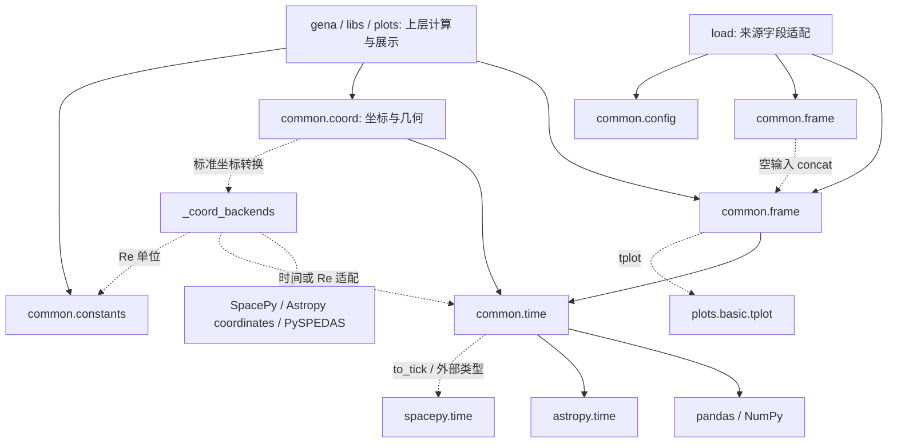

# common 基础模块手册

`common` 定义整个程序库共同使用的时间类、坐标类、数据类、以及公共的常用几何函数、数据操作函数等。此外包含了程序运行时配置和物理常数。

本文档结构如下安排，第一节说明common模块的设计需求，思路和功能；第二节说明 common 的依赖和调用组织方式；第三节说明整个程序库的运行时参数和定义的物理常数；第四、五、六节说明common 定义的时间、坐标、和数据类；第七节给出调用方式；第八节说明扩展规范、迁移和测试。

所有标为 `example:` 的 Python 代码块都可以从仓库根目录独立执行，包含断言；示例使用合成数据、临时目录或模拟读取，无真实观测数据访问。

## 1. ``common`` 基础模块设计需求

- **A. 数据类型统一化**
  GENA-CODE 是一个多种观测数据源（单点时间序列、粒子行数据、高维成像数据）和多数据格式（ CDF, PARQUET, CSV）的ENA空间探测分析程序库。多元数据类型（比如 omni 的cdf 中储存的 dst，从 kyoto U 获取的 ae指数，从 themis 中不同仪器读取的粒子信息，它们有着不同的key命名和 value 类型，GENA data 则是按照行数据储存粒子）处理需要定义各种定制化的功能函数进行处理，引入了不必要的设计负担。
  因此common基于 pandas 的 dataframe 设计了统一的数据类型。把字典 cdf txt row等等通过定义好的接口（load 模块）读成统一的数据类型，方便后续的科学数据处理函数的实现。定义好数据类型后，需要提供对于 frame 类型的数据基础操作。层次画的设计，方便后续上层函数调用。


- **B. 统一的时间格式、空间坐标定义和转换**  
  天文，空间，python numpy pandas 给出了不同时间格式，坐标类也有非常多的实现，每套库都有自己的定义和函数，调用需要不同的 api，非常繁琐。
  项目还需要定义统一的时间类和坐标类，以应包装不同时间格式和坐标定义的转换，增加鹊桥仪器坐标系向空间和天文坐标转换，以及多种单位转换的接口。并通过 class 隐藏了实现细节。


- **C. 程序运行时参数和常数定义**
  common 还需要负责整个程序的全局参数定义、比如绘图路径，源数据、并检测合法性、以便在程序运行时时提供正确的全局的访问。同时还需要统一定义科学和工程常数，便于后续程序的全局访问。

总而言之，common 的设计是为了简化和方便后续数据处理过程，增加程序的可读性和扩展性。 同时作为基础类，除了一些必要的公共函数，应该尽量不被用户感知。

## 2. common 的设计实现

### 2.1 模块化设计
common 模块共包含以下文件：

| 文件 | 负责内容 | 主要入口 |
|---|---|---|
| `__init__.py` | 部分公共名称的延迟导出与缓存 | `Time`、`Coordinates`、两类 DataFrame、`concat`、部分常数 |
| `time.py` | UTC 时间输入、输出、科学格式转换、每日展开 | `Time` |
| `frame.py` | pandas 时间表、行选择、分段、连续量重采样、多表拼接和按元信息读取变量 | `TimeIndexedDataFrame`、`TimeSeriesDataFrame`、`split_time_intervals`、`concat`、`read_variable` |
| `coord.py` | 坐标样本存储、坐标系转换、姿态与时间对齐，以及角度、FOV、四元数运算 | `Coordinates`、`transform_vectors`、七个几何函数；旧入口 `coord` |
| `config.py` | 进程内数据路径、结果路径、校验和缓存 | `resolve_paths`、`configure`、`get_configured_paths`、`resolve_output_path` |
| `constants.py` | 共用物理与天体尺寸数值 | 光速、静质量能量、质量、电荷、`RE`、`RM` |
| `_coord_backends/__init__.py` | 内部后端名称校验和延迟分发 | 私有实现；上层调用 `transform_vectors` |
| `_coord_backends/spacepy.py` | SpacePy 笛卡尔坐标适配 | 内部 `transform` |
| `_coord_backends/astropy.py` | Astropy 原生位置坐标适配 | 内部 `transform` |
| `_coord_backends/pyspedas.py` | PySPEDAS 数组坐标适配 | 内部 `transform` |


### 2.2 common 的具体功能和调用
`common` 的主体由 `time.py`、`coord.py` 和 `frame.py` 组成。三者分别统一时间表达、空间坐标与几何、pandas 时间表。它们都采用“内部只保存项目通用的 pandas/NumPy 数据，需要科学转换时再调用外部库”的方式，避免把 Astropy、SpacePy 或坐标后端对象传到整个程序库中。

#### 2.2.1 时间类：`Time`

`Time` 是时间输入的归一化与格式转换入口。它不另外实现一套时间数组容器：标量保存为 `pd.Timestamp`，一维序列保存为 `pd.DatetimeIndex`，统一使用无时区标记的 UTC `datetime64[ns]`。普通字符串、Python/NumPy/pandas 时间和 Unix 秒直接通过 pandas 处理；JD、MJD、GPS、非 UTC 时间尺度、Astropy `Time` 和 SpacePy `Ticktock` 先通过 Astropy 转为 UTC，再落回 pandas。

类的关键实现过程如下。这里省略了输入类型、越界、NaT、闰秒和维度检查；完整规则见第 4 节。

```python
class Time:
    def __init__(self, value, *, format=None, scale=None):
        # 唯一持久状态：Timestamp 或 DatetimeIndex。
        self.datetime = self._convert(value, format=format, scale=scale)

    @staticmethod
    def _convert(value, *, format=None, scale=None):
        if isinstance(value, Time):
            return value.datetime
        if isinstance(value, AstropyTime):
            return astropy_utc_to_pandas(value)
        if is_spacepy_ticktock(value):
            return astropy_utc_to_pandas(value.APT)
        if is_scientific_format(format, scale):
            return astropy_utc_to_pandas(AstropyTime(value, format=format, scale=scale))
        return pandas_to_utc_nanoseconds(value, format=format)

    def __getattr__(self, name):
        # floor、ceil、strftime、year 等原生操作直接交给 pandas。
        return getattr(self.datetime, name)

    def to_timestamp(self):
        return pandas_nanoseconds(self.datetime) / 1e9

    def to_astropy(self):
        return AstropyTime(self.to_numpy(), format="datetime64", scale="utc")
```

上层程序通过 `.datetime` 取得可直接放入 DataFrame 的原生 pandas 时间；Unix 秒和普通字符串由 pandas 路径输出，科学时间格式由 Astropy 按需转换，SpacePy 对象也只在调用 `to_tick()` 时创建。

```python
# example: core_time_usage
import numpy as np
import pandas as pd
from common.time import Time

epoch = Time(0)
samples = Time([0, 1, 2])
jd = Time(2451545.0, format="jd")

assert epoch.datetime == pd.Timestamp("1970-01-01 00:00:00")
assert isinstance(samples.datetime, pd.DatetimeIndex)
np.testing.assert_array_equal(samples.to_timestamp(), [0.0, 1.0, 2.0])
assert jd.to_iso() == "2000-01-01T12:00:00.000000000Z"

frame = pd.DataFrame({"Datetime": samples.datetime})
assert frame["Datetime"].dtype == np.dtype("datetime64[ns]")
assert samples.floor("s").equals(samples.datetime)
```

#### 2.2.2 坐标类：`Coordinates`

`Coordinates` 保存空间样本及解释这些样本所必需的信息：`values` 固定为 `(N, 3)` 浮点 NumPy 数组，`times` 固定为 `(N,) datetime64[ns]`，同时保存坐标系、单位、参考原点和可选的 xyzw 姿态四元数。类中不保存 SpacePy、Astropy 或 PySPEDAS 的坐标对象，也不缓存已经转换出的坐标系；每次转换和重采样都返回新的 `Coordinates`。

坐标类通过 `transform_vectors()` 共享同一条转换路径。A/B/QQ、GSM/AGSM 的固定旋转在公共层完成；跨越 QQ 与标准坐标系时用姿态连接 ECI2000；其余标准坐标转换才分发到明确指定的后端。向量角度、FOV、四元数规范化、旋转和 SLERP 也定义在 `coord.py`，共享同一个向量形状约定。

```python
class Coordinates:
    def __init__(self, values, times, frame, *, unit=None, origin="earth", attitude=None):
        self.values = np.atleast_2d(validate_vectors(values)).copy()
        self.times = normalize_with_Time(times, count=len(self.values))
        self.frame = frame
        self.unit = unit
        self.origin = origin.lower()
        self.attitude = None if attitude is None else normalize_xyzw(attitude, count=len(self.values))

    def to(self, frame, *, backend="spacepy", attitude=None):
        quat = self.attitude if attitude is None else normalize_xyzw(attitude, count=len(self.values))
        values = transform_vectors(
            self.values,
            source=self.frame,
            target=frame,
            times=self.times,
            attitude=quat,
            unit=self.unit,
            origin=self.origin,
            backend=backend,
        )
        return Coordinates(values, self.times, frame, unit=self.unit,
                           origin=self.origin, attitude=quat)

    def resample_at(self, times):
        # 分量在原坐标系中线性插值；姿态使用四元数 SLERP。
        values = interpolate_components(self.times, self.values, times)
        attitude = (None if self.attitude is None else
                    interpolate_quaternions(self.times, self.attitude, times))
        return Coordinates(values, times, self.frame, unit=self.unit,
                           origin=self.origin, attitude=attitude)
```

普通调用优先使用 `Coordinates` 和 `transform_vectors()`；小写 `coord` 只用于兼容仍在运行的旧调用。无需标准后端的本地旋转可以直接执行，标准坐标转换需要提供时间，并按后端要求提供单位和原点。

```python
# example: core_coordinate_usage
import numpy as np
from common.coord import Coordinates, fov_to_vector, transform_vectors, vector_to_fov

look = fov_to_vector([0.0, 10.0], [0.0, -5.0], direction="look")
px, py = vector_to_fov(look, direction="look")
np.testing.assert_allclose(px, [0.0, 10.0])
np.testing.assert_allclose(py, [0.0, -5.0])

samples = Coordinates(
    [[0.0, 0.0, -1.0], [0.0, 1.0, -1.0]],
    [0, 1],
    "QQ",
    attitude=[0.0, 0.0, 0.0, 1.0],
)
probe_a = samples.to("A")
middle = samples.resample_at([0.5])
assert probe_a.values.shape == (2, 3)
assert middle.values.shape == (1, 3)
assert transform_vectors([0.0, 0.0, -1.0], source="A", target="QQ").shape == (3,)
```

#### 2.2.3 表格类：`TimeIndexedDataFrame` 与 `TimeSeriesDataFrame`

`frame.py` 直接继承 pandas DataFrame，不再引入额外表格容器。`TimeIndexedDataFrame` 是所有带时间行数据的基础类，构造时要求恰好一个 `Datetime` 列，并通过 `Time` 归一化为 UTC `datetime64[ns]`。它提供行选择、跨表条件选择、时间区间切分和延迟绘图；`gena.frame.ParticleDataFrame` 继承它，因此粒子事件只获得按行操作和粒子统计方法。粒子产品中的位置、姿态是与事件一一对应的普通列，不提供 `pos()`、`rot()` 或插值接口。

`TimeSeriesDataFrame` 继承 `TimeIndexedDataFrame`，专门表示可按时间采样的物理量。`resample()` 和 `resample_to()` 只负责建立目标时间轴，最终都调用 `resample_at()`：连续数值列线性插值，整数、布尔、质量标记、字符串和数组单元格使用最近邻；所有列都禁止外推，并通过 `max_gap` 控制是否跨越数据缺口。

```python
class TimeIndexedDataFrame(pd.DataFrame):
    def __init__(self, *args, **kwargs):
        super().__init__(*args, **kwargs)
        require_exactly_one_column(self, "Datetime")
        self["Datetime"] = Time(self["Datetime"]).datetime

    @property
    def _constructor(self):
        # 结果仍含 Datetime 时保留实际子类；普通选列返回 pd.DataFrame。
        return constructor_that_checks_datetime

    def select(self, condition): ...
    def select_by(self, other, condition, *, method="nearest", max_gap="auto"): ...
    def between(self, boundaries): ...
    def split(self, tgap=1800): ...


class TimeSeriesDataFrame(TimeIndexedDataFrame):
    def resample(self, resolution, *, method="linear", max_gap="auto"):
        target = regular_grid_inside_source_coverage(resolution)
        return self.resample_at(target, method=method, max_gap=max_gap)

    def resample_to(self, other, *, method="linear", max_gap="auto"):
        target = overlap_with_reference_times(other["Datetime"])
        return self.resample_at(target, method=method, max_gap=max_gap)

    def resample_at(self, times, *, method="linear", max_gap="auto"):
        target = Time(times).datetime
        for column in physical_columns(self):
            rule = "linear" if is_continuous_numeric(column) else "nearest"
            synchronize_without_extrapolation(column, target, rule, max_gap)
        return type(self)(synchronized_columns)


class ParticleDataFrame(TimeIndexedDataFrame):
    # 粒子事件保持离散；位置和姿态由调用方直接读取对应列。
    def window_ave(self, key, window="5min", **kwargs): ...
    def window_hist0d(self, window="5min", **kwargs): ...


class ParameterDataFrame(TimeSeriesDataFrame):
    # PDF 工参是连续采样量；按请求时刻清理并插值位置和姿态。
    def _loc_from_pdf(self, gap=1):
        return sorted_valid_position_samples(self, gap)

    def _rot_from_pdf(self, gap=1, norm_tol=0.1):
        return sorted_valid_rotation_samples(self, gap, norm_tol)

    def pos_at(self, times):
        source_time, source_position = self._loc_from_pdf()
        return interpolate_without_extrapolation(source_time, source_position, times)

    def rot_at(self, times):
        source_time, source_rotation = self._rot_from_pdf()
        return slerp_without_extrapolation(source_time, source_rotation, times)
```

同一文件中的 `split_time_intervals()` 只接收原生 pandas datetime，不再经过 `Time`；`concat()` 负责按输入顺序拼接、保留全部行并合并变量说明；`read_variable()` 根据 `frame.attrs["variables"]` 读取标量、三分量向量或数组变量。这些是表格层的操作，不负责解释 CDF、Parquet 或任务专用字段。

```python
# example: core_frame_usage
import numpy as np
from common.frame import TimeIndexedDataFrame, TimeSeriesDataFrame, concat, read_variable, split_time_intervals

events = TimeIndexedDataFrame({
    "Datetime": [0, 5, 10],
    "Energy": [2.0, 4.0, 8.0],
})
selector = TimeSeriesDataFrame({
    "Datetime": [0, 5, 10],
    "quality": [0, 1, 1],
})
selected = events.select_by(selector, "quality == 1", max_gap=None)
assert selected["Energy"].tolist() == [4.0, 8.0]

field = TimeSeriesDataFrame({
    "Datetime": [0, 10],
    "Bx": [0.0, 10.0],
    "quality": [0, 1],
})
aligned = field.resample_at([0, 5, 10], max_gap=None)
np.testing.assert_allclose(aligned["Bx"], [0.0, 5.0, 10.0])
assert aligned["quality"].tolist() == [0, 0, 1]

intervals = split_time_intervals(events["Datetime"], max_gap="4s")
assert len(intervals) == 3
assert len(concat([events.iloc[:2], events.iloc[2:]])) == 3
assert read_variable(field, "Bx")["values"].tolist() == [0.0, 10.0]
```

三个主体模块的推荐导入方式如下。包顶层只延迟导出少量高频类型；函数从实际所属子模块导入，使调用位置能直接看出其责任。

```python
# example: core_common_imports
from common import Time, Coordinates, TimeIndexedDataFrame, TimeSeriesDataFrame
from common.frame import concat, read_variable, split_time_intervals
from common.coord import (
    transform_vectors,
    angle_between,
    angle_to_plane,
    vector_to_fov,
    fov_to_vector,
    quaternion_array,
    rotate_vectors,
    interpolate_quaternions,
)
from common.config import configure, get_configured_paths
from common.constants import SPEED_C, MASS_E, MASS_H, MASS_O, RE, RM, mass_H_kg, e_charge

assert Time(0).to_timestamp() == 0.0
assert SPEED_C == 299792458.0
```

优先从所属子模块导入函数，尤其是 `read_variable`、`transform_vectors`、几何函数和配置函数。包级导出是明确名单，并不会自动导出各子模块的所有名称。`common.__getattr__` 在首次访问时导入所属模块并缓存对象；单独 `import common` 不会立即加载全部依赖。

包级名称 `timer`、`logger`、`repeat`、`mid_ary`、`i1d`、`i_rot`、`i_pos`、`f_interp_vars` 和 `clean_nan` 由 `common.decos` 与 `common.interp` 提供。探测器尺寸 `X_MCP`、`Y_MCP` 实际由 `gena.constants` 定义；当前包级旧名单仍列着这两个名称，但 `common.constants` 没有实现，不能将它们作为可用的 common API，也不建议使用 `from common import *`。

### 2.3 common 模块的依赖关系
如下图：


图中的实线表示常规依赖，虚线表示仅在调用相应功能时发生的依赖。

这里有两个需要明确的边界：`Time` 为识别科学时间对象在模块导入时导入 `astropy.time.Time`，因此“以 pandas 存储”不等于“整个时间模块不依赖 Astropy”；坐标后端包和 `astropy.coordinates` 则按需加载。表的 `tplot()` 延迟调用绘图库，包级便利导出也可能指向其他基础模块，因此当前所有调用路径并非严格只有从上到下的依赖。构造普通表、做本地几何运算均不需要导入绘图库或调用下载器。

## 3. TimeSeries and TimeIndexed Dataframe 格式

同一时刻可以有多个粒子事件，也可以只有一个磁场采样。两者都需要行选择与区间分段，但插值只适用于有相应科学含义的采样量。因此 `TimeIndexedDataFrame` 负责共有行操作，`TimeSeriesDataFrame` 增加连续采样量同步。`gena.frame.ParticleDataFrame` 继承前者；`gena.frame.ParameterDataFrame` 继承后者，并为 PDF 工参增加 `pos_at()` 和 `rot_at()`。粒子事件不会自动获得物理量插值方法。

空间相关的公共操作统一放在 `coord`：同一文件同时提供坐标系变换、向量角度、旋转、FOV 表示和四元数插值。几何函数本身仍不引入时间轴或坐标后端含义；例如，`rotate_vectors` 只执行旋转，而 `Coordinates` 负责解释姿态表示 QQ → ECI2000。这种组织保留行为边界，同时让调用方只维护 `common.coord` 一个导入路径。
### 3.1 时间与表格

时间保存为 pandas 原生对象；表格继承 pandas DataFrame；坐标和四元数保存为 NumPy 数组。Astropy、SpacePy、PySPEDAS、SciPy Rotation 在需要转换或计算时使用，转换结果重新回到 pandas 或 NumPy。这样，上层函数可以继续使用 `.dt`、布尔掩码、pandas 选列和 NumPy 向量运算。

`Time` 提供输入归一化和格式转换，原生时间操作通过 `.datetime` 完成。它没有额外的数组容器协议：索引、切片、长度、形状、日期运算都直接使用 pandas。`Coordinates` 则需要保存坐标系、单位、原点和姿态这些与样本共同变化的信息，因此提供转换、重采样和受约束的加减操作。


`Time` 检查时间是否可表示；范围入口检查是否有两个端点以及起止顺序；DataFrame 构造函数检查必需时间列；加载器解释 CDF、Parquet 或后端字段。一个三列数组不能自动证明它是空间向量，一个名为 `v` 的轴也不能自动证明它是能量轴。

导入配置模块不创建目录；加载和写文件由上层明确调用。坐标转换选择明确后端，不在不支持时自动换成另一个模型。公共基础模块也不保存下载状态、仪器标定策略或具体研究事件的筛选条件。

| 项目 | 格式与含义 | 保证位置 |
|---|---|---|
| 单个时间 | 无时区 `pd.Timestamp`，值解释为 UTC，纳秒单位 | `Time` |
| 时间序列 | 无时区 `pd.DatetimeIndex`，一维 `datetime64[ns]` | `Time` |
| 表格时间列 | 恰好一列 `Datetime`，原生 `datetime64[ns]`，UTC | `TimeIndexedDataFrame` 构造时 |
| 数字时间列 | `Timestamp` 表示 Unix 秒；是否提供由加载器决定 | 加载器；重采样重新生成 |
| 表格索引 | 普通 pandas 索引，不强制为时间索引 | 调用方 |
| 缺测物理量 | 可为 NaN、NA 等；不允许缺测时间 | 时间由构造检查，物理量由算法处理 |
| 样本顺序、重复时刻 | 构造时允许存在；不同操作按各自规则处理 | 具体算法 |

“无时区”只是存储形式，不表示当地时间。无时区输入被视为 UTC，带时区输入先换算到 UTC 再去掉标记。不要对已经是 UTC 的时间用 `tz_localize("Asia/Shanghai")` 改变其含义。

`Timestamp` 不会由表构造函数自动新增或与 `Datetime` 自动核对。如果手动同时提供两列，调用方需要保证它们表示同一时刻；需要可逆纳秒时间时，优先保留 `Datetime` 或 `datetime64[ns]`。浮点 Unix 秒在较大的 epoch 数值处不能精确表示每一个纳秒。

### 3.2 变量、向量与姿态

标量变量通常占一列；声明的空间向量占多个分量列；能谱、角分布等每个时刻的多维样本保存在单列的数组单元格中。数组单元格不能直接按通用连续量方法插值，当前时间表同步采用最近邻。

坐标对象始终保存 `(N, 3)` 浮点分量和 `(N,)` UTC `datetime64[ns]` 时间；单向量构造也保存为 `(1, 3)`。数组函数 `transform_vectors` 和几何函数则保留单向量 `(3,)` 与批量 `(N, 3)` 的区别。

四元数顺序统一为 SciPy 使用的 `[x, y, z, w]`，保存为单位四元数行 `(1, 4)` 或 `(N, 4)`；单个姿态可以广播。QQ 姿态的含义是 QQ → ECI2000，按 `R @ v` 应用。四元数 `q` 与 `-q` 表示同一个旋转。坐标系、单位和原点不能仅从三个分量的数值推断。

### 3.3 元信息

`frame.attrs` 保存来源、产品、probe 等信息；`attrs["variables"]` 保存变量布局、单位和轴说明，详见第 6 节。它是普通字典，不是自动检验所有列的机制。删除或重命名变量列时，调用方需同步修改相关说明。

pandas 原地修改不会持续重新验证时间列；`Time.datetime`、`Coordinates.values/times/attitude` 也可直接访问。构造和方法调用保证各自入口行为，但这些对象并非不可变对象。不要用字符串覆盖规范化后的 `Datetime`；若改变时间，应通过 `Time(new_values).datetime` 重新赋值，并同步维护数字时间列。

## 4. 时间：common.time

### 4.1 构造与格式含义

```python
Time(value, *, format=None, scale=None)
```

| 输入 | 默认解释或路径 |
|---|---|
| 字符串、Python date/datetime、NumPy datetime64、pandas Timestamp/DatetimeIndex/Series | pandas 解析并归一化为 UTC 纳秒 |
| 裸整数或浮点数 | Unix 秒，不按大小猜测单位 |
| `format="unix" / "unix_ms" / "unix_ns"` | 明确以秒、毫秒、纳秒表示 epoch 偏移 |
| `format="iso" / "isot" / "datetime" / "datetime64"` | 普通日期时间路径；ISO 输入允许时区信息 |
| `format="jd" / "mjd" / "gps"` 等科学格式 | Astropy 解析后转成 UTC，再保存到 pandas |
| Astropy Time | 采用对象自身尺度，经 UTC datetime64 转入 pandas |
| SpacePy Ticktock | 通过其 `.APT` Astropy 时间表示转入 pandas |
| 已有 `Time` | 使用其 pandas 时间表示 |
| 一维混合序列、生成器 | 各元素是单个时间；混合数值仍解释为 Unix 秒 |

`format` 表示输入的表达形式，`scale` 表示科学时间尺度，两者不是一回事。`jd` 与 `mjd` 是日计数格式，`utc`、`tai`、`tt` 等是时间尺度；pandas 的时区偏移则是当地钟表与 UTC 的关系。科学输入省略 `scale` 时采用 Astropy 对该格式的默认尺度，研究计算应明确指定来源尺度。

普通日历输入指定非 UTC 尺度时，先得到日历字段，再由 Astropy 按该尺度解释并转到 UTC。Unix epoch 数字表示绝对时刻，不因附加 `scale` 改变瞬间。已有 Astropy 对象自带尺度，包装为 `Time` 不会用构造参数重新解释它。最终对象只保存 UTC 时刻，不保存来源尺度、来源时区或天文位置元信息。

```python
# example: scientific_time_scales
import pandas as pd
from common.time import Time

# 2000-01-01 时 TAI 比 UTC 快 32 秒；输入字段按 TAI 解释。
tai = Time("2000-01-01T00:00:32", scale="tai")
assert tai.datetime == pd.Timestamp("2000-01-01")
assert tai.to_astropy().scale == "utc"
assert tai.to_astropy().tai.isot == "2000-01-01T00:00:32.000000000"
assert Time(0, format="gps").datetime == pd.Timestamp("1980-01-06")
assert Time(51544.0, format="mjd", scale="utc").datetime == tai.datetime
```

内部转换只有三项职责：`_convert` 选择普通/科学路线，`_as_datetime` 检查标量或一维结构并统一 UTC/ns，`_astropy_to_datetime` 将科学时间直接转为 UTC datetime64 后交给 pandas。通过 `datetime64[ns]` 衔接避免经过 Python datetime 的微秒上限；输入检查集中在这些入口，业务调用方无需再次解析同一份时间。

### 4.2 输出接口

| 接口 | 标量输出 | 数组输出 | 注意事项 |
|---|---|---|---|
| `.datetime` | `pd.Timestamp` | `pd.DatetimeIndex` | 内部原生对象，直接用于 DataFrame |
| `.isscalar` | `bool` | `bool` | 判断内部对象是否为 Timestamp |
| `to_timestamp()` | 浮点 Unix 秒 | 浮点 NumPy 数组 | 不适合作为任意纳秒时间的无损保存格式 |
| `to_iso()` | UTC 字符串 | NumPy 字符串数组 | 九位小数，末尾 `Z` |
| `to_str(fmt="%Y-%m-%d %H:%M:%S")` | 字符串 | NumPy 字符串数组 | `%f` 只有微秒；纳秒文本使用 `to_iso()` |
| `to_numpy(unit="ns")` | NumPy datetime64 | NumPy datetime64 数组副本 | 支持 ns 及更粗单位；粗单位会丢低位精度 |
| `to_astropy()` | 标量 Astropy Time | 数组 Astropy Time | UTC，显示精度 9 |
| `to_tick()` | 长度为 1 的 Ticktock | Ticktock | 空数组返回空 Ticktock；其不同时间表示可能有不同精度 |
| `convert(format, *, scale="utc")` | Astropy 格式的值 | Astropy 格式的数组 | 例如 `convert("mjd")`、`convert("jd", scale="tt")` |

`to_numpy` 接受 `Y/M/W/D/h/m/s/ms/us/ns`。没有 `to_pandas()`，因为 `.datetime` 已经提供原生对象；`shape`、`size` 等属性以及 `floor`、`ceil` 等方法直接委托 pandas；`len` 和索引等特殊操作仍通过 `.datetime` 完成。

科学格式的单个浮点 JD/MJD 等也受该浮点表达精度限制。保留 pandas 原生纳秒并不意味着每一种数字输入或数字输出都能表达纳秒级差异；只有来源本身具有足够精度时，才能讨论无损往返。

```python
# example: time_formats_and_precision
import datetime as dt
import numpy as np
import pandas as pd
from common.time import Time

t = Time(2451545, format="jd", scale="utc")
assert t.datetime == pd.Timestamp("2000-01-01 12:00:00")
assert t.to_timestamp() == 946728000.0
assert t.convert("mjd") == 51544.5
assert t.to_iso() == "2000-01-01T12:00:00.000000000Z"
assert t.to_str("%Y/%m/%d") == "2000/01/01"

exact = Time("2024-01-01T00:00:00.123456789Z")
assert exact.to_iso().endswith(".123456789Z")
assert Time(exact.to_astropy()).to_numpy() == exact.to_numpy()
assert exact.to_numpy("us") == np.datetime64("2024-01-01T00:00:00.123456", "us")
assert Time(pd.Timestamp("2024-01-01", tz="UTC")).datetime.tzinfo is None
assert Time(dt.datetime(2024, 1, 1)).datetime == pd.Timestamp("2024-01-01")
assert Time("2024-01-01T08:00:00+08:00").datetime == pd.Timestamp("2024-01-01")
assert Time(1000, format="unix_ms").datetime == Time(1).datetime
assert Time(1, format="unix_ns").datetime.value == 1
```

```python
# example: time_arrays_and_external_types
import numpy as np
import pandas as pd
from astropy.time import Time as AstroTime
from common.time import Time

times = Time([0, 1, 2])
assert not times.isscalar
assert isinstance(times.datetime, pd.DatetimeIndex)
np.testing.assert_array_equal(times.to_timestamp(), [0., 1., 2.])
assert Time([0]).datetime.shape == (1,)
assert Time([]).datetime.empty
assert Time([]).to_numpy().dtype == np.dtype("datetime64[ns]")
assert times.datetime[0] == pd.Timestamp("1970-01-01")
assert times.datetime[:1].shape == (1,)
assert Time(times.datetime[:1]).to_iso().shape == (1,)

frame = pd.DataFrame({"Datetime": times.datetime})
assert frame["Datetime"].dtype == np.dtype("datetime64[ns]")
assert frame["Datetime"].dt.second.tolist() == [0, 1, 2]
assert Time(np.array([0, 1], dtype="datetime64[s]")).to_timestamp().tolist() == [0., 1.]
assert Time(pd.Series(times.datetime)).datetime.equals(times.datetime)
assert Time([0, "1970-01-01T00:00:01Z"]).to_timestamp().tolist() == [0., 1.]
assert Time(AstroTime("2000-01-01T12:00:00", scale="utc")).datetime == pd.Timestamp("2000-01-01 12:00:00")
tick = times.to_tick()
np.testing.assert_array_equal(Time(tick).to_numpy(), times.to_numpy())
assert len(Time([]).to_tick()) == 0
```

### 4.3 每日展开与范围入口

`Time` 将未定义的属性和方法转交给内部 pandas 时间对象，可以直接调用 `t.floor("D")`、`t.ceil("D")`、`t.strftime(...)` 或读取 `t.year`。返回 pandas 原生结果，不改变实例；范围展开由调用方使用 `pd.date_range`。

```python
# example: days_and_range_validation
import pandas as pd
from common.time import Time

bounds = Time(["2024-01-01 23:00", "2024-01-03 01:00"]).floor("D")
days = pd.date_range(bounds[0], bounds[1], freq="D")
assert days.equals(pd.date_range("2024-01-01", periods=3).as_unit("ns"))
unique = Time(["2024-01-02 12:00", "2024-01-01", "2024-01-02"]).floor("D").unique().sort_values()
assert len(unique) == 2 and unique[0].day == 1
assert Time(days).datetime.tz is None

def range_endpoints(trange):
    endpoints = Time(trange).datetime
    if isinstance(endpoints, pd.Timestamp) or len(endpoints) != 2:
        raise ValueError("trange must contain exactly two endpoints")
    start, stop = endpoints
    if start > stop:
        raise ValueError("trange start must not be later than end")
    return start, stop

assert range_endpoints([0, 1])[1] == pd.Timestamp("1970-01-01 00:00:01")
```

通用类不把每个长度为 2 的数组当成范围；端点是否可相等、是否包含终点、是否可以跨天，均由接收 `trange` 的业务入口定义。不要重新引入只包装 `Time(trange).datetime` 的 `normalize_trange`。

### 4.4 明确拒绝的输入

拒绝多维时间、无效日期、None、NaT、掩码数组、布尔/复数、非有限数值和超出 pandas 纳秒范围的时刻。UTC 闰秒 `23:59:60` 无法由 pandas 表示，科学对象中的闰秒也明确报错。可表示范围约为 1677–2262 年；具体边界以 `pd.Timestamp.min/max` 为准。需要跨越此范围或保留闰秒的研究不能仅用这个类保存完整时间轴。

```python
# example: invalid_times
import numpy as np
import pandas as pd
import pytest
from common.time import Time

for bad in (None, pd.NaT, "invalid", "2016-12-31T23:59:60Z", "1500-01-01",
            [0, np.nan], [[0, 1]], True, 1 + 2j, np.ma.array([0], mask=[True])):
    with pytest.raises((ValueError, TypeError, OverflowError)):
        Time(bad)
```

## 5. 表格类型：common.frame

### 5.1 类层次与构造

```text
pandas.DataFrame
└── TimeIndexedDataFrame                 共享时间列与行操作
    ├── gena.frame.ParticleDataFrame     GENA 离散粒子事件：位置、姿态保持普通列
    └── TimeSeriesDataFrame              连续采样量：resample / resample_to / resample_at
        └── gena.frame.ParameterDataFrame GENA PDF 工参：pos_at / rot_at
```

两个 common 基类及其上层子类都接收 pandas DataFrame 的构造参数。`TimeIndexedDataFrame.__init__` 要求恰好一个 `Datetime` 列，用 `Time(column).datetime` 归一化；没有 `Date` 别名推断、没有从 `Timestamp` 自动生成时间列、没有自动新增 `Timestamp`、没有自动排序或去重。空表也要声明空 `Datetime` 列。

`_constructor` 按结果是否保留恰好一个 `Datetime` 列决定返回具体子类还是普通 DataFrame。单列选择仍是 pandas Series；保留时间列的多列选择和行选择通常保留具体类型。普通 pandas 操作可能改变元信息，尤其涉及不同 `attrs` 的合并；需要模块规定的拼接行为时使用 `common.frame.concat`。

```python
# example: frame_construction_and_selection
import numpy as np
import pandas as pd
import pytest
from common.frame import TimeIndexedDataFrame, TimeSeriesDataFrame

frame = TimeSeriesDataFrame({"Datetime": [0, 10, 20], "B": [1., 2., 3.]})
frame.attrs["probe"] = "synthetic"
assert frame["Datetime"].dtype == np.dtype("datetime64[ns]")
assert "Timestamp" not in frame
assert isinstance(frame[["Datetime", "B"]], TimeSeriesDataFrame)
assert type(frame[["B"]]) is pd.DataFrame
assert isinstance(frame["B"], pd.Series)
for subset in (frame.select("B > 1"), frame.select(lambda f: f["B"] > 1), frame.select([False, True, True])):
    assert subset["B"].tolist() == [2., 3.]
    assert subset.index.tolist() == [0, 1]
    assert subset.attrs["probe"] == "synthetic"
with pytest.raises(ValueError):
    TimeIndexedDataFrame({"Timestamp": [0.]})
assert TimeIndexedDataFrame({"Datetime": pd.Series(dtype="datetime64[ns]")}).empty
```

### 5.2 行操作与区间边界

| 接口 | 行为 |
|---|---|
| `select(cond)` | query 字符串、返回掩码的 callable 或布尔掩码；结果重置索引 |
| `select_by(other, cond, *, method="nearest", max_gap="auto")` | 将 `other` 连续量表对齐到本表覆盖内的时刻，在对齐表上求条件，再从本表取原始行 |
| `between(time_list)` | 对相邻端点返回列表；每段为严格开区间 `start < Datetime < end` |
| `split(tgap=1800)` | 将时间排序；相邻间隔严格大于 `tgap` 秒时拆分；返回 `(段数, [[起点,终点],...], [子表,...])` |
| `tplot(key=None, trange=None, f=None, ax=None, **kwargs)` | 延迟导入并调用 `plots.basic.tplot`，不在表中实现绘图算法 |

`split_time_intervals(times, *, max_gap="60min")` 只接收 pandas datetime Series 或 DatetimeIndex，拒绝 NaT，不经过 `Time`。它先排序，再返回 `[(start, end), ...]`；空输入返回 `[]`，间隔等于阈值不拆分，保留输入时区。`split` 的端点包含两端，与 `between` 的开区间不同；该 helper 接收 Timedelta 兼容值，`split` 的 `tgap` 则明确以秒为单位。

`select_by` 的 `other` 必须是 `TimeSeriesDataFrame`。条件基于同步后的 selector，原表的测量值不会被插值。字符串条件中缺失布尔结果转为 False；callable 应明确处理 NaN。选择最终按时刻匹配，所以本表多个事件具有同一时间时，会一起保留。它不是按两个表的行号做连接。

```python
# example: intervals_and_cross_selection
import pandas as pd
from common.frame import TimeIndexedDataFrame, TimeSeriesDataFrame, split_time_intervals

events = TimeIndexedDataFrame({"Datetime": [0, 10, 20, 100], "id": [0, 1, 2, 3]})
parts = events.between([0, 20, 101])
assert [part["id"].tolist() for part in parts] == [[1], [3]]
count, intervals, frames = events.split(tgap=10)
assert count == 2
assert [f["id"].tolist() for f in frames] == [[0, 1, 2], [3]]
assert intervals[0] == [pd.Timestamp("1970-01-01"), pd.Timestamp("1970-01-01 00:00:20")]
assert len(split_time_intervals(events["Datetime"], max_gap="10s")) == 2
assert split_time_intervals(pd.DatetimeIndex([])) == []

selector = TimeSeriesDataFrame({"Datetime": [0, 20, 100], "quality": [0, 1, 1]})
chosen = events.select_by(selector, "quality == 1", max_gap=None)
assert chosen["id"].tolist() == [2, 3]
assert chosen["id"].isin(events["id"]).all()
```

该函数的现行直接调用方包括 `TimeIndexedDataFrame.split` 和 `gena.post.project.moon_blocking_intervals`，后者在遮挡掩码表选中行上计算连续区间。它属于表格时间轴操作，不能从 `common.time` 导入。

### 5.3 连续采样量重采样

| 接口 | 目标时间轴 |
|---|---|
| `resample(tres, *, method="linear", max_gap="auto")` | 在源覆盖范围内，从向上对齐的起点到向下对齐的终点生成规则网格，例如 `"4s"` |
| `resample_to(other, *, method="linear", max_gap="auto")` | 取另一 DataFrame 的 `Datetime`，限定共同覆盖，排序并去重 |
| `resample_at(times, *, method="linear", max_gap="auto")` | 显式一维时间序列；保留目标顺序和重复时间，覆盖外目标仍保留但值缺测 |

三者最终都调用 `resample_at`。显式目标必须是序列，单个目标写成 `[time]`；普通 DataFrame 作为 `resample_to` 的参考时，需已有规范化 `Datetime` 列。所有方法返回表格而非 pandas 的聚合 Resampler。

处理步骤：按源时间稳定排序、相同时间保留第一行；每列分别去掉无效标量样本；按列选择插值方法并计算缺口限制；生成目标列；重建 `Datetime`、Unix 秒 `Timestamp`，浅拷贝 `attrs`。不同列的有效覆盖可能不同，不是“一行缺测便删除整行”。

浮点等连续数值列在 `method="linear"` 时线性插值。整数、布尔、名字包含 `quality` 的列、字符串和数组单元格始终采用最近邻；若整数物理量应连续插值，应在输入中明确转为浮点类型。`method="nearest"` 则所有列使用最近邻；距离相等时选择较早样本。数组单元格作为完整样本最近邻复制，不按元素插值，单元格内部 NaN 不会自动清理。

`max_gap="auto"` 为该列有效时刻的正间隔中位数的三倍。`max_gap=None` 取消缺口限制，但仍不外推；显式限制应是正的 Timedelta 兼容值，建议写 `"30s"` 或 `pd.Timedelta(seconds=30)`，裸数字由 pandas 按纳秒解释。线性检查夹住目标的两个有效样本之间的间隔；最近邻检查目标到所选样本的距离。因此相同阈值在两种方法中的含义不同。精确源时刻不会因为相邻大缺口而丢失其有效值。

```python
# example: sampling_rules
import numpy as np
import pandas as pd
from common.frame import TimeSeriesDataFrame

source = TimeSeriesDataFrame({"Datetime": [0, 10, 20], "B": [0., 10., 20.],
                              "quality": [0, 1, 2], "spectrum": [np.array([1., 2.]), np.array([3., 4.]), np.array([5., 6.])]})
result = source.resample_at([15, 5, 5, 30], max_gap=None)
assert result["Timestamp"].tolist() == [15., 5., 5., 30.]
np.testing.assert_allclose(result["B"], [15., 5., 5., np.nan], equal_nan=True)
assert result["quality"].iloc[:3].tolist() == [1, 0, 0]
np.testing.assert_array_equal(result["spectrum"].iloc[1], [1., 2.])
assert np.isnan(result["B"].iloc[-1])
assert source.resample("5s")["Timestamp"].tolist() == [0., 5., 10., 15., 20.]
reference = pd.DataFrame({"Datetime": pd.to_datetime([20, 5, 5, 30], unit="s")})
assert source.resample_to(reference)["Timestamp"].tolist() == [5., 20.]

# 缺口 10s 大于 6s，线性拒绝跨越；最近邻距离仅 5s，仍可取样。
assert source.resample_at([5], max_gap="6s")["B"].isna().all()
assert source.resample_at([5], method="nearest", max_gap="6s")["B"].iloc[0] == 0.
assert source.resample_at([5], method="nearest", max_gap="4s")["B"].isna().all()

# pandas 的分箱聚合需要显式普通 DataFrame 视图。
bins = pd.DataFrame(source).set_index("Datetime")["B"].resample("10s").mean()
assert bins.tolist() == [0., 10., 20.]
```

离散列同步结果可能成为 object dtype，以容纳缺测；不要假设整数/布尔 dtype 在同步后一定保持原样。元信息是浅拷贝，嵌套字典仍可能共享引用，修改结果的嵌套 `attrs` 前需自行 `deepcopy`。

## 6. 表格操作与变量读取：common.frame

### 6.1 concat

`concat(frames)` 按 pandas 列并集拼接，保留各输入表的顺序及表内行顺序，不按 `Datetime` 排序或去重，重置索引。返回第一张表的 `_constructor` 所决定的类型，其他普通 `attrs` 取第一张表；`attrs["variables"]` 按输入顺序合并，同名变量说明以后来的为准。相同时间戳的行全部保留，拼接前应保证同名变量布局兼容。

多个合法事件可能发生在同一时刻，例如 A、B 探头的同时事件，因此拼接保留全部事件行。需要排序或去重时，由调用者根据具体产品显式处理。

空输入 `concat([])` 返回空 `TimeSeriesDataFrame`，包含规范的 `Datetime` 与浮点 `Timestamp`。输入为普通 DataFrame 时，函数不替调用方转换时间或补充列。普通输入不会被自动规范化。

```python
# example: concat_precedence
import numpy as np
from common.frame import TimeSeriesDataFrame, concat

first = TimeSeriesDataFrame({"Datetime": [10, 0], "B": [np.nan, 1.]})
second = TimeSeriesDataFrame({"Datetime": [10, 20], "B": [99., 3.], "n": [4., 5.]})
first.attrs = {"source": "first", "variables": {"B": {"kind": "scalar", "columns": ["B"], "units": "nT"}}}
second.attrs = {"source": "second", "variables": {"n": {"kind": "scalar", "columns": ["n"]}}}
joined = concat([first, second])
assert joined["Datetime"].dt.second.tolist() == [10, 0, 10, 20]
assert np.isnan(joined["B"].iloc[0])  # 保留 first 的缺测值以及 second 同时刻的独立行。
assert joined["B"].iloc[2] == 99.
assert joined.attrs["source"] == "first"
assert set(joined.attrs["variables"]) == {"B", "n"}
assert concat([]).empty and "Timestamp" in concat([])
```

### 6.2 read_variable 与元信息

`read_variable(frame, name)` 按 `frame.attrs["variables"][name]` 读取一个变量，返回 `{time, values, axes, units, attrs}`。有变量说明时，`time` 是 DatetimeIndex，`values` 是 NumPy 数组，`axes` 是名称到坐标数组的字典；`attrs` 深拷贝该变量的属性。没有说明时，把 `name` 作为一个普通标量列读取，只返回 `{time, values, axes}`，去掉 pandas 判定的缺失样本。

变量说明字段如下。轴不是空间坐标系，它描述能量、频率、pitch angle 等样本维度。

| 字段 | 含义 |
|---|---|
| `kind` | `scalar`、`vector` 或 `array` |
| `columns` | 标量一列、向量多个分量列、数组单元格一列 |
| `sample_shape` | 单个样本的非时间维度，例如能谱 `(E,)` |
| `units` | 变量单位；可以缺省为 None，不自动换算 |
| `attrs` | 来源变量属性 |
| `axes` | 轴名称到轴说明的映射 |
| `axes[name].column` | 每行保存该轴坐标数组的列 |
| `axes[name].static` | 声明该坐标是否本来为固定轴 |
| `axes[name].sample_shape` | 单个轴坐标的形状 |
| `axes[name].values` | 固定轴值，尤其用于没有有效样本的情况 |

标量按非缺失掩码读取；向量行只要任一分量有限便保留，可能仍包含部分 NaN；数组只接受 ndarray/list/tuple 单元格并按行 stack，不规则样本形状报错。轴沿相同掩码读取。声明静态且各行坐标一致时返回一个静态坐标数组；若各行不一致，返回采样坐标数组，避免在拼接后丢掉变化的轴。该函数不插值、不下载、不推断未知变量的物理意义。

```python
# example: variable_layouts
import numpy as np
from common.frame import TimeSeriesDataFrame, read_variable

frame = TimeSeriesDataFrame({"Datetime": [0, 10], "density": [1., np.nan],
                            "Bx": [1., np.nan], "By": [2., 3.], "Bz": [3., 4.],
                            "flux": [np.array([10., 20.]), np.array([30., 40.])],
                            "energy": [np.array([1., 2.]), np.array([1., 2.])]})
frame.attrs["variables"] = {
    "n": {"kind": "scalar", "columns": ["density"], "units": "cm^-3"},
    "B": {"kind": "vector", "columns": ["Bx", "By", "Bz"], "units": "nT"},
    "ions": {"kind": "array", "columns": ["flux"], "sample_shape": (2,), "units": "example-unit",
             "axes": {"energy": {"column": "energy", "static": True, "sample_shape": (2,), "values": [1., 2.]}}},
}
assert read_variable(frame, "n")["values"].tolist() == [1.]
assert read_variable(frame, "B")["values"].shape == (2, 3)
assert np.isnan(read_variable(frame, "B")["values"][1, 0])
ions = read_variable(frame, "ions")
assert ions["values"].shape == (2, 2)
np.testing.assert_array_equal(ions["axes"]["energy"], [1., 2.])
frame.at[1, "energy"] = np.array([2., 4.])
assert read_variable(frame, "ions")["axes"]["energy"].shape == (2, 2)
assert set(read_variable(frame, "density")) == {"time", "values", "axes"}
```

这些说明由 `load.assemble()` 根据加载器的明确布局生成。不要为了读取一条能谱重新把整张表逆转换成后端字典；绘图应调用 `read_variable` 读取所需变量。

## 7. 坐标：common.coord 与转换后端

### 7.1 Coordinates 与数组入口

```python
Coordinates(values, times, frame, *, unit=None, origin="earth", attitude=None)
transform_vectors(values, *, source, target, times=None, backend="spacepy", attitude=None, unit=None, origin="earth")
```

`Coordinates` 复制输入分量、规范化时间、保存 frame/unit/origin/attitude，不保存后端对象和派生坐标缓存。单个时间广播到 N 行，一维时间序列必须长度等于 N；长度为 1 的序列不会被当成标量广播。`frame` 使用明确的大写名称，例如 `GSM`、`ECI2000`，公共层不做大小写或拼写别名猜测；`origin` 保存为小写。构造允许缺测向量值，具体转换和插值可能传播 NaN。

| 接口 | 行为 |
|---|---|
| `len(c)` | 坐标样本数 |
| `c.to(frame, *, backend="spacepy", attitude=None)` | 返回新对象，原对象不变；本次 attitude 参数可覆盖保存的姿态 |
| `c.resample_at(times)` | 在当前坐标系线性插值三个分量，姿态用 SLERP；不先转坐标系，不允许覆盖外目标 |
| `c + other`、`c - other` | frame/unit/origin 和时间轴必须完全匹配；本地 QQ/A/B 还要求姿态表示同一旋转 |
| `transform_vectors(...)` | 直接返回新的 NumPy 分量，保留 `(3,)` 或 `(N,3)` 形式，不需要创建长期对象 |

坐标重采样先稳定排序、相同时间保留第一项；保留目标顺序和重复项。与表的 `resample_at` 不同，它遇到覆盖外目标抛 ValueError，没有 `max_gap` 限制，也不逐分量清理 NaN。需要防止跨越长时间姿态缺口时，由调用方先按有效观测段切开再采样。

### 7.2 本地坐标路径

| 路径 | 实现 | 需要输入 |
|---|---|---|
| A → QQ | 绕 X 轴旋转 −5° | 向量 |
| B → QQ | 绕 X 轴旋转 +5° | 向量 |
| QQ → ECI2000 | 用 QQ→ECI2000 四元数，`R @ v` | 明确姿态 |
| ECI2000 → QQ | 上述姿态的逆旋转 | 明确姿态 |
| GSM → AGSM | XY 平面绕 Z 固定 +4.2° | 向量 |
| AGSM → GSM | 固定旋转的逆 | 向量 |

A/B/QQ 之间、QQ↔ECI2000 的姿态旋转、GSM↔AGSM 不需要外部标准坐标后端。`transform_vectors` 在仅经过这些本地路径时也不需要时间；后端名称仍会检查是否合法。QQ 的源方向视线沿 −Z，而传播方向约定沿 +Z，FOV 的 `direction` 必须与物理用途一致。

跨越其他坐标系时，A/B 先到 QQ，经姿态到 ECI2000，再走标准后端；AGSM 经 GSM 进入标准后端。目标路径反向执行。原点不会隐式改变，也不会自动叠加月球或卫星位置。

```python
# example: local_coordinates_and_attitude
import numpy as np
from scipy.spatial.transform import Rotation
from common.coord import Coordinates, transform_vectors

values = np.array([[1., 0., 0.], [0., 1., 0.]])
gsm = Coordinates(values, "2024-01-01", "GSM", unit="Re")
values[:] = 99  # 构造时已复制。
assert gsm.values[0, 0] == 1.
agsm = gsm.to("AGSM")
np.testing.assert_allclose(agsm.to("GSM").values, gsm.values, atol=1e-14)
assert agsm.unit == "Re" and agsm.origin == "earth"
assert transform_vectors([1, 0, 0], source="GSM", target="AGSM").shape == (3,)
assert transform_vectors([[1, 0, 0]], source="GSM", target="AGSM").shape == (1, 3)

attitude = Rotation.from_euler("z", 90, degrees=True)
qq = Coordinates([1., 0., 0.], 0, "QQ", attitude=attitude)
inertial = qq.to("ECI2000")
np.testing.assert_allclose(inertial.values, [[0., 1., 0.]], atol=1e-14)
np.testing.assert_allclose(inertial.to("QQ").values, qq.values, atol=1e-14)
np.testing.assert_allclose((gsm - gsm).values, 0.)
```

### 7.3 标准后端能力与限制

| 后端 | 支持范围 | 单位、原点和时间要求 |
|---|---|---|
| `spacepy` | SpacePy `SYSAXES_TYPES` 中支持 car 的框架，例如 GEO/GSE/GSM/SM/ECI2000；使用 `use_irbem=False` | 标准转换需 UTC 时间、earth 原点；保持数值单位，适用于笛卡尔分量旋转 |
| `pyspedas` | GSE/GSEQ/GSM/SM/GEI/GEO/MAG/J2000/HEE/HAE/HEEQ；适配器将 ECI2000 映射到 J2000 | 标准转换需 UTC 时间、earth 原点；调用 `cotrans` 数组接口，不创建 tplot 变量 |
| `astropy` | 地心 ITRS/GCRS/CIRS/TEME；同一太阳系质心原点的 ICRS/GALACTIC；GEO 明确映射到 ITRS | 必须提供长度单位如 km/m/Re；地心族 origin=earth，质心族 origin=solar_system_barycenter；不跨原点 |

Astropy 不把 GCRS/ICRS 当成 ECI2000，也不提供 GSM/GSE 的虚构别名；因此 QQ 的 ECI2000 路径若还需要进一步转换，不能任意换成 Astropy 后端。后端不支持时抛 NotImplementedError，依赖缺失时抛 ImportError，不自动回退。PySPEDAS 列出的框架仅反映当前适配器支持的名称，它仍按原样保留 origin 元信息，不能据此推断已完成日心或其他原点平移。

标准转换使用时间轴关联的实际时刻；两种后端支持同名坐标不意味着其数值模型必然完全相同。Astropy 适配器使用随包 IERS 表并关闭自动下载，适合离线可重复的软件验证；要求更高 Earth-orientation 精度的研究需另行准备和验证所用表。

```python
# example: standard_coordinate_backends
import numpy as np
import pytest
from common.coord import Coordinates

times = ["2024-01-01T00:00:00", "2024-01-01T00:00:10"]
values = np.array([[7000., 0., 0.], [7000., 10., 0.]])
terrestrial = Coordinates(values, times, "ITRS", unit="km")
celestial = terrestrial.to("GCRS", backend="astropy")
np.testing.assert_allclose(celestial.to("ITRS", backend="astropy").values, values, atol=1e-7)
with pytest.raises(NotImplementedError):
    terrestrial.to("GSM", backend="astropy")
with pytest.raises(ValueError):
    Coordinates(values, times, "ITRS").to("GCRS", backend="astropy")

eci = Coordinates([[2., 1., -3.], [4., -2., 1.]], times, "ECI2000", unit="Re")
gsm = eci.to("GSM", backend="spacepy")
np.testing.assert_allclose(gsm.to("ECI2000", backend="spacepy").values, eci.values, atol=1e-7)
```

```python
# example: coordinate_resampling
import numpy as np
import pytest
from scipy.spatial.transform import Rotation
from common.coord import Coordinates

source = Coordinates([[0., 0., 0.], [2., 0., 0.]], [0, 10], "QQ",
                     attitude=Rotation.from_euler("z", [0., 90.], degrees=True))
mid = source.resample_at([5])
np.testing.assert_allclose(mid.values, [[1., 0., 0.]])
np.testing.assert_allclose(mid.to("ECI2000").values, [[2**-0.5, 2**-0.5, 0.]], atol=1e-14)
assert source.resample_at([10, 0, 10]).times.shape == (3,)
assert source.resample_at([]).values.shape == (0, 3)
with pytest.raises(ValueError):
    source.resample_at([11])
with pytest.raises(ValueError):
    source + Coordinates(source.values, [0, 10], "GSM")
```

### 7.4 仍在使用的旧 coord 入口

`coord(dt, coord_value, coord_type, rot=None, *, backend="spacepy", unit=None, origin="earth")` 是 `Coordinates` 子类。它以旧的“时间在前”参数顺序构造；未提供 `rot` 或 `rot=0` 时采用单位姿态，保留历史行为。新代码跨 QQ 与标准坐标系时应显式提供已知姿态。

`convert(out_type, *, backend=None)` 更新派生数组字典 `.c`，返回 None；`legacy["GSM"]` 在需要时调用 convert 再取数组。`.datetime` 提供 pandas 时间视图；`sync(new_datetime)` 重采样当前原始坐标与姿态，丢弃之前派生坐标，只留下原坐标系缓存。它没有旧式 `.rot` 属性，规范姿态存储是 `.attitude`。当前 `gena.utils`、投影及部分三维绘图仍使用此入口；新实现优先使用 `Coordinates.to()`。

## 8. 几何与四元数：common.coord

### 8.1 函数规范

| 函数 | 输入与输出 |
|---|---|
| `angle_between(a, b, *, degrees=True)` | `(3,)` 或可广播 `(N,3)`，非零有限向量；无符号角 0–180° |
| `angle_to_plane(vectors, normal, *, degrees=True, signed=True)` | 向量与平面的夹角；有符号结果 −90–90°，正号朝平面法向；无符号取绝对值 |
| `vector_to_fov(vectors, axes=None, *, direction="propagation")` | 返回 `(px,py)` 度数；默认以 +Z 为传播方向，look 以 −Z 为视线方向 |
| `fov_to_vector(px, py, *, direction="propagation")` | 度数、有限且严格位于 `(−90,90)`，标量或一维广播；返回单位向量 |
| `quaternion_array(rotation, *, count=None)` | 数组或 SciPy Rotation，检查非零有限四元数并归一化；返回 xyzw 二维数组 |
| `rotate_vectors(vectors, rotation, *, inverse=False)` | 固定 `(3,3)` 矩阵、xyzw 四元数或 Rotation；按 `R @ v`，逆向按 `R.T @ v`；保持向量输入维度 |
| `interpolate_quaternions(source, rotation, target)` | 数值一维时间坐标，source 有限且严格递增、target 在覆盖内；SLERP 返回 `(len(target),4)` |

`vector_to_fov` 计算投影后的 `atan2(x,z)` 和 `atan2(y,z)`。显式 `axes` 为按行列出的三个正交单位基向量，可以是 `(3,3)` 或逐样本 `(N,3,3)`；它已经定义方向，不能同时传 `direction="look"`。没有显式基时，look 的法向为 −Z、横向仍为 +X/+Y。

`fov_to_vector` 是前半球内的逆映射；`vector_to_fov` 可以给出前半球之外的角度，这些角度不能再交给只接受 `(−90,90)` 的逆函数。向量转 FOV 和角度计算拒绝零向量及非有限分量。

矩阵旋转路径仅按给出的矩阵做乘法，不自动校验其正交性或行列式；调用方保证它是所需旋转。四元数路径会检查并归一化。`interpolate_quaternions` 不解析日期，source/target 必须使用同一数值坐标与单位；单姿态表示常量，但目标仍需在 source 时间覆盖内。清理重复时刻属于上层 `Coordinates` 的责任。

```python
# example: fov_and_angles
import numpy as np
import pytest
from common.coord import angle_between, angle_to_plane, fov_to_vector, vector_to_fov

assert angle_between([1, 0, 0], [0, 1, 0]) == pytest.approx(90.)
assert angle_between([1, 0, 0], [0, 1, 0], degrees=False) == pytest.approx(np.pi / 2)
assert angle_to_plane([0, 0, -1], [0, 0, 1]) == pytest.approx(-90.)
assert angle_to_plane([0, 0, -1], [0, 0, 1], signed=False) == pytest.approx(90.)
for direction, z in (("propagation", 1.), ("look", -1.)):
    np.testing.assert_allclose(fov_to_vector(0, 0, direction=direction), [0., 0., z])
    vectors = fov_to_vector([-10., 0., 20.], [5., 0., -5.], direction=direction)
    px, py = vector_to_fov(vectors, direction=direction)
    np.testing.assert_allclose(px, [-10., 0., 20.], atol=1e-14)
    np.testing.assert_allclose(py, [5., 0., -5.], atol=1e-14)
with pytest.raises(ValueError):
    fov_to_vector(90, 0)
```

```python
# example: rotations_and_slerp
import numpy as np
from scipy.spatial.transform import Rotation
from common.coord import quaternion_array, rotate_vectors, interpolate_quaternions

rotation = Rotation.from_euler("z", 90., degrees=True)
vector = np.array([1., 0., 0.])
for representation in (rotation, rotation.as_quat(), rotation.as_matrix()):
    rotated = rotate_vectors(vector, representation)
    np.testing.assert_allclose(rotated, [0., 1., 0.], atol=1e-14)
    np.testing.assert_allclose(rotate_vectors(rotated, representation, inverse=True), vector, atol=1e-14)
np.testing.assert_allclose(quaternion_array([0, 0, 0, 2]), [[0., 0., 0., 1.]])
source = Rotation.from_euler("z", [0., 90.], degrees=True)
middle = interpolate_quaternions([0., 10.], source, [5.])
np.testing.assert_allclose(rotate_vectors(vector, middle), [2**-0.5, 2**-0.5, 0.], atol=1e-14)
```

## 9. 配置与常数：common.config、common.constants

### 9.1 路径解析与配置优先级

根路径优先级是显式参数 > `configure` 保存的进程配置 > 环境变量 > 默认值。数据根默认 `/Volumes/Rsync/ENA/`，路径扩展 `~` 并转为绝对路径。各数据子路径按 `FILE_BASE / 子目录` 解析；环境变量中的开头 `/` 会被去掉，所以 `GENA_PQT="/GENA_PQT/"` 表示数据根下的目录，不能用这个字段指定独立绝对数据目录。

| 环境变量 | 返回字段 | 默认或用途 |
|---|---|---|
| `FILE_BASE` | `file_base` | 数据根，默认 `/Volumes/Rsync/ENA/` |
| `GENA_RAW` | `gena_raw`、`raw_base` | 原始配置项与完整路径，默认 `/GENA_RAW/` |
| `GENA_PQT` | `gena_pqt`、`pqt_base` | 默认 `/GENA_PQT/` |
| `SPEDAS` | `spedas`、`spedas_base` | 默认 `/SPEDAS/` |
| `GENA_RES` | `gena_res`、`res_base` | 默认 `/GENA_RES/`，相对于数据根 |
| `GENA_OUTPUT_DIR` | 覆盖 `res_base` | 独立结果目录，也可用 `output_dir` 参数指定 |

| 函数 | 副作用与行为 |
|---|---|
| `resolve_paths(file_base=None, *, output_dir=None)` | 只解析，不检查存在、不建目录、不保存参数 |
| `configure(file_base=None, *, output_dir=None, mkdir=True, validate=True)` | 可校验数据根、创建四类目录，成功后保存明确提供的配置并清空缓存 |
| `get_configured_paths(file_base=None, *, mkdir=True, validate=True, refresh=False)` | 按解析结果与选项缓存准备结果，返回字典副本；refresh 重新准备 |
| `resolve_output_path(path="")` | 相对路径放到 res_base；绝对路径直接使用；不建目录、不校验输入数据根 |

`validate=True` 检查数据根是目录，不会逐个证明产品文件存在。`mkdir=True` 会创建 raw/pqt/spedas/res 目录。仅绘图导出可用 `configure(output_dir=..., mkdir=False, validate=False)`，实际写入者负责父目录。进程配置优先于后来的环境变量；需要改变已经配置的路径，应再次明确调用 configure。缓存会随解析路径变化而切换，外部删除已缓存目录后可用 `refresh=True` 重新校验。

```python
# example: configuration_in_temporary_directory
from pathlib import Path
from tempfile import TemporaryDirectory
from unittest.mock import patch
import common.config as config

# 测试隔离进程配置与环境，退出上下文后恢复。
with TemporaryDirectory() as tmp, \
     patch.object(config, "_RUNTIME_FILE_BASE", None), \
     patch.object(config, "_RUNTIME_OUTPUT_DIR", None), \
     patch.object(config, "_CONFIG_CACHE", {}), \
     patch.dict("os.environ", {"GENA_RAW": "/GENA_RAW/", "GENA_PQT": "/GENA_PQT/", "SPEDAS": "/SPEDAS/", "GENA_RES": "/GENA_RES/"}, clear=True):
    base, output = Path(tmp).resolve() / "data", Path(tmp).resolve() / "results"
    paths = config.resolve_paths(base, output_dir=output)
    assert paths["pqt_base"] == str(base / "GENA_PQT")
    assert not base.exists() and not output.exists()
    base.mkdir()
    config.configure(base, output_dir=output)
    assert (base / "GENA_PQT").is_dir()
    assert config.resolve_output_path("figures/a.png") == output / "figures/a.png"
    assert config.resolve_output_path(Path(tmp) / "override.png") == Path(tmp).resolve() / "override.png"
    returned = config.get_configured_paths()
    returned["pqt_base"] = "changed"
    assert config.get_configured_paths()["pqt_base"] == str(base / "GENA_PQT")
```

示例中的私有配置变量仅用于测试隔离，业务代码不应直接修改它们。当前 `config.py` 尾部还存在一段重复的常数定义，不在配置模块的 `__all__` 中，也不应作为常数入口；统一从 `common.constants` 读取。

### 9.2 常数的数值和单位

所有值是数值标量，不携带 Astropy Quantity 单位。单位由变量定义和调用方维护；不要将以米定义的 `RE` 直接当成公里或把静质量能量 `MASS_H` 当成 kg。

| 名称 | 当前定义 | 单位与说明 |
|---|---|---|
| `SPEED_C` | SciPy speed_of_light = 299792458 | m/s |
| `MASS_E` | 510998.918 | 电子静质量能量，eV，代码固定值 |
| `MASS_H` | `MASS_E * 1837.15267343` | 质子静质量能量，eV |
| `MASS_O` | `MASS_H * 15.8695` | 氧静质量能量，eV |
| `mass_H_kg` | `1.6726e-27` | 质子质量，kg，近似值 |
| `e_charge` | `1.6022e-19` | C，也用于 eV → J，近似值 |
| `RE` | Astropy `R_earth.value`，当前 6378100 | m；不是 WGS-84 的 6378137 m |
| `RM` | `0.27 * RE` | m；现有近似月球半径，不是精密星历常数 |

并非所有常数都由外部库实时推导，不能把旧注释中“全部来自 SciPy/Astropy”理解为当前实现。GENA 的 MCP 尺寸、几何因子、标定与效率函数归 `gena.constants`。更新共同常数时需同时评估 `libs.plasma/flux`、坐标 Re 换算、投影和事件转换的数值影响。

```python
# example: constants_and_units
import numpy as np
from common.constants import SPEED_C, MASS_H, MASS_O, RE, RM, e_charge, mass_H_kg

assert SPEED_C == 299792458.
assert MASS_O > MASS_H > 0
assert RM == 0.27 * RE
radius_km = RE / 1000.
energy_joule = 1000. * e_charge  # 1 keV
speed_m_s = np.sqrt(2. * energy_joule / mass_H_kg)  # 非相对论近似
assert 6300 < radius_km < 6400
assert 400000 < speed_m_s < 500000
```

## 10. 上层模块如何使用 common

### 10.1 各层拥有的解释责任

| 上层模块 | 使用的基础能力 | 自身负责的内容 |
|---|---|---|
| `load.load_gena` | config、pandas、GENA 的共享基类 | Parquet 时间字段、产品名、事件排序/去重和产品类型构造 |
| `load.load_spedas/load_indices` | config、TimeSeriesDataFrame、concat | 来源解码、变量布局、单位、下载与缓存策略 |
| `load.parse_spedas/assemble` | Time、TimeSeriesDataFrame | 将后端字段解析成明确变量说明，再拼列与时间外连接，形成变量元信息 |
| `gena.frame` | TimeIndexedDataFrame、TimeSeriesDataFrame | 粒子事件类型、PDF 工参类型和工参位置姿态插值方法 |
| `gena.post.project` | coord、constants、split_time_intervals | 射线、遮挡与具体空间投影 |
| `gena.post.statistic` | Time、constants | 分箱、计数、曝光、效率与通量计算 |
| `libs.regions/plasma/flux/ephemeris` | 共享表、时间、坐标与常数 | 区域分类、物理公式、星历与模型 |
| `plots.basic.timeseries` | read_variable | 变量图形与坐标轴表达 |
| `plots.vis`、报告和动画 | resolve_output_path 等 | 输出命名、绘制与实际文件写入 |

### 10.2 从外部数据到筛选与几何的顺序

推荐顺序是：加载器解码来源 → 明确时间格式 → 建表 → 必要时做连续量同步 → 按条件选择原始事件 → 构建向量与姿态 → 显式坐标转换 → 科学计算与绘图。先插值后转换与先转换后插值通常不是同一个结果；`Coordinates.resample_at` 明确采用前者，在源坐标系插值，随后 `to` 转换。

```python
# example: synthetic_processing_pipeline
import numpy as np
from common.time import Time
from common.frame import TimeIndexedDataFrame, TimeSeriesDataFrame
from common.coord import Coordinates, angle_between

times = Time([0, 5, 10, 15, 20])
events = TimeIndexedDataFrame({"Datetime": times.datetime, "Timestamp": times.to_timestamp(),
                               "Energy": [2., 4., 6., 8., 10.]})
field = TimeSeriesDataFrame({"Datetime": [0, 10, 20], "Bx": [-1., -2., -3.],
                            "By": [0., 0., 0.], "Bz": [1., 1., 1.], "quality": [0, 1, 1]})
selected = events.select_by(field, "quality == 1", max_gap=None)
assert selected["Energy"].tolist() == [6., 8., 10.]
aligned = field.resample_to(selected, max_gap=None)
coords = Coordinates(aligned[["Bx", "By", "Bz"]].to_numpy(), aligned["Datetime"], "GSM", unit="nT")
angles = angle_between(coords.to("AGSM").values, [-1., 0., 0.])
assert angles.shape == (len(aligned),) and np.isfinite(angles).all()
# nT 分量采用本地旋转；不能作为 Astropy 位置坐标的长度单位。
```

事件行如果有重复时刻，`resample_to` 会产生去重后的连续量参考轴，不能直接假设其行数等于事件表并按位置赋值；应按明确时间键映射，或使用保持目标顺序与重复项的 `field.resample_at(events["Datetime"])`。

### 10.3 模拟加载边界

测试基础模块和加载适配器时，模拟真正负责读文件/下载的入口，让日期解析、产品布局和 DataFrame 构造正常运行。下面测试 THEMIS ESD 的未知数组字段保留为数组单元格；它不启动真实下载。

```python
# example: mocked_loader_boundary
from unittest.mock import patch
import importlib
import numpy as np
from load import load_spedas
from common.frame import TimeSeriesDataFrame, read_variable

loader = importlib.import_module("load.loaders.spedas")
raw = {"custom": {"x": [0., 1., 2.], "y": np.arange(6).reshape(3, 2)}}
layout = {"custom": {"kind": "array", "columns": ["custom"], "time_axis": 0}}
with patch.object(loader, "read_spedas", return_value=(raw, layout)) as backend:
    result = load_spedas("themis", [0., 1.], "esd", variable_layouts=layout)
assert backend.called and isinstance(result, TimeSeriesDataFrame)
assert result["Timestamp"].tolist() == [0., 1.]
np.testing.assert_array_equal(read_variable(result, "custom")["values"], [[0, 1], [2, 3]])
```

## 11. 开发规范与旧接口迁移

### 11.1 新模块与新数据源的规范

1. 先确定行为所属层。时间表达交给 `Time`，pandas 表类型、行操作、变量读取与拼接交给 `frame`，坐标变换与通用空间几何交给 `coord`；产品字段、探测器标定和下载策略放在上层。
2. 在入口声明格式、维度、单位、坐标系与原点。数字非 Unix 秒时明确写 `format`，时间序列明确一维；数组不能仅凭长度被解释为特殊物理量。
3. 复用已经规范化的时间列。构造后普通表操作直接使用 `frame["Datetime"]`；只做时间分段的函数不要再包装 `Time`。提供范围的入口自行检查端点数和起止顺序。
4. 区分连续量与事件。采样插值需要明确科学意义；粒子事件按行选取或统计，不能继承连续量同步只为复用便利方法。
5. 写清排序、重复样本、目标覆盖、缺口、开闭区间、缺测和元信息复制行为。测试既检查数值，也检查行顺序与返回类型。
6. 新坐标后端仅通过 `_coord_backends` 适配，输入输出都是 NumPy；共享本地旋转不在各后端重复实现。不默认改单位或原点，不静默回退。
7. 避免导入阶段读取数据、创建目录或下载。需要 I/O 的便利方法延迟调用，并明确参数与输出路径。
8. 公共函数从所属子模块提供；包级导出只加明确需要的名称。同步维护 `__all__`、本手册、架构文档和调用方，不把旧注释中不存在的名称继续当成 API。
9. 对高精度时间、地球定向、半径和标定改变，验证实际科学影响；合成数组的通过不能证明仪器产品正确。

### 11.2 时间与公共接口迁移

| 旧写法或思路 | 当前写法 |
|---|---|
| 独立 `normalize_time/normalize_datetime/convert_time/tick` 等转换函数 | `Time(value, format=..., scale=...)` 与其输出方法 |
| 对 Time 使用索引、切片、shape、size、len | 对 `.datetime` 使用 pandas 原生操作；必要时将切片重新包装为 Time |
| `normalize_trange(trange)` | `Time(trange).datetime`；范围入口检查两个端点和顺序 |
| 独立 `normalize_days(...)` | `t.floor("D")` |
| 从 `common.time` 导入 `split_time_intervals` | 从 `common.frame` 导入，传原生 pandas datetime |
| 通过科学对象保存表的时间列 | 原生 pandas `datetime64[ns]`；科学对象用于转换 |
| `dict_to_dataframe/dataframe_to_dict/to_variable_dict` | 加载器负责明确布局；单变量使用 `read_variable`；普通 `to_dict` 保持 pandas 行为 |
| `common.utils` | 已拆分为 `common.decos`、`common.interp`，时间 API 直接用 `common.time` |
| `common.vis` | `plots.vis` |
| 旧 `coord(times,values,frame,rot)` | 新代码使用 `Coordinates(values,times,frame,attitude=rot)` |
| `legacy.convert(frame); legacy[frame]` | `new = c.to(frame, backend=...)`；使用 `new.values` |
| 探测器常数从 common 读取 | 从 `gena.constants` 读取 |

### 11.3 现有实现的边界

这份手册按实际源代码说明 API，不保证历史注释、根目录旧示例或旧包级名单都已经无残留。尤其注意包级 detector 常数名单与配置文件尾部的常数重复定义；其正确拥有者已经在第 2、9 节明确。`Time`、DataFrame 和 Coordinates 的公开字段可以修改，变量元信息也不会自动与列变更同步。若以后需要更严格的不可变对象或持续校验，应作为明确的 API 改动提出并验证，而不是在各调用方增加隐藏转换。

## 12. 测试、验收与适用范围

### 12.1 示例运行方式

从仓库根目录执行，使用满足 `pyproject.toml` 的环境：Python 3.12–3.14、NumPy 2、pandas 3、Astropy 7–8，项目还使用 SciPy、SpacePy、PySPEDAS 等。上面的错误输入示例需要 pytest；标准坐标示例需要相应后端；模拟 loader 示例需要加载器的导入依赖。将任一 `example:` 代码块保存为临时脚本执行即可，其断言就是验收条件。

下面的 Bash 命令会提取本手册全部 `example:` 代码块到临时目录，逐段用独立 Python 进程执行，不在 common 增加测试运行器，也不往源码目录写示例文件。

```bash
MPLBACKEND=Agg python - <<'PY'
import os
from pathlib import Path
import re
import subprocess
import sys
from tempfile import TemporaryDirectory

root = Path.cwd()
source = (root / "common/README.md").read_text()
blocks = re.findall(r"```python\n(# example: ([^\n]+)\n.*?)\n```", source, re.S)
assert blocks, "No examples found"
with TemporaryDirectory() as tmp:
    for code, name in blocks:
        path = Path(tmp) / f"{name}.py"
        path.write_text(code + "\n")
        env = dict(os.environ)
        env["PYTHONPATH"] = str(root) + os.pathsep + env.get("PYTHONPATH", "")
        subprocess.run([sys.executable, str(path)], cwd=root, env=env, check=True)
        print(f"PASS {name}")
print(f"Validated {len(blocks)} examples")
PY
```

### 12.2 回归测试对应关系

| 测试文件 | 主要覆盖 |
|---|---|
| `tests/test_common_time.py` | 标量、数组、科学格式、时区、精度、外部对象、异常与空数组 |
| `tests/test_common_utils.py`、`tests/test_time_ranges.py` | 每日展开与各范围入口 |
| `tests/test_timeseries_io.py` | 表构造、选择、分段、重复时间、插值、缺口和加载适配 |
| `tests/test_loader_layouts.py` | 标量/向量/多维数组、静态/采样轴、单位与读取 |
| `tests/test_common_geometry.py` | FOV 正反向、角度符号、旋转和 SLERP |
| `tests/test_coord.py`、`tests/test_coord_backends.py` | 本地坐标、姿态、真实后端回转、原点/单位限制、重采样和旧接口 |
| `tests/test_design_migration.py` 中的配置测试 | 路径、环境变化、输出与目录副作用 |
| `tests/test_gena_load.py`、`tests/test_load_utils.py` | 加载边界与共享时间格式 |
| `tests/test_plots.py`、`tests/test_gena_project.py` | 表与几何在绘图、投影中的实际使用 |

```bash
MPLBACKEND=Agg python -m pytest -q \
  tests/test_common_time.py tests/test_common_utils.py tests/test_time_ranges.py \
  tests/test_timeseries_io.py tests/test_loader_layouts.py \
  tests/test_common_geometry.py tests/test_coord.py tests/test_coord_backends.py \
  tests/test_gena_load.py tests/test_load_utils.py tests/test_plots.py tests/test_gena_project.py

# 单独检查配置，避免把同文件中其他历史迁移断言算作配置验证。
MPLBACKEND=Agg python -m pytest -q tests/test_design_migration.py \
  -k 'runtime_configuration or environment_changes or savefig_uses_runtime_output'
```

### 12.3 基础模块验收重点

验证同一时刻的不同表示能够一致转换，并在 pandas/NumPy/Astropy 往返中保留可表示的纳秒；验证构造后的时间列仍为原生 datetime64[ns]；验证空数组与单元素数组不会变成标量；验证 NaT、非法日期、越界时刻和闰秒明确拒绝。表格验证应同时检查缺口、端点包含方式、重复样本处理、离散列的最近邻规则、返回类型和元信息。

坐标验证应包括各本地路径的符号、姿态正反变换、标准后端回转、元信息不变、错误原点/单位明确拒绝，以及坐标与姿态重采样的一致性。加载与绘图测试使用模拟读取、临时文件和无界面绘图；标准坐标转换可以使用真实数学后端且保持离线。

本手册示例证明的是软件接口与合成数据行为，不验证实际仪器标定、真实遥测质量、长缺口姿态可靠性或高精度天体参考值。与其相关的研究应在上层使用对应产品和模型做专项验证。


# 坐标数组与可选转换后端

`common.coord.Coordinates` 保存 NumPy 三分量数组与 UTC 时间轴，以及坐标系、单位、参考原点和可选姿态。它不继承、不保存任何后端的坐标对象。`common._coord_backends` 负责适配 SpacePy、Astropy 和 PySPEDAS，依赖只在调用对应转换时加载。

坐标系名称由调用方直接使用标准大写形式，例如 `ECI2000`、`GSM`、`GSE`、`QQ`。公共层不自动修改大小写或将 `J2000` 改为 `ECI2000`；PySPEDAS 适配器仍将标准 `ECI2000` 翻译为其内部要求的 `J2000`。

## 基本用法

```python
from common.coord import Coordinates

position = Coordinates(
    [[10.0, 1.0, -2.0], [12.0, 2.0, -1.0]],
    ["2024-01-01T00:00:00", "2024-01-01T00:00:10"],
    frame="ECI2000",
    unit="Re",
    origin="earth",
)
gsm = position.to("GSM", backend="spacepy")
gsm_spedas = position.to("GSM", backend="pyspedas")
midpoint = position.resample_at(["2024-01-01T00:00:05"])
```

`values` 始终为 `(N, 3)` 浮点数组，单个 `(3,)` 输入扩展为一行；`times` 为 `(N,)` 的 `datetime64[ns]` 数组，按项目约定表示 UTC。标量时间广播到全部样本，时间序列必须与样本数一致。输入数组在构造时复制；公开数组可以修改，后续转换始终读取当前数据，没有派生缓存。修改数组时需要自行保持时间与样本对齐。

数值时间经 `common.time.Time` 解释为 Unix 秒；其他数值时间格式先显式构造 `Time(value, format=...)`。`to()` 和 `resample_at()` 返回新的 `Coordinates`，原对象不会改变。

## 直接转换数组

所有坐标系之间的数组转换统一使用 `transform_vectors()`；`Coordinates.to()` 调用同一实现。结果保持输入的 `(3,)` 或 `(N, 3)` 形状，类中的数据仍统一保存为 `(N, 3)`。

```python
from common.coord import transform_vectors

qq = transform_vectors([0.0, 0.0, -1.0], source="A", target="QQ")
agsm = transform_vectors([[1.0, 2.0, 3.0]], source="GSM", target="AGSM")
gsm = transform_vectors(position.values, times=position.times,
                        source="ECI2000", target="GSM", backend="pyspedas")
```

A/B/QQ 内部与 GSM/AGSM 之间的固定旋转无需时间；跨 QQ 与 ECI2000 的姿态旋转需要姿态；调用标准后端的转换需要时间。提供时间或姿态时，入口统一检查它们与样本数是否一致。源和目标坐标系之间的小函数为私有实现，不再分别公开。

`common` 顶层仅重新导出 `Coordinates`；数组转换和几何运算都从 `common.coord` 显式导入。

## 后端范围

| 后端 | 支持范围 | 约束 |
|---|---|---|
| `spacepy` | SpacePy 的笛卡尔标准坐标系，如 ECI2000、GSE、GSM、GEO、SM | 使用 SpacePy 自身转换后端，参考原点必须为 earth |
| `pyspedas` | cotrans 的标准坐标系，如 J2000、GSE、GSM、GEO、SM | 输入直接使用数组，不创建 tplot 变量；ECI2000 映射为 J2000 |
| `astropy` | ITRS、GCRS、CIRS、TEME，以及 ICRS、GALACTIC；GEO 映射为 ITRS | 使用原生位置变换，要求长度单位；地心与太阳系质心之间的原点变换不在本接口范围内 |

Astropy 不将 GCRS 或 ICRS 冒充 ECI2000，也不提供项目自定义的 GSE/GSM 扩展。指定不支持的转换会抛出 `NotImplementedError`，不会自动改用其他后端。不存在的 backend 抛出 `ValueError`，缺少所选依赖时给出 `ImportError`。无需标准后端的本地旋转只检查 backend 名称，无需安装对应库。

```python
terrestrial = Coordinates([[6378.1, 0.0, 0.0]], "2024-01-01", "ITRS", unit="km")
geocentric = terrestrial.to("GCRS", backend="astropy")
```

Astropy 使用随安装提供的 IERS 表，关闭转换过程中的自动下载。`Re` 按项目 `common.constants.RE` 换算。不同后端的天文与磁场模型可能不同，不要求跨后端结果逐位一致。

## 项目坐标系与姿态

A/B 与 QQ 之间使用固定安装旋转；QQ 与 ECI2000 之间使用姿态；AGSM 与 GSM 之间使用固定 4.2° 旋转。这些步骤由公共层完成，不在适配器中重复实现。

```python
probe_vectors = Coordinates(
    [[0.0, 0.0, -1.0]],
    "2024-01-01",
    "A",
    attitude=[0.0, 0.0, 0.0, 1.0],
)
look_gsm = probe_vectors.to("GSM", backend="spacepy")
```

姿态四元数为 SciPy 的 xyzw 顺序，定义 QQ → ECI2000 的 `R @ v`，构造后仅保存为 NumPy 数组。四元数格式检查、应用与 SLERP 分别由 `common.coord.quaternion_array`、`rotate_vectors`、`interpolate_quaternions` 完成；`Coordinates` 负责定义姿态的 QQ → ECI2000 含义。接受单四元数、`(1, 4)` 或 `(N, 4)`，也接受 SciPy `Rotation` 并提取其数值。跨越 QQ/A/B 与标准坐标系时必须提供姿态；A/B/QQ 内部转换无需姿态。可以在 `to(..., attitude=...)` 中显式指定。

转换不会给向量添加位置偏移，也不会把月心位置自动改为地心位置。SpacePy/PySPEDAS 路径保持数值单位，Astropy 原生路径仅用于明确长度单位的位置。加减运算要求时间轴、坐标系、单位和参考原点一致；本地坐标系还要求姿态一致。

## 时间重采样与几何函数

`resample_at()` 在原始坐标系内逐分量线性插值，姿态使用 SLERP。源时间排序、重复时间保留第一条，目标顺序与重复项保留；禁止超出源覆盖范围，不进行外推。方向向量线性插值后不保证单位长度，需要调用方按用途归一化。

`common.coord` 提供无时间轴、无坐标系依赖的 `angle_between`、`angle_to_plane`、`vector_to_fov` 和 `fov_to_vector`。FOV 函数由 GENA 投影与视场判断使用；角度函数目前没有生产调用，作为基础几何操作与坐标接口集中在同一文件，但不属于坐标转换入口。角度默认为度，向量夹角与平面角可通过 `degrees=False` 返回弧度。平面角默认有符号，正号由法向量决定。

FOV 函数通过 `direction="propagation"` 使用 +Z，或 `direction="look"` 使用 -Z；两者的横向正方向均为 +X/+Y。零角指向对应的中心轴。反变换限制角度严格处于 `(-90°, 90°)`；正向变换可返回后半球角度，因此仅在前半球保证往返。自定义基向量按行存储，形状为 `(3, 3)` 或逐样本 `(N, 3, 3)`，必须正交归一。

## 旧接口

`coord(times, values, frame, rot, backend="spacepy")`、`convert()`、`obj["GSM"]` 保留。`convert()` 存储旧接口的数组结果，`sync()` 更新原始数据并清除这些结果；不再保留 SpacePy `temp` 对象。未使用的旧 `coord.rot` 属性已移除；旧构造中的 `rot` 参数仍用于传入姿态。旧构造中省略姿态或传入 `0` 仍表示单位姿态，新类则要求显式提供跨本地坐标系边界的姿态。

逐坐标系函数及重复的旧几何函数名已移除。坐标转换统一迁移到 `transform_vectors()`；`fov_2_vec`/`vec_2_fov` 迁移到 `common.coord.fov_to_vector`/`vector_to_fov`。标量 FOV 角度的新返回为 `(3,)`；需要一行数组时显式使用 `np.atleast_2d`。基向量统一使用 `(3, 3)` 或逐样本 `(N, 3, 3)`。旧 `coord` 加减也要求原始坐标系和时间轴一致；需要先显式转换、对齐后再运算。
