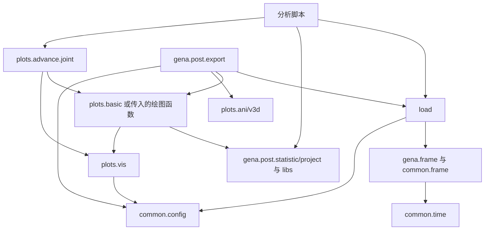

# GENA-CODE-Dev 架构设计

编写日期：2026-09-16；源码核查与第 11 节整理日期：2026-09-17。本文描述本次修改后的工作目录；逐项核查依据、修改范围、测试结果与剩余问题见 [独立修改报告](docs/design_review_20260917.md)。第 11 节原文实际列出 10 项问题。

## 1. 项目定位与设计目标

本程序库以鹊桥二号 GENA ENA 数据处理为核心，结合 THEMIS、MMS、OMNI 和地磁指数开展联合分析。GENA 保留遥测解码、仪器校准、事件过滤与科学产品计算；外部观测经过格式适配后参加科学计算与联合绘图。

1. 按主要职责组织：数据读取放在 `load/`，科学绘图放在 `plots/`，跨任务科学计算放在 `libs/`。
2. GENA 仪器类型、参数、事件判据与专用处理保留在 `gena/`，便于引用溯源。
3. 外部时序表共享数据格式，GENA 事件表继承共享表类型。
4. 通过已加载数据和明确参数组合模块，联合绘图采用 `Panel`。
5. 本次迁移同步更新调用入口，不保留旧模块路径的兼容壳。

## 2. 项目文件组织形式

项目采用“根目录按主要职责组织，GENA 保留专用领域包”的方式。同一科学流程不必被拆成大量微小模块；已有功能只在职责明确、确有复用的边界迁移。

| 模块 | 组织依据 | 主要责任 |
| --- | --- | --- |
| `load/` | 数据获取与格式适配 | 文件定位、必要下载、本地读取、变量提取 |
| `gena/` | GENA 仪器与事件处理 | 类型、标定、过滤、遥测转换、事件统计与投影 |
| `libs/` | 科学问题与物理模型 | 区域判据、等离子体公式、通量模型、能谱归一化与星历服务 |
| `plots/` | 展示与联合编排 | 基础绘图、产品图、联合图、动画和三维场景 |
| `common/` | 共享基础设施 | 路径、时间、数据类型、坐标和常数 |
| 分析脚本 | 具体研究问题 | 日期、事件选择、论文图件与研究假设 |

`plots.basic` 按数据源保留默认变量和画法；共享轴、colorbar 和文件保存复用 `plots.vis`，通用时间序列画线复用 `plots.basic.tplot`，无需再次按 1D/2D/3D 建立多套底层实现。

## 3. 当前目录与功能

下面列出本次涉及的现行模块，并非完整文件清单。

```text
GENA-CODE-Dev/
├── design.md
├── load/
│   ├── gena.py             # Parquet 加载与产品类型构造
│   ├── themis.py
│   ├── mms.py
│   ├── omni.py
│   └── indices.py
├── gena/
│   ├── frame.py            # ParticleDataFrame、ParameterDataFrame
│   ├── constants.py
│   ├── filter.py           # 掩码规则、诊断与质量分类
│   ├── utils.py            # 领域几何、速度与现有轨道图
│   ├── raw/               # 遥测解码、级别转换及写入
│   ├── post/              # statistic、project、export
│   └── deprecated/        # 历史实现
├── libs/
│   ├── regions.py
│   ├── plasma.py
│   ├── ephemeris.py
│   ├── environment.py
│   ├── space.py
│   ├── flux.py
│   └── spectrum.py         # 复用存档中的能谱归一化实现
├── plots/
│   ├── vis.py              # axes、colorbar、刻度、savefig
│   ├── config.py           # 现有样式模块，仍有外部 myplot 依赖
│   ├── basic/              # timeseries（tplot）、gena、themis、mms、omni
│   └── advance/
│       ├── __init__.py     # Panel、overview、env、plot_region_code
│       ├── joint.py
│       ├── ani.py
│       └── v3d.py
├── common/
│   ├── config.py
│   ├── frame.py            # DataFrame 类型、表操作、同步与变量读取
│   ├── utils.py            # 时间归一化、时间分段、插值及通用工具
│   ├── coord.py
│   └── constants.py
├── tests/
├── docs/
└── deprecated/
```

### 3.1 数据加载

| 入口 | 主要数据 | 网络行为 |
| --- | --- | --- |
| `load.load_gena` | GENA Parquet | 读取本地产品 |
| `load.load_spedas("themis", ...)` | ESA、FGM、MOM、EFI、SST、ESD | 默认 `download=False` |
| `load.load_spedas("mms", ...)` | FPI、HPCA | 默认 `download="local_first"` |
| `load.load_spedas("omni", ...)` | OMNI HRO | 默认 `download=True`，支持本地模式 |
| `load.load_indices` | Kyoto AE/Dst/SYM/ASY，GFZ Kp/ap/Ap/SN/F10.7 | 统一 `download=False` 离线、`local_first` 缓存优先、`refresh` 刷新策略；API 读取与解析，loader 组装与合并 |

GENA 加载器按产品返回不同类型：PDF 工参返回 `gena.frame.ParameterDataFrame`，粒子产品返回 `gena.frame.ParticleDataFrame`。外部加载器默认返回 `common.frame.TimeSeriesDataFrame`，显式 `return_type="dict"` 则返回逐变量字典。它是有效的数据格式选项，不是旧模块路径兼容层。

加载器保留各数据源的 probe、level、变量选择与产品时间适配含义，不承担研究事件选择或绘图布局。

### 3.2 GENA 专用处理

`gena.raw` 负责遥测解析、Raw/L0/L1/L2 转换及写入；`gena.constants` 负责仪器几何与效率；`gena.filter` 生成布尔掩码；`gena.post.statistic` 负责计数、通量及派生统计；`gena.post.project` 负责射线与投影。

`gena.frame` 保存两个 GENA 数据表类型。`ParticleDataFrame` 只保留离散事件的行操作和粒子统计方法，逐事件位置姿态保持普通列；`ParameterDataFrame` 表示 PDF 工参，内部清理有效位置和姿态样本，并通过 `pos_at()`、`rot_at()` 按请求时刻插值。`load.load_gena` 只负责读取 Parquet、整理时间列并选择产品类型。

`gena.post.export` 是有 I/O 的报告编排层，可以组织加载、科学计算、绘图与输出。动画和三维实现位于 `plots.ani` 与 `plots.v3d`。

### 3.3 科学计算与服务

`libs.regions` 根据观测量判定区域或流结构；`libs.plasma` 提供等离子体公式；`libs.space` 提供空间环境模型；`libs.flux` 包含 Maxwellian/Kappa 通量与现有拟合。`libs.spectrum` 提供 GENA 与 THEMIS 共用的相对能谱归一化。

`libs.ephemeris` 涉及星历文件及显式轨道更新；`libs.environment.sw_keys` 组合 OMNI 和指数并在失败时回退默认值。这是加载后的组合服务，不能直接当作 OMNI 加载器的重复实现。

当前目录没有 `libs.energy_transport`、`libs.bbf_ena`、`libs.ena_response`、`libs.distribution` 或 `gena.post.ena_drift`。部分文件保存在 `undefined.zip`，历史测试和说明仍有引用；不能把它们列为当前可调用模块。

### 3.4 科学绘图

`plots.vis` 提供画布、坐标轴、装饰和保存工具；`plots.basic.tplot` 提供通用时间序列绘图，`plots.basic` 中的卫星模块提供产品图；`plots.advance.joint` 通过 `Panel`、`overview`、`env` 和 `plot_region_code` 组合已经加载的数据。这些联合入口仍可以从 `plots` 或 `plots.advance` 导入。

`overview` 共享 UTC 时间轴，保留各产品原生采样，`trange` 只限制显示范围。能量直方图与 FOV 空间图不能直接当作时间横轴 panel。自定义函数必须复用传入的 `ax`。

### 3.5 共享基础设施

`common.frame` 定义共享 DataFrame 类型、表操作、同步和变量读取；产品字典适配位于 `load`。`common.time` 定义时间输入与转换，`common.frame` 负责 pandas datetime 的连续区间分段，`libs.utils` 提供其他插值工具。`common.config` 管理输入目录和运行时结果目录；`common.coord` 管理坐标变换。

表的 `tplot()` 是保留的便利方法，只在调用时导入 `plots.basic.tplot`；因此不能声称 common 在所有调用路径上完全不依赖 plots。普通表构造不导入绘图库。

## 4. 数据规范

### 4.1 基础结构

| 内容 | 约定 |
| --- | --- |
| 共享类型 | `common.frame.TimeSeriesDataFrame` |
| GENA PDF 工参类型 | `gena.frame.ParameterDataFrame` |
| GENA 粒子类型 | `gena.frame.ParticleDataFrame` |
| `Datetime` | 无时区 pandas `datetime64[ns]`，数值含义为 UTC |
| `Timestamp` | Unix 秒 |
| 标量 | 独立数值列 |
| 三分量矢量 | `<name>_x/y/z` |
| 能谱与分布 | 行内数组，轴信息放在伴随列和元数据中 |
| 来源与变量布局 | `DataFrame.attrs` |

GENA 一行可以是粒子事件或工程采样；其他数据源一行对应变量采样时刻。共享表操作不代表粒子事件可按连续场量插值。

`load` 中的产品适配器先按原生时间并集建表，生成普通列字典后构造实例。`TimeSeriesDataFrame.__init__` 只检查必需的 `Datetime` 列并调用 `common.time.Time(...).datetime`，不识别 CDF、Parquet 或后端专用字段，也不从其他列推断时间；THEMIS 常规 ESA 的 DataFrame 输出进一步以 reduced-ion `peir` 时间为参考同步 ESA 变量。跨任务统一网格由调用者显式决定。

统一的 `load/load.py` 按 parser、assembler 和 loader 三层组织。THEMIS/MMS 的字段布局由对应 loader 明确声明，`parse_spedas()` 将已解码后端变量转换成明确变量说明；OMNI HRO 按 `Epoch` 与标量字段解析，indices 按各自来源解析，GENA 按 Parquet 列解析。三列数组不会自动识别为空间向量，`v` 不会自动命名为能量。`assemble()` 只负责按明确说明拼列、外连接和生成统一时间列。旧式字典输出直接合并原始变量，绘图通过 `common.frame.read_variable` 读取单个变量。

### 4.2 时间与筛选

`select`、`select_by`、`between`、`split`、`sync` 保留具体子类和元数据。`concat` 提供共享拼接。`sync` 对浮点标量默认线性插值，对整数、布尔、质量标记及数组使用近邻，默认自动缺口限制避免跨长时间中断插值。

`common.time.Time` 统一标量和一维时间输入，内部保存 pandas `Timestamp` 或 `DatetimeIndex`，输出无时区 UTC 纳秒时间。裸数字只表示 Unix 秒；毫秒、JD、MJD 等显式指定 `format`，不按数值大小猜测。普通时间处理走 pandas，科学格式和时间尺度转换按需使用 Astropy。DataFrame 使用 `.datetime`，数字和 SpacePy 时间分别使用 `to_timestamp()`、`to_tick()`；旧独立转换函数已删除。范围入口直接用 `Time(trange).datetime` 并检查两个端点，每日展开由调用方使用 `pd.date_range`；连续区间分段位于 `common.frame.split_time_intervals`，直接处理 pandas datetime，不经过 `Time`。详见 [时间 API](docs/time.md)。

GENA 过滤统一遵循“函数返回掩码，表负责选行”：

```python
from gena import filter as gf

mask = gf.energy_eff(l2, Emin=4, Emax=100)
rule = gf.energy_eff(Emin=4, Emax=100) & gf.onboard_eff()
selected = l2.select(rule)
```

`FilterNode` 只负责延迟调用和 `& | ~` 组合。`SelectorNode` 及重复的 `gena.filter.select` 已移除。通道判据、阈值和探头标定保持原实现。

### 4.3 科学量与姿态

调用前核对单位、坐标、能量范围、探针和级别。典型就位观测使用密度 cm⁻³、温度 eV、磁场 nT、位置 R_E；GENA 能量统计使用 keV。GENA 事件权重以行位置对齐的外部数组传入，默认单位几何因子不代表绝对标定通量。

粒子产品中的位置与姿态是捕获事件时记录的离散列，投影函数直接读取，不提供 `pos()`、`rot()` 或插值方法。PDF 工参由 `ParameterDataFrame.pos_at(times)` 与 `rot_at(times)` 在已有覆盖范围内插值。

## 5. 依赖关系与数据流

箭头表示主要调用关系，不能当作所有导入边的严格无环证明。



一次分析的调用顺序是：配置目录 → 加载产品 → 检查单位和坐标 → 生成掩码并选行 → 按需同步 → 计算科学量 → 组合产品图 → 保存结果。各步均可单独使用。

加载器不决定科学筛选策略；计算优先接收内存数据；普通 panel 不下载数据。`report`、三维场景构造、环境和星历服务允许组织 I/O，但必须通过参数和文档明确。

## 6. 跨任务区域判定：已有列映射与适用边界

Liuzzo、Kiehas、Runov 的实现位于 `libs.regions`，默认识别 THEMIS 列名，并已接受 `columns` 映射。MMS 可显式传入密度、标量温度、磁场等实际列；这部分不能再统一标为“待实现”。

Runov 仍需要额外高能粒子矩，不能将 FPI 数据重复传入代替 ESA/SST 的物理组合。Grigorenko reduced-ESA 检查是 THEMIS 专用分支。`plot_region_code` 只适用于含区域代码的输出，Kiehas/Runov 布尔结果不自动成为完整区域分类。详见 [区域说明](docs/regions.md)。

## 7. 配置、I/O 与输出边界

`resolve_paths()` 只解析；`configure()` 显式校验/建目录，并保存调用者指定的运行时目录；`get_configured_paths()` 根据当前解析结果缓存校验，环境或运行时目录变化会生成新的缓存项。`resolve_output_path()` 只解析结果路径，不校验输入数据盘。

```python
from common.config import configure
from load import load_gena
from plots import savefig
from plots.basic import gena as plot_gena

configure(file_base="/data/ENA", output_dir="/data/results/run_20260917")
l2 = load_gena(trange=["2026-04-07", "2026-04-08"], product="l2_a")
figure, axis = plot_gena.energy(l2)
savefig(figure, "figures/energy.png")
```

路径优先级为：函数显式参数 → 运行时配置 → 环境变量 → 默认值。`GENA_OUTPUT_DIR` 可设置独立结果目录；未设置时仍使用数据根目录下的 `GENA_RES`。相对输出路径放在结果根目录下，绝对路径为显式覆盖。报告默认放在 `<结果根>/reports/`，三维批量输出默认放在 `<结果根>/YYYYMMDD/3d.html`。

只绘制内存数据时可用 `configure(output_dir=..., mkdir=False, validate=False)`，实际保存时创建父目录。原始遥测转换和数据下载仍按其输入数据目录或显式输出参数工作。直接调用 Matplotlib、pandas 或 Plotly 的原生写入方法不会被项目配置自动拦截。

## 8. 当前保留的例外

| 现状 | 处理边界 |
| --- | --- |
| `gena.utils` 同时含计算与轨道图 | 保留算法和接口；未来根据实际复用再拆分 |
| `plots.basic.themis` 含统计便利计算 | 共用能谱归一化已复用 `libs.spectrum`，其他实现保留 |
| 绘图导入时设置部分 `rcParams` | 仍存在；此次未扩大到全项目样式改造 |
| `plots.config` 依赖 `myplot` | 当前环境可导入，但该外部依赖未列入项目安装依赖，迁移到新环境时需要处理 |
| 表的 `tplot()` 延迟调用 plots | 明确保留的便利方法 |
| `libs.flux.integral_ena_counts` 原为空函数草稿 | 现在显式抛出 `NotImplementedError`，现有估算请调用 `qk_estimate_ena_counts` 并提供物理参数 |
| 历史测试引用缺失模型和分析脚本 | 未恢复被移走的研究功能；详见本次报告中的实际测试结果 |

## 9. 扩展与验证原则

新增数据源先建立 `load/<source>.py`，复用共享表适配器；有产品图需求时再建立 `plots/basic/<source>.py`。GENA 仪器专用算法留在 GENA，跨任务科学量放在 libs。新增联合图优先组合现有 `Panel`。

验证覆盖数据格式、时间缺口、列映射、原算法行为、输出类型和实际文件路径。小型内存表、临时 Parquet 和模拟下载边界可验证软件行为，不能替代真实遥测、标定和跨仪器科学适用性验证。不能引用历史测试次数作为本次结果。

## 10. 参考文档

- [common 基础模块手册](common/README.md)：全部基础模块的设计、数据格式、接口、调用关系和可执行测试示例。

- [修改报告](docs/design_review_20260917.md)：本次逐项判断、修改清单、测试命令及剩余问题。
- [中文 README](readme.zh.md) / [英文 README](readme.md)：现行导入和使用入口。
- [绘图说明](docs/plots.md)：产品图、联合图、迁移和结果目录。
- [区域说明](docs/regions.md)：输入列映射和仪器适用范围。
- [THEMIS ESD](docs/themis_esd_loader.md)：多维数组及轴信息。
- [L1 角分布研究记录](docs/themis_thb_l1_3d_angular_distribution_20251204.md)：具体事件背景。
- [历史 observation review 迁移记录](docs/gena_observation_review_migration.md)：历史过程与当时验证结果，不代替本次验收。
- [GENA 后处理说明](gena/post/readme.md) / [raw 文档](gena/raw/doc/)：科学语义和历史背景，部分历史模块当前不在工作目录。

## 11. 原有问题与本次处理状态

| 原序号 | 原问题 | 本次状态 |
| --- | --- | --- |
| 1 | GENA 加载入口尚未进入 load | 已集中到 `load/load.py` 的 `load_gena()`，类型位于 `gena/frame.py` |
| 2 | filter 抽象较多、规则不统一 | 保留掩码组合，删除重复选行层，统一用表的 `select()` |
| 3 | config 职责与实现复杂度不清 | 简化实现和注释，保留解析/校验边界，修复运行时配置与缓存 |
| 4 | 共享表类型与操作需要统一管理 | 合并到 `common/frame.py`，同步所有现行引用 |
| 5 | timeseries 与 utils 时间功能重叠 | 独立时间函数集中到 utils，类型与表适配放在 type |
| 6 | common.vis 应属于 plots | 整体迁入 `plots/vis.py`，不保留旧路径转接 |
| 7 | ani/v3d 移动后依赖断裂 | 导入指向现有文件，并补齐 advance 包入口；验证报告与三维输出 |
| 8 | flux 空函数导致语法错误 | 修复模块导入，草稿明确报错，现有模型实际测试；旧缺失 API 另行记录 |
| 9 | 文档沿用旧加载/绘图路径 | 更新现行示例，历史记录明确标注 |
| 10 | 输出目录缺乏运行时统一设置 | `configure(output_dir=...)` 与 `resolve_output_path()` 覆盖项目图件、CSV、Excel、动画与三维批量输出 |

上述“已处理”仅表示相应架构问题已处理，不表示全部历史功能和测试均已恢复。

