```mermaid
flowchart TD
    subgraph "MAIN LOOP (DO 10 K=1,KKK)"
        direction TB
        A["Read L1 Data"] --> B{TOF0 > 2 and Tof1 < Tof0?}
        B -->|YES| B1["set Tof0 = 0 and Tof1 = Tof0"] --> B2["Rollover Correction<br/>if Xe<Xs: Xe=Xs+663.47"]
				B -->|NO| B1["set Tof0 = 0 and Tof1 = Tof0"] --> B2["Rollover Correction<br/>if Xe<Xs: Xe=Xs+663.47"]
        B2 --> C{"Zero Signal Check<br/>line 159<br/>(X1e=0 AND X2e=0)<br/>OR<br/>(Y1e=0 AND Y2e=0)?"}

        C -->|YES| L11["**LABEL 11**<br/>WRITE VOID (NVO++)<br/>GOTO 10"]
        C -->|NO| D["Calculate START Position<br/>lines 170-183"]

        D --> D1["Check X: XL<(X2s-X1s)<XR ?<br/>KX=0 if valid"]
        D1 --> D2["Check Y: YD<(Y2s-Y1s)<YU ?<br/>KY=0 if valid"]

        D2 --> E{"KX=0 AND KY=0?<br/>Both Valid?"}

        E -->|YES| E1["Tofs=MAX(Tofx0,Tofy0)<br/>line 186"] --> L20["**LABEL 20**<br/>GOTO End Calc"]
        E -->|NO| F{"KX=1 AND KY=1?<br/>Both Invalid?"}

        F -->|YES| L11
        F -->|NO| G["SINGLE-SIGNAL REPAIR<br/>lines 192-209"]

        subgraph "REPAIR LOGIC"
            direction TB

            G --> G0{"Which is missing?"}

            G0 -->|KY=1, KX=0<br/>Y missing| Y1["Tofs=Tofx0<br/>line 192"]
            G0 -->|KX=1, KY=0<br/>X missing| X1["Tofs=Tofy0<br/>line 201"]

            Y1 --> Y2{"|Y2s-Tofs| < |Y1s-Tofs|?"}
            X1 --> X2{"|X2s-Tofs| < |X1s-Tofs|?"}

            Y2 -->|YES<br/>Y2 closer| Y3["Ys=(2*(Tofs-Y2s)-CY-Z0Y)*CofY<br/>line 194"]
            Y2 -->|NO<br/>Y1 closer| Y4["Ys=(2*(Tofs-Y1s)+CY-Z0Y)*CofY<br/>line 197"]

            X2 -->|YES<br/>X2 closer| X3["Xs=(2*(X2s-Tofs)-CX-Z0X)*CofX<br/>line 204"]
            X2 -->|NO<br/>X1 closer| X4["Xs=(2*(Tofs-X1s)+CX-Z0X)*CofY<br/>line 207 ⚠️BUG"]

            Y3 --> Y5["if((Y1s-Tofs)>CY)<br/>Y1e=Y1s<br/>rollover flag"]
            Y4 --> Y6["if((Y2s-Tofs)>CY)<br/>Y2e=Y2s<br/>rollover flag"]
            X3 --> X5["if((X1s-Tofs)>CX)<br/>X1e=X1s"]
            X4 --> X6["if((X2s-Tofs)>CX)<br/>X2e=X2s"]
        end

        Y5 & Y6 & X5 & X6 --> H{"Bounds Check<br/>line 211-212<br/>|Xs|≤45 AND |Ys|≤15?"}

        H -->|NO| L11
        H -->|YES| L20

        L20 --> I["Calculate END Position<br/>lines 216-229"]

        I --> I1["Check Xe: XL<(X2e-X1e)<XR?<br/>KKX=0 if valid"]
        I1 --> I2["Check Ye: YD<(Y2e-Y1e)<YU?<br/>KKY=0 if valid"]

        I2 --> J{"KKX=0 AND KKY=0?"}

        J -->|YES| J1["Tofe=MIN(Tofy1,Tofx1)<br/>line 231"]
        J -->|NO| K{"KKX=1 AND KKY=1?"}

        K -->|YES| L22["**LABEL 22**<br/>WRITE INITIAL (NIN++)<br/>GOTO 10"]
        K -->|NO| M["END POSITION REPAIR<br/>lines 247-259"]

        subgraph "END REPAIR"
            direction TB

            M --> M0{"Which is missing?"}

            M0 -->|KY=1, KX=0| N1["Tofe=Tofx1<br/>line 247"]
            M0 -->|KX=1, KY=0| N2["Tofe=Tofy1<br/>line 254"]

            N1 --> N3{"|Y2e-Tofe| < |Y1e-Tofe|?"}
            N2 --> N4{"|X2e-Tofe| < |X1e-Tofe|?"}

            N3 -->|YES| N5["Ye=(2*(Y2e-Tofe)-Cy-Z0Y)*CofY<br/>line 249"]
            N3 -->|NO| N6["Ye=(2*(Tofe-Y1e)+Cy-Z0Y)*CofY<br/>line 251"]

            N4 -->|YES| N7["Xe=(2*(X2e-Tofe)-Cx-Z0X)*CofX<br/>line 256"]
            N4 -->|NO| N8["Xe=(2*(Tofe-X1e)+Cx-Z0X)*CofY<br/>line 258 ⚠️BUG"]
        end

        N5 & N6 & N7 & N8 --> O{"End Bounds Check<br/>line 261-262<br/>|Xe|≤75 AND |Ye|≤27.5?"}

        O -->|NO| L22
        O -->|YES| P["Final Validation<br/>lines 264-269"]

        P --> P1["DTof=Tofe-Tofs+ETof"] --> P2{"6≤DTof≤187?"}
        P2 -->|NO| L22
        P2 -->|YES| P3["DX=Xe-Xs, DY=Ye-Ys"] --> P4{"|DX|≤45 AND |DY|≤15?"}

        P4 -->|NO| L22
        P4 -->|YES| Q["Particle ID & Write VALID<br/>NVI++"]

        Q --> L10["**LABEL 10**<br/>CONTINUE<br/>Next Event"]
    end

    style L11 fill:#ff9999,stroke:#ff0000,stroke-width:3px
    style L22 fill:#ffcc99,stroke:#ff6600,stroke-width:3px
    style L20 fill:#99ccff,stroke:#0066ff,stroke-width:3px
    style L10 fill:#99ff99,stroke:#00cc00,stroke-width:3px
    style Q fill:#99ff99,stroke:#00cc00,stroke-width:2px
    style G fill:#ffffcc,stroke:#cccc00,stroke-width:2px
    style M fill:#ffffcc,stroke:#cccc00,stroke-width:2px
    style X4 fill:#ffcccc,stroke:#ff0000,stroke-width:2px
    style N8 fill:#ffcccc,stroke:#ff0000,stroke-width:2px
```

---

## GOTO Target Summary

| Label | Line | Action | Color |
|-------|------|--------|-------|
| **LABEL 10** | 324 | Continue to next event (loop end) | 🟢 Green |
| **LABEL 11** | 160 | Write VOID file, NVO++, goto 10 | 🔴 Red |
| **LABEL 20** | 216 | Calculate end position (entry point) | 🔵 Blue |
| **LABEL 22** | 241 | Write INITIAL file, NIN++, goto 10 | 🟠 Orange |

## Key Repair Formulas

**Start Position (Lines 194, 197, 204, 207):**
- Y from Y2: `Ys=(2*(Tofs-Y2s)-CY-Z0Y)*CofY`
- Y from Y1: `Ys=(2*(Tofs-Y1s)+CY-Z0Y)*CofY`
- X from X2: `Xs=(2*(X2s-Tofs)-CX-Z0X)*CofX`
- X from X1: `Xs=(2*(Tofs-X1s)+CX-Z0X)*CofY` ⚠️ **BUG: should be CofX**

**End Position (Lines 249, 251, 256, 258):**
- Ye from Y2: `Ye=(2*(Y2e-Tofe)-Cy-Z0Y)*CofY`
- Ye from Y1: `Ye=(2*(Tofe-Y1e)+Cy-Z0Y)*CofY`
- Xe from X2: `Xe=(2*(X2e-Tofe)-Cx-Z0X)*CofX`
- ## Xe from X1: `Xe=(2*(Tofe-X1e)+Cx-Z0X)*CofY` ⚠️ **BUG: should be CofX**
