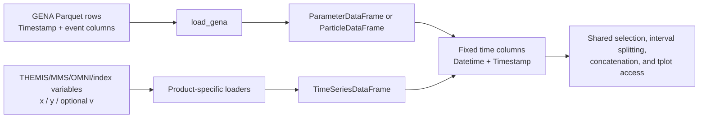

# GENA-CODE — Satellite Data Analysis for ENA Imaging

Data processing and analysis code for the **GENA** (Grid-based Energetic Neutral Atom) imager onboard the QueQiao relay satellite, for collaborating with in-situ and solar wind data from THEMIS, MMS, and OMNI.

---

## Architecture

See the [common foundation manual (Chinese)](common/README.md) for module design, data formats, dependencies, API boundaries, and runnable test examples.

The codebase follows a **hybrid layered architecture**: GENA processing lives in `gena/`, external observation loaders in `load/`, and cross-mission region classification in `libs.regions`, while shared infrastructure for data processing lives in `common/`. Indepent libs contains plasma module, astrophysics module and space physics modules.

```
GENA-CODE/
│
├── gena/               ← GENA ENA imager (primary instrument)
│   └── raw/            ← decode raw data and converts to different levels of data
│   └── post/           ← post-processing functions for GENA L2 data
│   ├── constants.py    ← inherit from common, and defines gena-specific constants.
│   ├── frame.py        ← ParticleDataFrame and ParameterDataFrame
│   ├── filter.py       ← Filters for different levels of data
│
├── load/           ← GENA and external observation loading
│   ├── gena.py     ← GENA Parquet and engineering pose lookup
│   ├── __init__.py
│   ├── themis.py   ← THEMIS ESA/FGM/MOM/EFI/SST/ESD
│   ├── mms.py      ← MMS FPI/HPCA
│   ├── omni.py     ← OMNI solar wind
│   └── indices.py  ← Geomagnetic indices
│
├── plots/          ← Scientific plots and cross-mission orchestration
│   ├── vis.py      ← Shared plotting and savefig
│   ├── __init__.py  ← Public entrypoint
│   ├── basic/      ← gena.py, themis.py, mms.py, omni.py
│   └── advance/  ← joint.py / ani.py / v3d.py
│
├── common/         ← Shared infrastructure
│   ├── config.py          ← Path resolution and explicit path validation
│   ├── constants.py       ← Shared physical constants and celestial radii
│   ├── time.py            ← Pandas time storage, scientific conversion, daily expansion
│   ├── frame.py           ← Time-indexed frames, selection, interpolation, concatenation, variable reading
│   ├── coord.py           ← Coordinate transforms, FOV geometry, vector rotation, quaternion SLERP
│   └── _coord_backends/   ← Internal SpacePy / Astropy / PySPEDAS adapters
│
├── libs/            ← other stand-along libs/modules
│   ├── regions.py      ← Cross-mission region and flow classification
│   ├── plasma.py       ← plasma parameters calculator, mainly from NRL formula
│   ├── ephemeris.py    ← Sun/Moon SPICE positions and updateable SSCWeb satellite orbits
│   └── space.py        ← Bow shock and magnetopause models
│
└── deprecated/     ← Historical code preserved for reference
```

### Design Principles

| Principle | Implementation |
|-----------|---------------|
| **Loading is centralized** | `load` organizes source parsers, frame assembly, and named mission loaders in one module |
| **Shared infrastructure is centralized** | Coordinates, time and types live in `common/`; plotting helpers live in `plots.vis` |
| **Cross-mission coordination via composition** | Analysis scripts import from multiple mission packages as needed |
| **No circular dependencies** | Loaders depend on data types; plotting composes science functions. DataFrame.tplot imports plotting lazily. |
| **Public API via `__init__.py`** | Each package exports only what other packages should import |

### Dependency Flow

Analysis scripts call mission loaders and `plots`. `plots.advance` composes product panels from `plots.basic`; both reuse `plots.vis`. Plotting does not implicitly synchronize or download data. Mission plotting implementations now live only in `plots.basic`; GENA report orchestration calls `plots`.

See [the plotting guide](docs/plots.md) for joint-figure examples and migration details.

Mission loaders are exposed as named functions from `load`; the old per-mission loader modules have been removed without aliases.

### Import Style

Imports follow a consistent pattern through the unified `load` package:

```python
# GENA ENA data
from load import load_gena
from gena.frame import ParameterDataFrame, ParticleDataFrame
from plots.basic import gena as gena_vis

# THEMIS in-situ
from load import load_spedas
from plots.basic.themis import themis as plot_themis, flux
from plots.basic.themis import get_ma_beta

# MMS in-situ
from load import load_spedas
from plots.basic.mms import fpi, hpca

# OMNI solar wind + indices
from load import load_spedas
from load import load_indices
from load import load_sw

# Shared infrastructure
from common import Time, Coordinates, TimeIndexedDataFrame, TimeSeriesDataFrame
from common import config
from common.frame import concat, read_variable
from common.coord import transform_vectors
from common import SPEED_C, MASS_H, RE, RM

# Astrodynamics / plasma / space physics
from libs import ephemeris, plasma, space
```

Satellite positions are returned in GSE `R_E`. Local coverage is strict by default; pass `update=True` to extend one satellite through the latest requested timestamp, or call `ephemeris.update_satellite_orbits(end=...)` to update the complete local archive. Updates use NASA SSCWeb definitive THEMIS/ARTEMIS data first and predictive observatories only for the remaining near-real-time gap.

Loader naming convention:

| Package | Standard API | Notes |
|---------|--------------|-------|
| `load` | `load_gena(file=...)` or `load_gena(trange=..., product=...)` | `file` and `trange` are mutually exclusive; `product` is the parquet suffix, e.g. `pdf`, `l2_a`. |
| `load` | `load_spedas("themis", trange, product, probe=..., download=False)`, `load_spedas("themis", trange)` | Local-only by default. Use `download=True` or `download="local_first"` to reuse local files and download missing files. |
| `load` | `load_spedas("mms", trange, product, variables=None)`, `load_spedas("mms", trange, product)` | `product` is `fpi` or `hpca`. |
| `load` | `load_spedas("omni", trange, product="hro", *, prefix=None, download=True, variables=None)` | Current implementation supports OMNI HRO. Set `download=False` to read local CDF files under the configured `spedas_base/omni_data/hro_1min/YYYY/`. |
| `load` | `load_indices(trange, product)` | `product` selects Kyoto AE/Dst/SYM/ASY or GFZ Kp/ap/daily Ap/SN/F10.7. See [field list and cache options](load/api/indices.md). |

Only the standard loader names above are public. Older mission-specific loader names are intentionally not part of the API.

GENA uses one loader with two mutually exclusive input modes:

```python
# Discover daily files by UTC range.
pdf = load_gena(trange=["2024-12-03", "2024-12-04"], product="pdf")

# Read one complete file.
pdf_file = load_gena(file="/data/20241203_pdf.pqt")
```

All standard GENA and THEMIS loaders accept either one interval `[start, end]` or multiple intervals `[[start1, end1], [start2, end2], ...]`. GENA returns `ParameterDataFrame` for PDF engineering products and `ParticleDataFrame` for particle products, both with a fresh index. THEMIS, MMS, OMNI, and index loaders return `TimeSeriesDataFrame` by default; pass `return_type="dict"` when the legacy per-variable `x/y/v` representation is required.

THEMIS network access is explicit and local-only by default:

```python
esa = load_spedas("themis", trange, "esa", probe="b")                         # local only
esa = load_spedas("themis", trange, "esa", probe="b", download=True)          # allow download
esa = load_spedas("themis", trange, "esa", probe="b", download="local_first") # reuse local files and download missing files
```

## Shared mission tables: `TimeIndexedDataFrame` and `TimeSeriesDataFrame`

`common.frame.TimeIndexedDataFrame` provides shared pandas time columns and row operations, with two subclasses for different row models:

| Data source | Meaning of one row | Native time input | Concrete frame |
|-------------|--------------------|-------------------|----------------|
| GENA PDF | One engineering sample | Parquet `Timestamp` in Unix seconds | `ParameterDataFrame` |
| GENA L1/L2 | One detected particle event | Parquet `Timestamp` in Unix seconds | `ParticleDataFrame` |
| THEMIS/MMS/OMNI/indices | Values sampled at an observation time; different variables may have different cadences | pySPEDAS-style `x` arrays | `TimeSeriesDataFrame` |

`ParticleDataFrame` inherits from `TimeIndexedDataFrame`; its per-event position and attitude remain ordinary columns and it has no pose interpolation methods. `ParameterDataFrame` inherits from `TimeSeriesDataFrame` and adds `pos_at()` and `rot_at()` for PDF engineering samples. Each mission still owns its spectra, coordinates, units, calibration, and detector response.

### Construction paths

The two loader families enter the shared contract through different adapters:



The GENA path is strict: `load_gena()` rejects a Parquet file without `Timestamp`, performs product-specific sorting and duplicate handling, creates `Datetime` directly with pandas, and then constructs the product-specific frame. Pandas operations which retain `Datetime` preserve the concrete subclass through `_constructor`.

THEMIS and MMS declare variable layouts in their loaders, then use a private pySPEDAS adapter. OMNI HRO reads its shared `Epoch` and scalar fields independently, while indices use their own source readers. GENA Parquet uses its table columns directly. The loaders prepare ordinary column dictionaries before constructing a frame.

- Scalars occupy one column; only explicitly declared vectors expand into named components.
- Other multidimensional variables remain per-row arrays, including unknown three-column fields.
- Coordinate names and static versus sampled axes are explicit. Only declared energy coordinates use `_energy`; an arbitrary `v` axis is not assumed to be energy.
- Variables are outer-joined on native observation times. Each retains its original sampling and values; loading performs no alignment or interpolation.
- Variable layouts, units, and backend attributes are retained in `DataFrame.attrs`.

### Fixed time columns supplied by loaders

Loaders map source time fields to `Datetime` and supply `Timestamp` (Unix seconds) where required by mission consumers. Construction requires exactly one `Datetime` column and calls `common.time.Time(...).datetime` to produce timezone-naive UTC `datetime64[ns]`; invalid times are rejected by that shared helper. It does not infer time from `Date`, `Timestamp`, or CDF field names, and does not automatically add a `Timestamp` column. Manual construction can supply datetime strings, datetime objects, or Unix seconds under `Datetime`. Column selections without `Datetime` return ordinary pandas DataFrames; selections retaining it preserve the concrete subclass. Normal pandas in-place mutation remains possible and does not continuously revalidate the table.

`to_dict(orient=...)` retains standard pandas behavior. Use loader `return_type="dict"` to request native legacy variable dictionaries; loaders merge these records directly, preserving their individual timestamps and metadata. The old common conversion functions and `to_variable_dict()` have been removed. Plotting reads one variable through `common.frame.read_variable` without converting the whole table.

### Shared operations and boundaries

`TimeIndexedDataFrame` supplies shared row operations; `TimeSeriesDataFrame` additionally supplies `resample/resample_to/resample_at`. The standalone `concat` function lives in `common.frame`:

- `select(condition)` selects rows and preserves the concrete subclass and `attrs` metadata.
- `select_by(other, condition)` synchronizes a condition from another frame onto this frame's timestamps, then returns matching original rows without changing this frame's measured values.
- `between(boundaries)` returns slices between consecutive time boundaries.
- `split(tgap)` sorts by `Datetime` and splits the frame at gaps larger than `tgap` seconds.
- `tplot(variable, ...)` delegates scalar/vector plotting to `plots.basic.tplot`.
- `concat(frames)` concatenates interval results while preserving type and provenance metadata.

GENA-only behavior remains in `gena.frame` or the rest of the `gena` package: PDF position and attitude interpolation, event filtering, detector response, energy and species products, projection, and ENA statistics. Particle positions and attitudes are read directly from their event rows. THEMIS/MMS/OMNI/index loading and mission-specific spectral plotting remain in their own packages.

---

## Unified time input and conversion

`from common import Time` accepts scalar or one-dimensional time inputs and stores native pandas UTC nanosecond datetime values. Use `.datetime` for DataFrame columns, `to_timestamp()` for Unix seconds, `to_iso()` for UTC text, and `to_tick()` for SpacePy. Bare numbers mean Unix seconds; milliseconds and scientific formats require explicit `format`, e.g. `Time(value, format="unix_ms")` or `Time(value, format="jd")`. Astropy is used only for scientific conversion. See [Time API and migration](docs/time.md).

## Data Levels (GENA Pipeline)

GENA data flows through a multi-level pipeline from raw telemetry to science products:

| Level | Description | Location |
|-------|-------------|----------|
| **Raw** | Binary telemetry packets | `raw/` — `packet.py`, `decode.py` |
| **L0** | Decoded Parquet files (engineering units) | Generated by `raw/decode.py` |
| **L1** | TDC-calibrated, noise-filtered events | `gena/scripts/level1/` |
| **L2** | Physics products (energy, species, FOV mapping) | `gena/scripts/level2/` |

Generated L2 parquet suffixes have distinct quality meanings:

| Product | Meaning |
|---------|---------|
| `l2_a`, `l2_b` | Standard L2 converted from L1A without the soft/golden quality selection. |
| `l2s_a`, `l2s_b` | Soft quality selection: standard channel checks without the X/Y TOF-consistency requirement. |
| `l2g_a`, `l2g_b` | Golden quality selection: strict checks including X/Y TOF consistency, followed by the spatial detector-window check. |

The product string passed to `load_gena()` is the exact filename suffix; for example, `load_gena(trange=trange, product="l2g_a")` intentionally loads golden-filtered probe-A data rather than standard `l2_a` data.

## Filters and row selection

Functions decorated with `gena.filter.filter_rule` have two explicit modes:

- `rule(df, ...)` executes immediately and returns a boolean mask.
- `rule(...)` returns a deferred `FilterNode` that can be combined using `&`, `|`, and `~`, then called with a DataFrame.

All filter rules produce boolean masks; use `df.select(rule)` for row selection. `FilterNode` retains `&`, `|`, and `~` composition.

## GENA geometry and efficiency constants

`gena.constants` exposes detector-response functions that callers can use to construct event weights:

- `ENA_PRE(E)` converts measured post-foil energy to estimated pre-foil energy.
- `eff_E(E, spec)` provides energy-dependent efficiency.
- `eff_XY(x, y, spec, uv_flag, normal=...)` provides the 10 keV spatial MCP response.
- `eff_total(E, x, y, spec, uv_flag, normal=..., mcp_uniform=...)` combines the energy and spatial responses.

The instrument-frame FOV geometry is exposed separately. `va0` and `vb0` are the probe boresights; `va1`–`va4` and `vb1`–`vb4` are corner vectors; `fov_set_a` and `fov_set_b` are flat lists of 209 vectors sampled over an 11-by-19 angular grid. These FOV vectors are not applied automatically by the flux functions.

Particle pose columns are discrete values recorded on each event and are read directly by projection code. For PDF engineering data, `ParameterDataFrame.pos_at(times)` linearly interpolates valid position samples and `ParameterDataFrame.rot_at(times)` performs SLERP with SciPy's `(x, y, z, w)` quaternion convention; both reject requests outside PDF coverage.

## GENA L2 Post Processing

Post-processing functions live in `gena.post.statistic` and operate on ordinary `pandas.DataFrame` objects. `counts_nd()` performs the event histogramming, `counts_to_flux()` applies the common physical normalization, and `flux_e()`, `flux_t()`, and `flux_t_e()` are thin public wrappers. Event weights are constructed by the caller and passed as a one-dimensional array aligned with the rows.

```python
from load import load_gena
from gena.post import statistic as gena_stat
import numpy as np
import pandas as pd

l2 = load_gena(trange=trange, product="l2_a")
energy_bins = np.geomspace(1.0, 100.0, 33)
time_bins = pd.date_range(trange[0], trange[1], freq="5min")
weights = np.ones(len(l2))  # replace with calibrated per-event weights when available
exposure = (pd.Timestamp(trange[1]) - pd.Timestamp(trange[0])).total_seconds()

centers, flux, flux_err = gena_stat.flux_e(l2, energy_bins, exposure=exposure, weights=weights)
times, band_flux, band_flux_err = gena_stat.flux_t(l2, time_bins, (1.0, 3.0), weights=weights)
times, e_centers, te_flux, te_flux_err = gena_stat.flux_t_e(l2, time_bins, energy_bins, weights=weights)
temperature_counts = gena_stat.counts_nd(l2, {"Energy": energy_bins}, weights=weights, keepdims=("Energy",))
temperature_flux = gena_stat.counts_to_flux(temperature_counts, exposure=exposure)
temperature, temperature_err, fitted_slope, slope_err, r_squared = gena_stat.flux_to_temperature(temperature_flux, energy_axis=temperature_counts.dims.index("Energy"))
```

For a known bulk drift, pass `drift_velocity_kms` and the cosine between the ENA velocity and the chosen positive drift axis as `look_direction_cosine`. These arguments can be scalars or arrays broadcastable to the non-Energy output shape; zero drift remains the default.

`flux_t()` and `flux_t_e()` require explicit time-bin edges and derive each bin's exposure from adjacent edges. Defaults of `geometric_factor=1` and `flux_e(exposure=1)` produce flux proxies rather than absolutely calibrated fluxes. Projection geometry remains in `gena.post.project`.

---

## Quick Start

All mission loaders accept a `trange` parameter — a list or tuple of two ISO-format strings (`["2024-11-12", "2024-11-13"]` or timestamps `["2024-11-12T00:00:00", …]`). Set your data root once via environment variable; all packages resolve paths through `common.config`. `resolve_paths()` only computes paths. Use `configure()` when you want to validate the data root and create standard subdirectories explicitly. Loaders also validate paths when they actually need to read or write data.

```python
# --- one-time setup -------------------------------------------------
import os
os.environ["FILE_BASE"] = "/path/to/your/data"

from common.config import configure
config = configure()           # validates paths, creates subdirectories

# --- pick a time range ----------------------------------------------
trange = ["2024-11-12", "2024-11-13"]

# =====================================================================
#  GENA ENA imager
# =====================================================================
from load import load_gena

pdf = load_gena(trange=trange, product="pdf")   # engineering data (ParameterDataFrame)
l2 = load_gena(trange=trange, product="l2_a")  # science events (ParticleDataFrame)

# =====================================================================
#  THEMIS in-situ  (ESA, FGM, MOM, EFI, SST)
# =====================================================================
from load import load_spedas

esa, fgm, mom, sst = tuple(load_spedas("themis", trange, product, probe="b") for product in ("esa", "fgm", "mom", "sst"))

# =====================================================================
#  MMS in-situ  (FPI moments, HPCA ion composition)
# =====================================================================
from load import load_spedas

fpi  = load_spedas("mms", trange, "fpi", probe=1)
hpca = load_spedas("mms", trange, "hpca", probe=1)

# =====================================================================
#  OMNI solar wind + geomagnetic indices
# =====================================================================
from load import load_spedas
from load import load_indices
from load import load_sw

omni_data = load_spedas("omni", trange)           # B, V, nₚ, P, β, Mach  (dict)
ae_data  = load_indices(trange, "ae")     # AE index — 1-min cadence
dst_data = load_indices(trange, "dst")    # Dst hourly, source timestamps at HH:29:30
context = load_indices(trange, ["sym_h", "kp", "ap_daily", "f107"], download="local_first")

# solar wind parameters interpolated to an arbitrary time array
import pandas as pd
t = pd.date_range("2024-11-12", "2024-11-13", freq="5min")
sw = load_sw(t)                          # → {'Pressure', 'BY_GSM', 'BZ_GSM', …}
```

---

## Adding a New Mission

1. Add the source parser, explicit variable layouts, backend helper, and named `load_<mission>()` wrapper to `load/load.py`, then export the public loader from `load/__init__.py`.
2. Have the parser produce the variable descriptions required by `assemble()`, and return `TimeSeriesDataFrame` by default from the named loader.
3. Add product plots in `plots/basic/<mission>.py`, reusing `plots.vis`.
4. Use `common.config.resolve_paths()` for pure path parsing and `common.config.configure()` or `get_configured_paths()` when I/O paths must be validated.
5. For coordinate transforms, import from `common.coord`.
6. Put reusable cross-mission calculations in `libs/` and study-specific orchestration in analysis scripts.

加载器负责解释来源文件，科学模块负责物理计算，绘图模块负责展示；它们通过这里明确的时间与数组格式交换数据。本手册按当前实现说明行为，特别区分“函数已经保证的事情”和“调用方需要保证的事情”。
