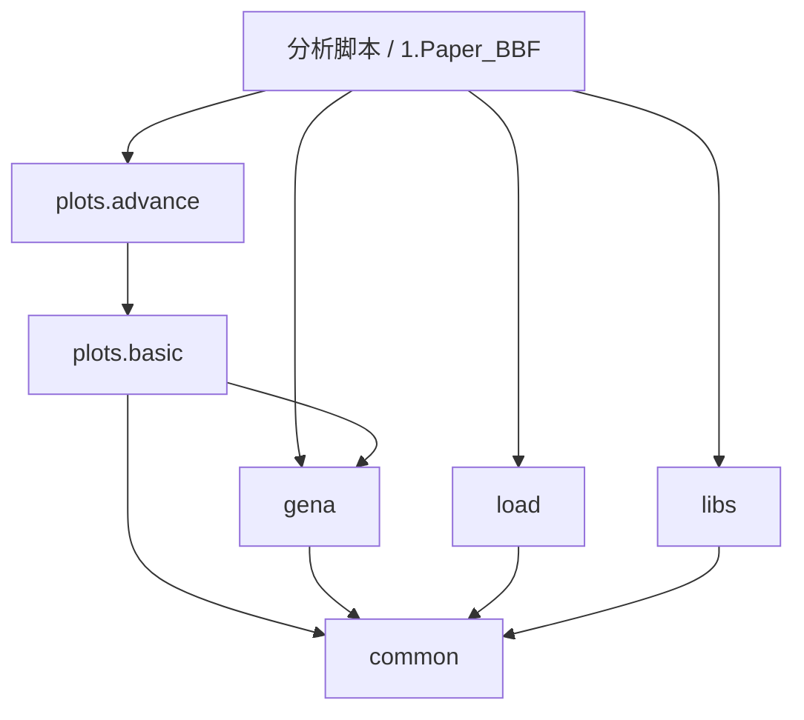
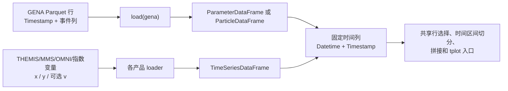

# GENA-CODE——ENA 成像卫星数据分析

本项目用于处理和分析鹊桥二号中继星搭载的 **GENA**（Grid-based Energetic Neutral Atom，阵列式能量中性原子成像仪）数据，并与 THEMIS、MMS 的原位探测数据及 OMNI 太阳风数据开展联合分析。

---

## 项目架构

项目采用混合分层架构：GENA 专用处理保留在 `gena/`，外部观测加载器集中放在 `load/`，可复用的数据处理基础设施放在 `common/` 中，跨任务物理模型放在 `libs/` 中，具体科研问题由分析脚本组合这些模块完成。

基础模块的完整设计、数据格式、调用关系、各接口边界和可执行测试示例见 [common 基础模块手册](common/README.md)。

```text
GENA-CODE-Dev/
│
├── gena/                   ← GENA ENA 成像仪主模块
│   ├── raw/                ← 遥测包解析及 Raw/L0/L1/L2 转换
│   ├── post/               ← GENA L2 科学产品、投影、统计与报告
│   ├── constants.py        ← GENA 几何、标定和效率常量
│   ├── frame.py            ← ParticleDataFrame 与 ParameterDataFrame
│   ├── filter.py           ← 不同质量等级的事件过滤规则
│
├── load/                   ← GENA 与外部观测加载
│   ├── gena.py             ← Parquet 与工程位置/姿态读取
│   ├── __init__.py
│   ├── themis.py           ← THEMIS ESA/FGM/MOM/EFI/SST/ESD
│   ├── mms.py              ← MMS FPI/HPCA
│   ├── omni.py             ← OMNI 太阳风
│   └── indices.py          ← 地磁指数
│
├── plots/                  ← 科学产品绘图与跨任务联合调度
│   ├── vis.py              ← 通用绘图及 savefig
│   ├── __init__.py         ← 统一入口
│   ├── basic/              ← gena.py、themis.py、mms.py、omni.py
│   └── advance/          ← joint.py / ani.py / v3d.py
│
├── common/                 ← 跨任务共享基础设施
│   ├── config.py           ← 路径解析和显式路径校验
│   ├── constants.py        ← 共享物理和天体尺寸常量
│   ├── time.py             ← pandas 时间存储、科学格式转换与每日展开
│   ├── frame.py            ← 时间表、行选择、分段、连续量插值、拼接与变量读取
│   ├── coord.py            ← 坐标转换、FOV 几何、向量旋转与四元数 SLERP
│   └── _coord_backends/    ← SpacePy / Astropy / PySPEDAS 内部适配
│
├── libs/                   ← 跨任务物理模型
│   ├── regions.py          ← 跨任务区域与流结构判定
│   ├── plasma.py           ← 等离子体参数和公式
│   ├── ephemeris.py        ← 基于 SPICE 的日、月和卫星星历
│   └── space.py            ← 弓激波、磁层顶和区域模型
│
└── deprecated/             ← 仅供历史参考的旧代码
```

### 设计原则

| 原则 | 实现方式 |
|------|----------|
| 加载流程集中组织 | `load` 在同一模块中组织来源解析、时间序列表组装和具名任务加载器 |
| 共享基础设施集中管理 | 时间、表格同步、坐标、几何和插值放在 `common/`，通用绘图在 `plots.vis` |
| 跨任务物理模型独立管理 | 等离子体、星历和空间环境模型放在 `libs/` |
| 跨任务分析采用组合方式 | 分析脚本分别加载各任务数据，再显式对齐和组合 |
| 依赖方向单一 | 分析层依赖任务包和 `libs`，任务包与 `libs` 依赖 `common` |
| 公共 API 明确 | 各包仅通过公开函数和 `__init__.py` 暴露稳定入口 |

### 依赖关系



任务加载和计算保持独立。分析脚本分别加载数据后，通过 `plots.advance` 组织联合图；仅在跨数据源计算确有需要时显式同步时间采样。GENA 报告编排调用 `plots`；旧 `*.vis` 路径已移除。示例见[绘图模块说明](docs/plots.md)。

任务加载器统一通过 `load` 包中的具名函数暴露；原来的分任务加载模块已删除，不保留兼容层。

### 导入方式

```python
# GENA ENA 数据
from load import load
from gena.frame import ParameterDataFrame, ParticleDataFrame
from plots.basic import gena as gena_vis
from gena.post import statistic as gena_stat

# THEMIS 原位探测数据
from plots.basic.themis import themis as plot_themis, flux, get_ma_beta

# MMS 原位探测数据
from plots.basic.mms import fpi, hpca

# OMNI 太阳风和地磁指数
from load import load_sw

# 共享基础设施
from common import Time, Coordinates, TimeIndexedDataFrame, TimeSeriesDataFrame
from common import config
from common.frame import concat, read_variable
from common.coord import transform_vectors
from common import SPEED_C, MASS_H, RE, RM

# 星历、等离子体和空间物理模型
from libs import ephemeris, plasma, space
```

### 标准加载器

| 包 | 标准 API | 说明 |
|----|----------|------|
| `load` | `load("gena", file=...)` 或 `load("gena", trange=..., product=...)` | `file` 与 `trange` 互斥；`product` 是 Parquet 文件名后缀，例如 `pdf`、`l2_a` |
| `load` | `load("themis", trange, product, variables=None, probe=..., download=False)`、`load("themis", trange, probe=...)` | 默认严格读取本地数据；支持 ESA ESD 三维分布；显式设置 `download=True` 或 `download="local_first"` 才允许联网 |
| `load` | `load("mms", trange, product, variables=None, probe=...)`、`load("mms", trange, product, probe=...)` | `product` 为 `fpi` 或 `hpca` |
| `load` | `load("omni", trange, product="hro", download=True, variables=None)` | 当前实现支持 OMNI HRO 1 分钟产品；`download=False` 时读取本地 CDF |
| `load` | `load("indices", trange, product=None)` | `product` 选择 Kyoto AE/Dst/SYM/ASY 或 GFZ Kp/ap/日 Ap/SN/F10.7；省略时加载 AE/AL/AU；支持统一缓存和离线策略，详见 [indices API](load/api/indices.md) |

以上名称是标准公共入口。旧的任务专用加载函数不属于当前公共 API。

GENA 使用同一个加载器提供两种互斥的输入模式：

```python
# 按 UTC 时间范围发现每日文件
pdf = load("gena", trange=["2024-12-03", "2024-12-04"], product="pdf")

# 读取一个完整文件
pdf_file = load("gena", file="/data/20241203_pdf.pqt")
```

所有加载器一次接受一个时间区间 `[start, end]`；需要多个区间时逐次调用。GENA 的 PDF 工参返回重新编号索引的 `ParameterDataFrame`，粒子产品返回 `ParticleDataFrame`；THEMIS、MMS、OMNI 和地磁指数加载器默认返回 `TimeSeriesDataFrame`，需要旧式逐变量 `x/y/v` 字典时可传入 `return_type="dict"`。

THEMIS 默认严格使用本地数据，不会主动访问 Berkeley 远程索引：

```python
esa = load("themis", trange, "esa", probe="b")                         # 仅本地读取
esa = load("themis", trange, "esa", probe="b", download=True)          # 允许下载
esa = load("themis", trange, "esa", probe="b", download="local_first") # 先检查本地，缺失时下载
esd = load("themis", trange, "esd", probe="b", datatype="peif", download=True)  # ESA L2 三维离子分布
```

---

## 共享任务数据表：`TimeIndexedDataFrame` 与 `TimeSeriesDataFrame`

`common.frame.TimeIndexedDataFrame` 提供共同的 pandas 时间列与行操作，两个子类分别承载不同的行模型：

| 数据源 | 一行数据的含义 | 原生时间输入 | 具体数据表类型 |
|--------|----------------|--------------|----------------|
| GENA PDF | 一个工程参数采样点 | Parquet 中以 Unix 秒表示的 `Timestamp` | `ParameterDataFrame` |
| GENA L1/L2 | 一个粒子探测事件 | Parquet 中以 Unix 秒表示的 `Timestamp` | `ParticleDataFrame` |
| THEMIS/MMS/OMNI/indices | 某个观测时刻的变量值，不同变量可以具有不同采样率 | pySPEDAS 风格的 `x` 时间数组 | `TimeSeriesDataFrame` |

`ParticleDataFrame` 继承 `TimeIndexedDataFrame`；逐事件位置和姿态保持普通列，不提供姿态插值方法。`ParameterDataFrame` 继承 `TimeSeriesDataFrame`，并为 PDF 工参增加 `pos_at()` 和 `rot_at()`。不同任务的能谱、坐标系、单位、标定和仪器响应仍由各任务模块解释。

### 构造路径

两类加载器通过不同适配器进入同一个内存数据格式：



GENA 加载路径是严格的：`load("gena", )` 拒绝缺少 `Timestamp` 的 Parquet 文件，执行与产品类型对应的排序和去重，直接用 pandas 生成 `Datetime`，再构造对应的产品类型。保留 `Datetime` 的 pandas 操作通过 `_constructor` 保留具体子类。

THEMIS/MMS 在各自 loader 中声明变量布局，再交给私有 pySPEDAS 适配器处理。OMNI HRO 单独解释共享 `Epoch` 和标量字段；indices 使用各来源的读取逻辑；GENA Parquet 按已有表列处理。最终都生成普通的“列名 → 等长列数据”字典，再构造实例。

- 标量占一列；只有明确声明的向量才展开为指定的分量列。
- 其他多维变量按行保留数组，未知的三列变量不会自动识别为空间向量。
- 轴名称及其是否随时间变化都明确声明；只有确定为能量的轴才使用 `_energy`，不能仅凭 `v` 判断。
- 变量按原生时间外连接，各自保留原始时间戳、采样率和数值；加载时不执行对齐或插值。
- 变量布局、单位和后端属性保存在 `DataFrame.attrs`。

### loader 提供统一时间列

loader 将来源时间字段映射为 `Datetime`，并按任务需要提供 `Timestamp`（Unix 秒）。构造函数强制要求恰好一个 `Datetime` 列，调用 `common.time.Time(...).datetime` 统一成无时区 UTC `datetime64[ns]`，无效时间由该公共函数拒绝。构造函数不从 `Date`、`Timestamp` 或 CDF 字段猜测输入，也不自动增加 `Timestamp` 列。手动构造时可以在 `Datetime` 中提供日期字符串、datetime 对象或 Unix 秒。选列不含 `Datetime` 时返回普通 DataFrame；保留该列的选列及行筛选保留具体子类。仍允许 pandas 的原地修改，不会对后续每次修改持续校验。

`to_dict(orient=...)` 保持 pandas 的标准行为。需要旧式变量字典时，使用 loader 的 `return_type="dict"`；它直接合并原始记录并保留各变量的时间轴和元信息。原来的公共转换函数和 `to_variable_dict()` 已删除。绘图通过 `common.frame.read_variable` 读取目标变量，不再逆转换整张表。

### 共享操作及其边界

`TimeIndexedDataFrame` 提供两种行模型共有的行操作，`TimeSeriesDataFrame` 另外提供 `resample/resample_to/resample_at`；`concat` 位于 `common.frame`：

- `select(condition)` 选择数据行，并保留具体子类和 `attrs` 元数据。
- `between(boundaries)` 按连续时间边界返回多个数据片段。
- `split(tgap)` 按 `Datetime` 排序，并在相邻记录间隔大于 `tgap` 秒时切分数据表。
- `tplot(variable, ...)` 将标量或矢量绘图委托给 `plots.basic.tplot`。
- `concat(frames)` 拼接多个时间区间的结果，同时保留具体类型和来源元数据。

GENA 专用行为继续由 `gena.frame` 或 `gena` 包的其他模块负责，包括 PDF 位置姿态插值、事件过滤、探测器响应、能量和粒子种类产品、空间投影以及 ENA 统计。粒子位置和姿态由投影代码直接读取事件行。THEMIS、MMS、OMNI、地磁指数的加载和任务专用能谱绘图仍留在各自包中。

---

## 通用时间输入与转换

`from common import Time` 接收单个时间或一维时间序列，内部保存原生 pandas UTC 纳秒时间。DataFrame 使用 `.datetime`，Unix 秒使用 `to_timestamp()`，UTC 文本使用 `to_iso()`，SpacePy 坐标转换使用 `to_tick()`。裸数字默认 Unix 秒；毫秒和科学格式明确指定 `format`，例如 `Time(value, format="unix_ms")` 或 `Time(value, format="jd")`。Astropy 只负责科学转换。详见 [Time API 和迁移说明](docs/time.md)。

## GENA 数据级别

GENA 数据从原始遥测包逐级转换为科学产品：

| 级别 | 含义 | 当前实现位置 |
|------|------|--------------|
| **Raw** | 二进制遥测包 | `gena/raw/packet.py`、`gena/raw/decode.py` |
| **L0** | 解码后的 Parquet 数据 | `gena/raw/decode.py` |
| **L1/L1A/L1B** | TDC 通道解码、事件修复和中间标定产品 | `gena/raw/conversion.py` |
| **L2** | 能量、粒子种类、视场坐标和姿态等物理量 | `gena/raw/conversion.py` |

生成的 L2 Parquet 文件后缀具有不同的质量筛选含义：

| 产品 | 含义 |
|------|------|
| `l2_a`、`l2_b` | 从 L1A 转换得到的标准 L2，不应用 soft/golden 质量筛选 |
| `l2s_a`、`l2s_b` | Soft 质量筛选：执行标准通道检查，但不要求 X/Y TOF 一致性 |
| `l2g_a`、`l2g_b` | Golden 质量筛选：执行包含 X/Y TOF 一致性的严格检查，并继续执行空间探测器窗口筛选 |

传给 `load("gena", )` 的产品字符串就是文件名的准确后缀。例如，`load("gena", trange=trange, product="l2g_a")` 加载探针 A 的 golden L2，而不是标准 `l2_a`。

---

## 过滤和行选择

由 `gena.filter.filter_rule` 装饰的过滤函数具有两种明确调用方式：

- `rule(df, ...)` 立即执行并返回布尔掩码。
- `rule(...)` 返回延迟执行的 `FilterNode`；多个规则可用 `&`、`|` 和 `~` 组合，随后交给 DataFrame 执行。

```python
from gena import filter as gf

mask = gf.energy_eff(l2, Emin=4, Emax=100)                      # 立即得到布尔掩码
rule = gf.energy_eff(Emin=4, Emax=100) & gf.onboard_eff()       # 构造延迟规则
subset = l2.select(rule)
```

过滤规则统一返回布尔掩码，选行统一调用 `df.select(rule)`；`FilterNode` 保留 `&`、`|`、`~` 组合，不再设置额外选行类。

---

## GENA 几何、姿态和能量效率

`gena.constants` 提供当前 GENA 几何和相对能量效率模型：

- `ENA_PRE(E)` 将测得的碳膜后能量估算为碳膜前能量。
- `eff_H(E)` 给出氢的相对能量效率，有效范围限制在 1–60 keV，并归一化到 10 keV。
- `eff_O(E)` 给出氧的相对能量效率，有效范围限制在 5–60 keV，并归一化到 10 keV。
- `eff_E(E, spec)` 根据粒子种类选择氢或氧的相对能量效率。
- `GENA_GEOMETRIC_FACTOR_CM2_SR` 保存当前采用的全视场几何因子数值；定义该常量并不意味着科学产品函数会自动使用它。

`gena.constants` 提供能量与空间响应函数；调用方可据此构造与事件行位置对齐的一维权重数组，再显式传给统计函数。

仪器坐标系中的 FOV 几何单独定义：`va0` 和 `vb0` 是探针 A、B 的视轴，`va1`–`va4` 和 `vb1`–`vb4` 是四角方向，`fov_set_a` 和 `fov_set_b` 分别包含 11×19 个采样方向。新的通量函数不会自动应用这些 FOV 方向。

粒子产品中的姿态列是每个事件捕获时记录的离散值，由投影代码直接读取。PDF 工参使用 `ParameterDataFrame.pos_at(times)` 对有效位置样本做线性插值，使用 `ParameterDataFrame.rot_at(times)` 按 SciPy `(x, y, z, w)` 四元数约定执行 SLERP；两个接口都拒绝超出 PDF 覆盖范围的请求。

---

## GENA L2 后处理

GENA 派生统计量、通量和温度诊断主要位于 `gena.post.statistic`；射线和投影几何位于 `gena.post.project`。`counts_nd()` 负责事件直方图，`counts_to_flux()` 负责统一归一化，`flux_e()`、`flux_t()` 和 `flux_t_e()` 是三个薄封装。事件权重由调用方构造，并以与数据行位置对齐的一维数组传入。

```python
from load import load
from gena.post import statistic as gena_stat
import numpy as np
import pandas as pd

l2 = load("gena", trange=trange, product="l2_a")
energy_bins = np.geomspace(1.0, 100.0, 33)
time_bins = pd.date_range(trange[0], trange[1], freq="5min")
weights = np.ones(len(l2))  # 有标定结果时替换为逐事件权重
exposure = (pd.Timestamp(trange[1]) - pd.Timestamp(trange[0])).total_seconds()

centers, flux, flux_err = gena_stat.flux_e(l2, energy_bins, exposure=exposure, weights=weights)
times, band_flux, band_flux_err = gena_stat.flux_t(l2, time_bins, (1.0, 3.0), weights=weights)
times, e_centers, te_flux, te_flux_err = gena_stat.flux_t_e(l2, time_bins, energy_bins, weights=weights)
temperature_counts = gena_stat.counts_nd(l2, {"Energy": energy_bins}, weights=weights, keepdims=("Energy",))
temperature_flux = gena_stat.counts_to_flux(temperature_counts, exposure=exposure)
temperature, temperature_err, fitted_slope, slope_err, r_squared = gena_stat.flux_to_temperature(temperature_flux, energy_axis=temperature_counts.dims.index("Energy"))
```

若 bulk drift 已由独立观测给定，可向 `flux_to_temperature()` 传入 `drift_velocity_kms`，并用 `look_direction_cosine` 传入 ENA 速度方向与所选漂移正方向的夹角余弦。二者可以是标量，也可以广播到去掉 Energy 轴后的温度输出形状；默认零漂移保持原有 Scime 结果。

`flux_t()` 和 `flux_t_e()` 要求显式时间边界，并由相邻边界自动计算每个 bin 的曝光时间。`geometric_factor=1` 以及 `flux_e(exposure=1)` 只能得到通量代理；绝对标定时必须显式提供可靠的曝光时间、几何因子和事件权重。

投影示例：

```python
from gena.post.project import get_projection
from gena.post.export import dump

xyz = get_projection(l2, prob="A", coord="GSM")
table = dump(l2, prob="A", coord="GSM")
```

---

## 快速开始

所有任务加载器都使用 `trange` 表示时间范围，例如 `["2024-11-12", "2024-11-13"]` 或 `["2024-11-12T00:00:00", "2024-11-13T00:00:00"]`。通过环境变量设置一次数据根目录后，各包使用 `common.config` 解析路径；`resolve_paths()` 只计算路径，`configure()` 会校验数据根目录并创建标准子目录，加载器在实际读写时也会校验所需路径。

```python
# 一次性配置
import os
os.environ["FILE_BASE"] = "/path/to/your/data"

from common.config import configure
config = configure()

# 选择时间范围
trange = ["2024-11-12", "2024-11-13"]

# GENA ENA 成像仪
from load import load
from gena.post import statistic as gena_stat

pdf = load("gena", trange=trange, product="pdf")
l2 = load("gena", trange=trange, product="l2_a")

# THEMIS 原位探测数据（ESA、FGM、MOM、EFI、SST）
from load import load

esa, fgm, mom, sst = tuple(load("themis", trange, product, probe="b") for product in ("esa", "fgm", "mom", "sst"))

# MMS 原位探测数据（FPI、HPCA）
from load import load

fpi = load("mms", trange, "fpi", probe=1)
hpca = load("mms", trange, "hpca", probe=1)

# OMNI 太阳风和地磁指数
from load import load_sw

omni = load("omni", trange)
auroral = load("indices", trange)          # 同时包含 AE、AL 和 AU
dst = load("indices", trange, "dst")
context = load("indices", trange, ["sym_h", "kp", "ap_daily", "f107"], download="local_first")

# 将太阳风和 Dst 环境参数插值到任意时刻
import pandas as pd

t = pd.date_range("2024-11-12", "2024-11-13", freq="5min")
environment = load_sw(t)
```

THEMIS、MMS、OMNI 和地磁指数加载器可能访问网络。代码审查和离线测试不应隐式触发下载，应使用现有本地数据、小型内存数据表或模拟加载边界。`gena.raw.decode.decode()` 会写入 Parquet 产品和日志，仅在明确执行原始数据转换任务时调用。

---

## 新增卫星任务或数据源

1. 在 `load/load.py` 中添加数据源 parser、明确的变量 layout、后端辅助函数和命名为 `load_<mission>()` 的加载器，再从 `load/__init__.py` 导出公开入口。
2. parser 将源数据整理成 `assemble()` 所需的变量说明，命名加载器默认返回 `TimeSeriesDataFrame`；确有旧式字典调用需求时再提供 `return_type="dict"`。
3. 在命名加载器中明确解释产品字段、时间轴、分量和附加轴；`assemble()` 只验证并组装这些变量说明，共享类型不处理存储格式。
4. 在 `plots/basic/<mission>.py` 中实现任务专用绘图，并复用 `plots.vis` 的坐标轴和通用时序绘图基础设施。
5. 使用 `common.config.resolve_paths()` 进行只读路径解析；真正读写前使用 `configure()` 或 `get_configured_paths()` 校验路径。
6. 坐标变换和几何运算使用 `common.coord`，时间解析使用 `common.time`，连续量表同步使用 `TimeSeriesDataFrame`，插值工具使用 `common.interp`。
7. 不得从其他任务包横向导入。跨任务分析应在分析脚本中分别加载各任务数据并显式组合。

---

## 重要说明

- 仓库仍在持续开发，调用函数前应以当前源码签名为准，README 和历史分析脚本可能滞后。
- `gena.post.project.get_spacecraft_pos(l2df, coord)` 直接转换 L2 粒子行中已经存在的位置；需要按任意时刻读取工程位置或姿态时，先加载 PDF，再调用 `ParameterDataFrame.pos_at()` 或 `rot_at()`。
- 探针标识必须在过滤、数据转换、标定、投影和绘图过程中保持一致，并遵循各函数记录的大小写约定。
- 标准产品使用 `l2_a/l2_b`，soft 质量产品使用 `l2s_a/l2s_b`，只有需要严格通道检查和空间筛选时才使用 `l2g_a/l2g_b`。
- `deprecated/`、`TODO/` 和论文专用脚本属于历史或具体研究上下文，不是规范公共 API 的来源。
